## Why the Smart Home Is Hard {.center}

> The devices in your home are **always on**, **rarely patched**, and **talking to
> servers you never chose** — and almost nobody is watching the traffic.

A smart speaker, a thermostat, a doorbell camera, and a streaming stick share one Wi-Fi
network. Each is a small, opaque computer with sensors, an internet connection, and a
business model.

::: {.notes}
Frame the lecture: this is where security (devices can be discovered and controlled)
and privacy (devices leak what you do at home) collide on one Wi-Fi network. The
recurring research question for the whole deck is a single sentence: what are these
devices doing, and who are they talking to? Cold-call the room — how many
internet-connected devices in the place you sleep? Then how many can you name the
last software update for? Almost nobody can answer both. Cross-reference the
companion IoT breakout and the IoT debate that will run later this week. We've
studied this problem for years; the answers keep getting worse, and this deck ends
with state AGs treating the same findings as consumer-protection cases.
:::

## Two Questions That Drive the Lecture

::: {.columns}
::: {.column width="50%"}
**Security**

- Can a *website* you visit reach into your home network?
- Can it **discover** and **control** your devices?
- What happens when devices are not isolated from each other?
:::
::: {.column width="50%"}
**Privacy**

- Who do your devices **contact** when you're not looking?
- What **identifiers** and **content** leak to third parties?
- Do the privacy settings vendors offer actually work?
:::
:::

::: {.notes}
This is the roadmap for the deck; keep it explicit. First half is web-based attacks
that cross the boundary from browser to LAN — same-origin policy is the fence, DNS
rebinding is how you jump it. Second half is measurement studies of what devices
actually leak: IoT Inspector in the wild, plus the smart-TV crawler in the lab.
Tie back to earlier lectures — same-origin policy from the web-security block,
third-party tracking from Meeting 9, DNS from the networking basics — all reappear
here in the IoT setting. The through-line: the browser security model becomes the
IoT security model, and the ad-tech tracking economy becomes the IoT tracking
economy. Preview the policy payoff on the last slide, which is the freshest research-
to-enforcement arc in the course.
:::

## IoT Inspector

<!-- recovered from ppt-archive/10-IoT.pptx slide 1 -->
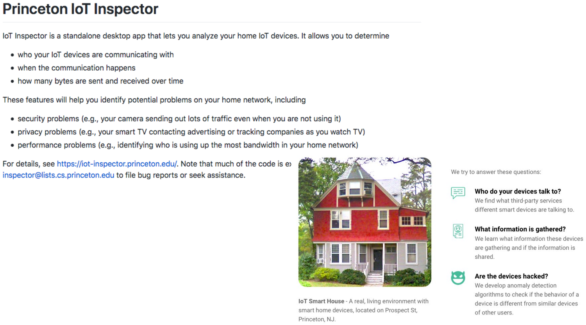{width="88%" fig-align="center"}

::: {.notes}
We've continued to work on this over the past several years (Danny Huang).
:::

## Initial Work: Connect and Monitor

<!-- recovered from ppt-archive/10-IoT.pptx slide 2 -->
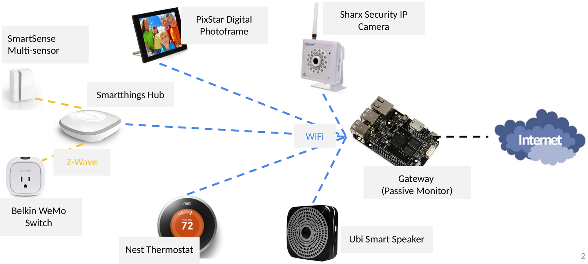{width="92%" fig-align="center"}

::: {.notes}
As before, we started with a simple question: what are these devices doing?
Who are they talking to? (circa 2015.) We picked the top few devices on
Amazon and tried to pick different manufacturers: Ubi smart speaker, Sharx
security IP camera, Nest thermostat, PixStar digital photo frame, SmartThings
hub, SmartSense multi-sensor, Belkin WeMo switch, over Wi-Fi and Z-Wave,
behind a gateway acting as a passive monitor. We thought this would be a lot
harder than it turned out to be: no encryption!
:::

## Many IoT Devices Run an Unauthenticated Web Server

Most smart-home gadgets talk to their phone app through a **local HTTP server** on the
device — often with **no authentication and no encryption**.

That means the **classic web-attack toolkit applies to your living room**:

- A malicious web page can try to **find** devices on your LAN
- ...and then **talk to them directly**, as if it were the companion app

::: {.notes}
This is the key insight of Acar, Huang, Li, Narayanan, Feamster, "Web-based
Attacks to Discover and Control Local IoT Devices," SIGCOMM 2018 Workshop on
IoT Security and Privacy. Origin story worth telling out loud: circa 2015 the
team bought the top-selling devices on Amazon expecting weeks of hard reverse
engineering — and found almost no encryption and almost no authentication.
The device's "API" is just an open web server on the local network. So the
browser security model becomes the IoT security model, which means every web
attack the class has already learned about applies inside your living room.
Cold-call: which of the browser defenses you know about — SOP, CORS,
HttpOnly cookies — would a device without any TLS actually get to rely on?
:::

# Attack 1: Identify Local IoT Devices {.center}

## Attack Steps: 1. Get Local IP

::: {.columns}
::: {.column width="65%"}
1. **Get local IP** (via WebRTC SDP)

The malicious page learns the victim browser's address, `192.168.6.6`.
:::
::: {.column width="35%"}
<!-- recovered from ppt-archive/10-IoT.pptx slide 4 -->
{width="70%" fig-align="center"}
:::
:::

::: {.notes}
Step one of the discovery attack: the page uses WebRTC's SDP candidates to
learn the browser's own local IP address, with no permission prompt.
:::

## Attack Steps: 2. Find Active Local Devices

2. **Find active local devices.**
   a. Scan local subnet on port 81, sending GET request (via Fetch API)
   b. Measure response times (TCP RST vs. TCP timeout)

<!-- recovered from ppt-archive/10-IoT.pptx slide 7 -->
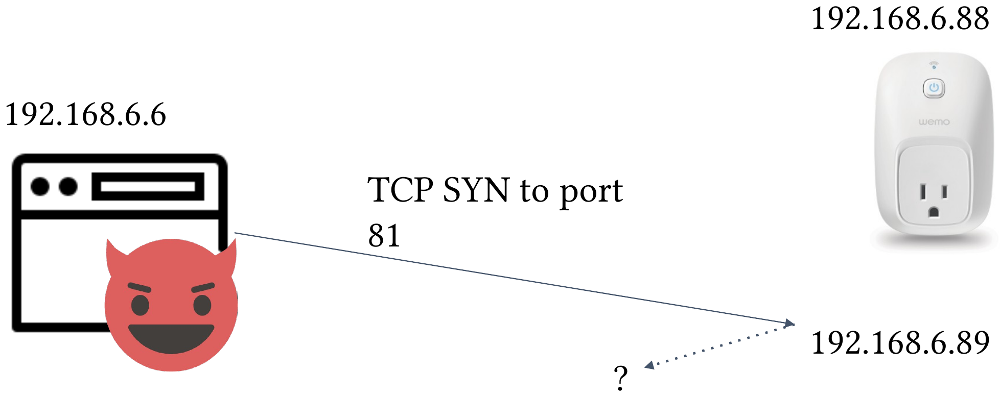{width="56%" fig-align="center"}

::: {.notes}
TCP RST is fast! Timeout is slooowww. Built up over three clicks in the
original: first the browser at .6 and the plug at .88, then the SYN to port 81
and the RST coming straight back, then the SYN to the empty .89 that just
hangs. Fast failure means a host is there; slow failure means nothing is.

Recovered from the original deck; the picture is static, so narrate the two
arrows. The page knows it is 192.168.6.6 from WebRTC and sends a fetch to each
address on the subnet, which the browser turns into a SYN to port 81. The live
plug at .88 answers immediately (RST if the port is closed, SYN-ACK if open);
the empty .89 never answers, so the fetch hangs until timeout. Fast failure
means a host is there, slow failure means nothing is. No response body is ever
read, so the same-origin policy never gets a say. This is port scanning with
the victim's own browser as the scanner; ask what a router could do about it
(nothing: it is all local traffic).
:::

## Attack Steps: 3. Identify IoT Devices

3. **Identify IoT devices.**
   a. Send request for our GET endpoints to active IP addresses, using the HTML5 `<audio>` element.
   b. Use the resulting `MediaError` message to infer resource availability (**new** side channel).

<!-- recovered from ppt-archive/10-IoT.pptx slide 9 -->
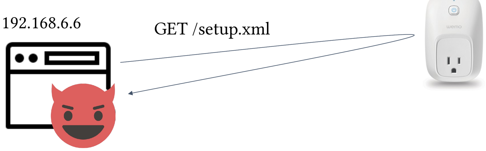{width="56%" fig-align="center"}

::: {.notes}
The page points an audio element at a device endpoint such as /setup.xml on
each live address it found in step 2. The build shows the GET going to the
plug at .88 and the answer coming back.
:::

## Attack Steps: 3. What the MediaError Says {.smaller}

| Browser | If the resource exists | Else |
|---|---|---|
| Chrome | `MEDIA_ERR_SRC_NOT_SUPPORTED` "DEMUXER_ERROR_COULD_NOT_OPEN: FFmpegDemuxer: open context failed" | `MEDIA_ELEMENT_ERROR` "Format error" |
| Firefox | `MEDIA_ERR_SRC_NOT_SUPPORTED` "Failed to init decoder" | `MEDIA_ELEMENT_ERROR` "Message 404: Not Found" |
| Safari | Fetches timed out | |
| Edge | No MediaError error messages | |

Safari and Edge: **Attack 1 does not work.**

::: {.notes}
Not supposed to be possible for a cross-origin request because of the
same-origin policy (except images, CSS, and passive resources); this is a new
vulnerability. Three slides in the original: Chrome's strings, Firefox's
strings, then Safari and Edge where the attack fails.

Walk the three steps slowly; the payoff is understanding a new side channel.
Step 1 uses WebRTC RTCPeerConnection to leak the victim's local IP through the
SDP candidate — pure browser feature, no permission prompt. Step 2 is timing:
TCP RST is fast (host up, port closed), timeout is slow (no host). Step 3 is
the clever part: the same-origin policy is supposed to stop a page from
learning anything about a cross-origin response (except images and CSS), but
the differing HTML5 MediaError strings — "DEMUXER_ERROR..." versus "Format
error" — leak existence. That's a new side channel the SOP is supposed to
prevent. Chrome paid a bug bounty for it. Note the defenses that landed later:
Safari timed the fetches out, Edge gave no error strings, so the attack didn't
work there. This is the lateral, "stepping-stone" pattern: browser used as
LAN reconnaissance tool with no malware installed on the victim's machine.
:::

## Implications

- Side channel sidestepping SOP (Chrome bug bounty)
- Attack stepping stone
- Privacy leaks (e.g., network fingerprinting)

# Attack 2: Access & Control Local Devices {.center}

## DNS Rebinding

- Attack fully bypassing SOP (D. Dean, E. Felten, and D. Wallach, IEEE S&P 1996)
- Requires a web attacker (controls malicious domain + webserver) **also** controlling the domain's authoritative DNS nameserver

::: {.notes}
Original paper worth naming: Dean, Felten, and Wallach, "Java Security: From
HotJava to Netscape and Beyond," IEEE S&P 1996 — the birth of the DNS
rebinding attack. The attacker needs to control a domain, its web server, and
its authoritative DNS. The trick is exploiting the gap between what the
browser's SOP keys on (the hostname) and what the network actually routes to
(the rebound IP). Emphasize: this is a 1996 attack that still worked against
2018-era IoT because devices had no Host-header checks, no auth, and no TLS.
Brannon Dorsey's 2018 disclosure demonstrated it on Google Home and
Chromecast — arbitrary YouTube playback, reboot, Wi-Fi scanning. Fix classes
to name: DNS pinning, rejecting private IPs in public DNS responses, Host
header allow-listing on the device, and Chrome's Private Network Access. Ask
the room: why did the same attack work 22 years after publication?
:::

## Attack Steps: Rebinding, Steps 1–2 {.smaller}

::: {.columns}
::: {.column width="48%"}
1. Victim visits *attacker.com*, queries malicious nameserver for *attacker.com*. Return web server IP w/ short TTL.
2. Attacker website loads another resource *test*.
:::
::: {.column width="52%"}
<!-- recovered from ppt-archive/10-IoT.pptx slide 17 (later HTTP overlay stripped) -->
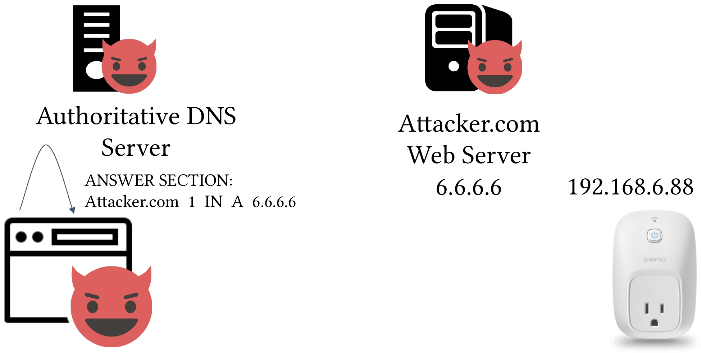{width="100%"}
:::
:::

::: {.notes}
Slides 16 to 18 in the original: the bare browser and plug, then the first
lookup answered with 6.6.6.6 and TTL 1 and the page fetched with HTTP 200,
then the page loading a second resource called test.
:::

## Attack Steps: Rebinding, Steps 3–5 {.smaller}

::: {.columns}
::: {.column width="48%"}
3. If *attacker.com*'s DNS A record is cached, *test* is directly retrieved. If so, wait and retry...
4. If *attacker.com*'s DNS A record is *not* cached, browser queries malicious nameserver again. Now return target IP w/ large TTL.
5. This time, retrieving *test* fails. But *attacker.com* is now **rebound** to the target IP, and can make direct requests.
:::
::: {.column width="52%"}
<!-- recovered from ppt-archive/10-IoT.pptx slide 22 -->
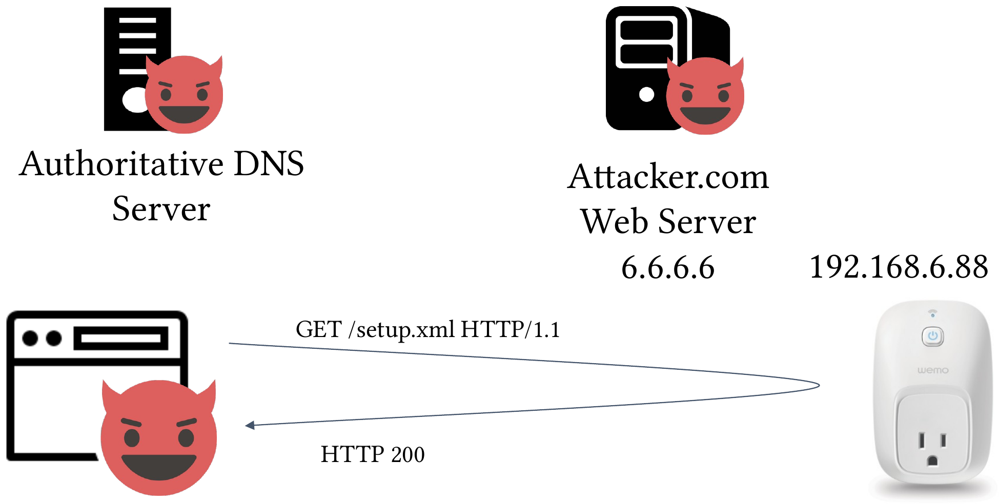{width="100%"}
:::
:::

::: {.notes}
Slides 19 to 22 in the original: GET /test answered 200 while the record is
cached; the second lookup answered with attacker.com 300 IN A 192.168.6.88;
GET /test now returns 404 because it is hitting the plug; and finally
GET /setup.xml to the plug returns 200. The page's origin never changed, so
the same-origin policy is satisfied.

Two static captures of the original build: narrate left, then right. Left:
the browser asks attacker.com's authoritative server and gets 6.6.6.6 with
TTL 1, so the record is discarded almost immediately; the page loads from the
attacker's web server and starts polling. Right: on the next lookup the same
nameserver answers 192.168.6.88, so "attacker.com" now means the smart plug;
GET /setup.xml goes straight to the device, comes back 200, and the page can
read it because its origin never changed. The SOP keys on the hostname, the
network keys on the IP, and the attacker controls the mapping between them.
Defenses to name: DNS pinning, refusing private addresses in public answers,
Host-header checks on the device, Chrome's Private Network Access.
:::

## Attack on Devices

::: {.columns}
::: {.column width="55%"}
*Google Home/Chromecast*

Potential attacks:

- Play arbitrary YouTube videos on Chromecast
- Reboot Chromecast/Home
- Scan for Wi-Fi networks and return information
:::
::: {.column width="45%"}
<!-- recovered from ppt-archive/10-IoT.pptx slide 23 -->
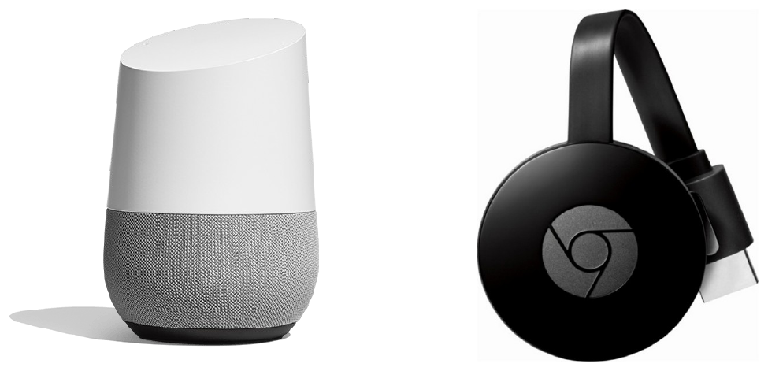{width="100%"}
:::
:::

## Demo: A User Visits a Site with a Malicious Script

<!-- recovered from ppt-archive/10-IoT.pptx slide 24 -->
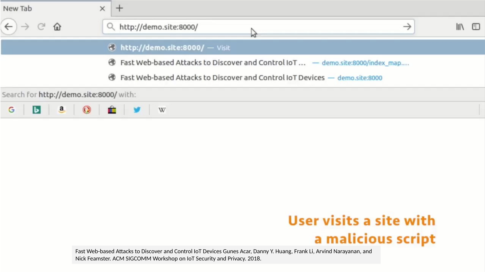{width="78%" fig-align="center"}

*Fast Web-based Attacks to Discover and Control IoT Devices.* Gunes Acar, Danny Y. Huang, Frank Li, Arvind Narayanan, and Nick Feamster. ACM SIGCOMM Workshop on IoT Security and Privacy, 2018.

::: {.notes}
Many of these devices interface with their smartphone companion app through
a simple, insecure, unauthenticated web server. This means that classical
web-based attacks also work on many of these devices! The original slide held
the demo video; this is its opening frame.
:::

## Implications

- Attacker control of IoT device actions
- Exploiting IoT device vulnerabilities for full compromise
- Privacy leaks (e.g., extensive device fingerprinting or user profiling)

## Moving Forward...

- Low barrier to attacks on local IoT devices via malicious websites.
- Need defenses that protect against lateral attacks.

## Why These Attacks Matter

::: {.columns}
::: {.column width="55%"}
- **No isolation**: devices trust anything on the LAN, so a browser becomes a foothold
- **Stepping stone**: discovery + control chains into full device compromise
- **Privacy leakage**: even *discovery* fingerprints your home (which devices you own)
- The barrier to entry is **a single malicious web page** — no malware install needed
:::
::: {.column width="45%"}
**Defense direction:** the network must protect devices from **lateral** attacks —
segmentation, Host-header validation, treating the LAN as **untrusted**.
:::
:::

::: {.notes}
Connect explicitly to the Mirai story from the DDoS lecture: the October 2016
Dyn takedown showed that IoT is attractive to attackers precisely because it
is unpatched and unisolated. Here the takeaway is the "zero-trust LAN" idea —
your home network should not be a soft interior behind a hard perimeter,
because a single malicious web page can be the perimeter breach. Segmentation,
Host-header validation, and treating the LAN as untrusted are the defensive
posture. Debate hook: consumers can't reasonably run their own segmentation —
so does that shift the obligation to router vendors, ISPs, or device makers?
That's the same debate that comes back on the last slide of this deck.
:::

# Privacy Challenges {.center}

## Difficult to Study Security/Privacy Systematically

::: {.columns}
::: {.column width="45%"}
**Anecdotal reports**

<!-- recovered from ppt-archive/10-IoT.pptx slide 28 -->
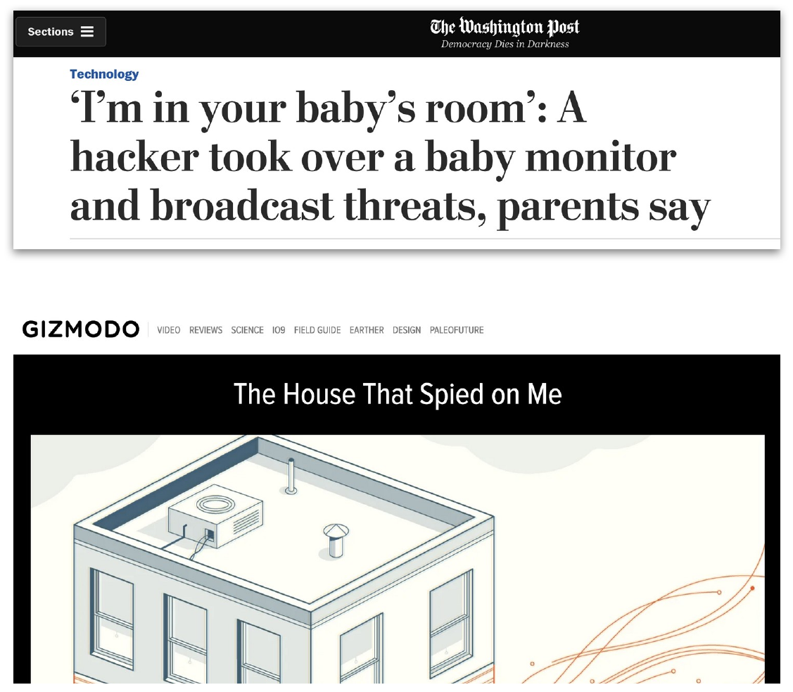{width="85%"}
:::
::: {.column width="55%"}
**Large-scale studies**

- Internet exposed only
- Home/enterprise networks: proprietary data
:::
:::

## What Is IoT Inspector

Open-source desktop application that passively monitors smart home networks

::: {.columns}
::: {.column width="50%"}
**Benefits to IoT users**

- Easy to install and use
- Visualization of potential security & privacy issues
:::
::: {.column width="50%"}
**Benefits to IoT researchers**

- Non-proprietary dataset
- IoT traffic in real homes
:::
:::

::: {.notes}
This is the answer to the observability problem from earlier. Paper: Huang,
Apthorpe, Acar, Li, Feamster, "IoT Inspector: Crowdsourcing Labeled Network
Traffic from Smart Home Devices at Large Scale," PoPETS 2020 (arXiv 1909.09848).
The genius is aligning incentives — users get a privacy dashboard, researchers
get ground-truth labeled data. Roughly 20% of the 50,000 devices got
user-supplied labels, and that labeling is what makes the dataset scientifically
valuable. Publicly released May 2019; TechCrunch coverage in April 2019 helped
seed adoption. Project now hosted at Princeton (inspector.cs.princeton.edu) and
NYU (inspector.engineering.nyu.edu) under Danny Yuxing Huang. Recent extensions
worth naming for follow-on reading: He et al. at EuroS&P 2024 on allowlists,
and Kumar et al. at PoPETS 2024 on tracing IoT data endpoints.
:::

## Download and Run IoT Inspector

::: {.columns}
::: {.column width="42%"}
<!-- recovered from ppt-archive/10-IoT.pptx slide 30 -->
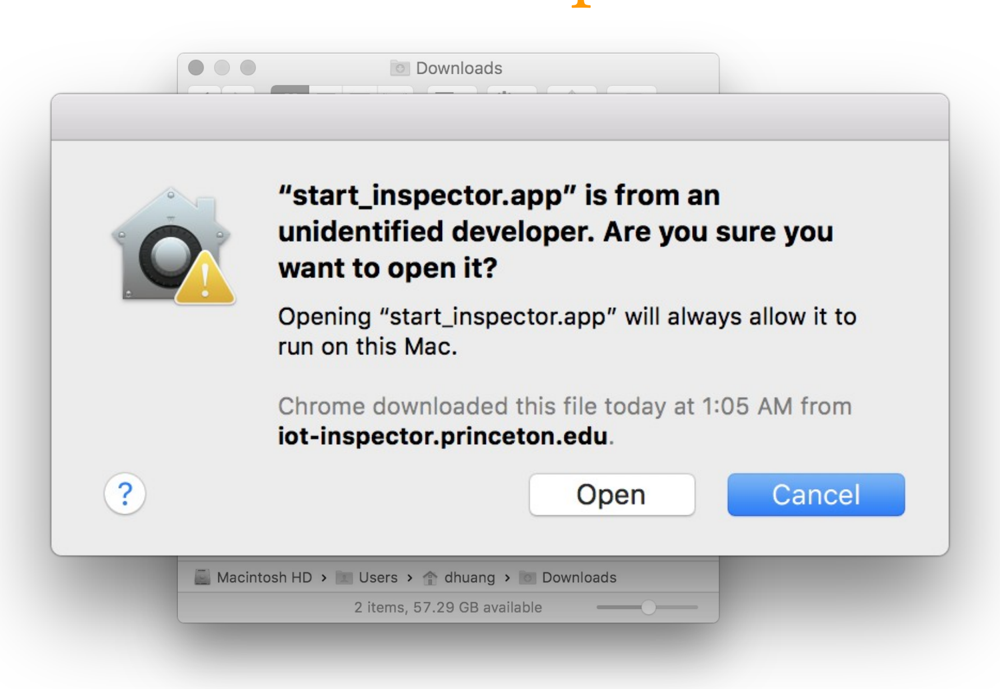{width="100%"}
:::
::: {.column width="58%"}
<!-- recovered from ppt-archive/10-IoT.pptx slide 31 -->
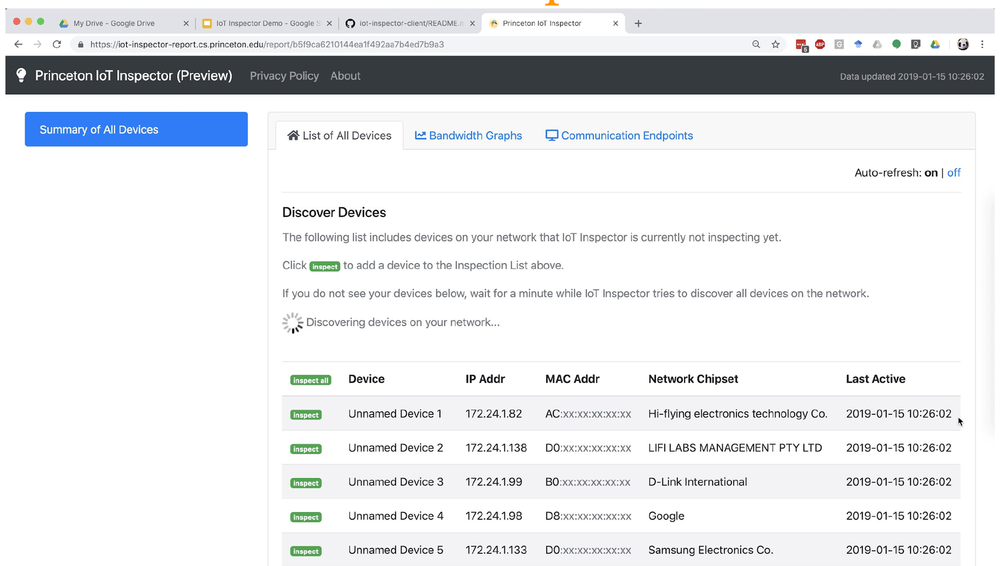{width="100%"}
:::
:::

::: {.notes}
Two slides in the original: the macOS "unidentified developer" dialog on first
launch, then the Discover Devices page listing the unnamed devices on the
network by IP, MAC, and chipset vendor.
:::

## Bandwidth Graph for Each Device

::: {.columns}
::: {.column width="52%"}
<!-- recovered from ppt-archive/10-IoT.pptx slide 32 -->
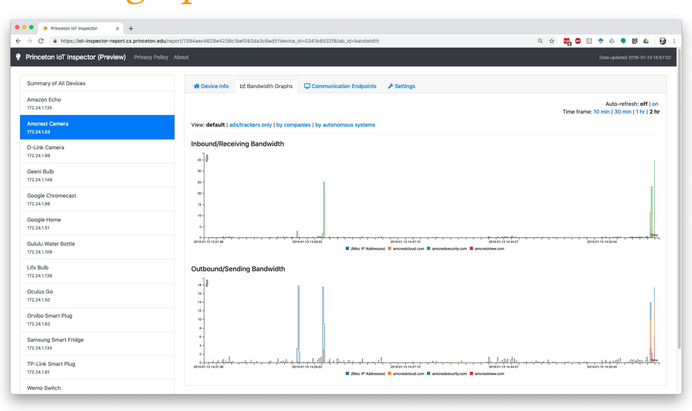{width="100%"}
:::
::: {.column width="48%"}
<!-- recovered from ppt-archive/10-IoT.pptx slide 33 -->
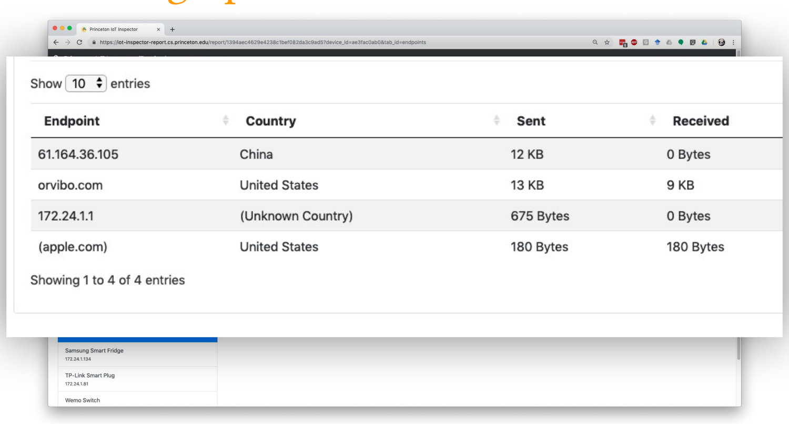{width="100%"}
:::
:::

::: {.notes}
Two slides in the original: the per-device inbound and outbound bandwidth
graph, then the communication-endpoints table (endpoint, country, bytes
sent and received).
:::

## IoT Inspector Works Through ARP Spoofing

<!-- recovered from ppt-archive/10-IoT.pptx slide 34 -->
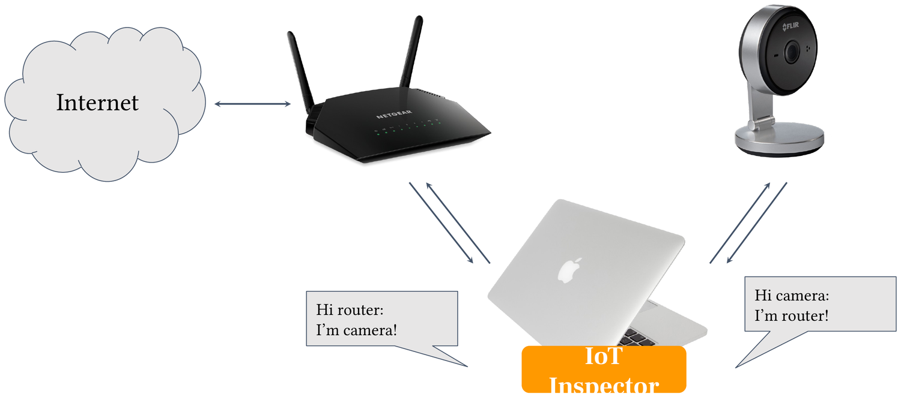{width="78%" fig-align="center"}

::: {.notes}
"Hi router: I'm camera!" and "Hi camera: I'm router!" Again, first page on
Amazon for "wifi smart socket."

Same primitive an attacker would use — ARP spoofing, sometimes called
man-in-the-middle — turned into a benign measurement tool on your own network.
Good moment to recall from networking basics that ARP has no authentication;
anyone on the LAN can announce whatever MAC-to-IP mapping they like. Inbound
data rates are inferred from TCP ACK numbers when only one direction is
observed. Be explicit that this only works on your own LAN with your consent;
the consent, on-device design, and opt-in labeling are what make this ethical
research rather than an attack. Ask: if the tool is technically indistinguishable
from an attack, what makes it acceptable to run — is it the intent, the
consent, or the design?
:::

## Insight: IoTs Communicate with Whom

<!-- recovered from ppt-archive/10-IoT.pptx slide 35 -->
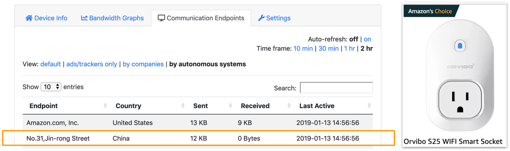{width="100%" fig-align="center"}

::: {.notes}
An Orvibo S25 Wi-Fi smart socket ("Amazon's Choice") talking to Amazon.com
in the United States and to No. 31, Jin-rong Street in China. Roku: 30% of
connected TVs, followed by 27% Amazon.
https://iot-inspector-report.cs.princeton.edu/report/6aae51c55c2246721dac4b5b44743f2b
:::

## Insight: Trackers/Ads on Roku TV

<!-- recovered from ppt-archive/10-IoT.pptx slide 36 -->
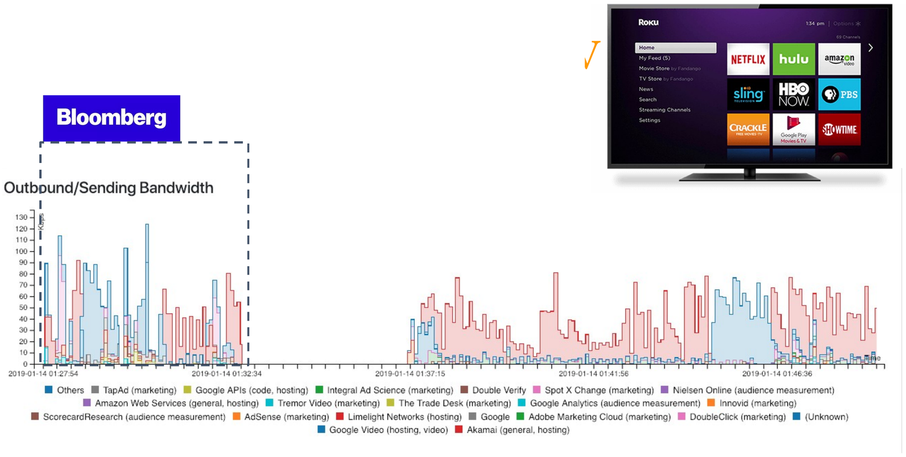{width="82%" fig-align="center"}

::: {.notes}
Roku: 30% of connected TVs, followed by 27% Amazon. The Bloomberg channel's
outbound traffic fans out to TapAd, Google APIs, Integral Ad Science, Double
Verify, Spot X Change, Nielsen Online, Tremor Video, The Trade Desk, Innovid,
ScorecardResearch, AdSense, Limelight, Adobe Marketing Cloud, DoubleClick,
Akamai, and more.
:::

## Insight: Trackers/Ads on Roku TV (Bloomberg and CBSN)

<!-- recovered from ppt-archive/10-IoT.pptx slide 37 -->
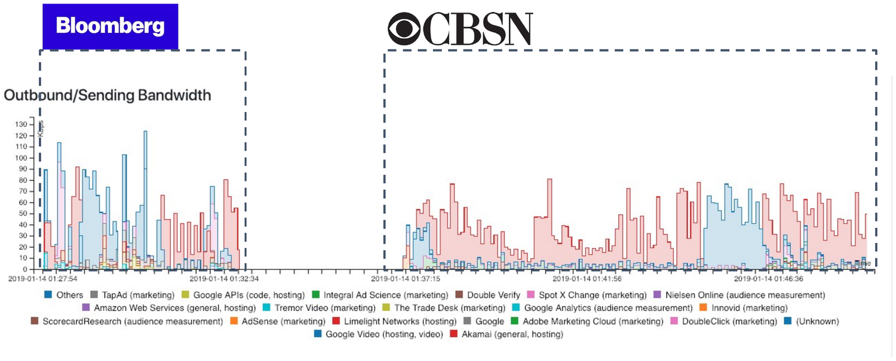{width="100%" fig-align="center"}

## Insight: A Samsung Fridge Talks to Trackers

<!-- recovered from ppt-archive/10-IoT.pptx slide 38 -->
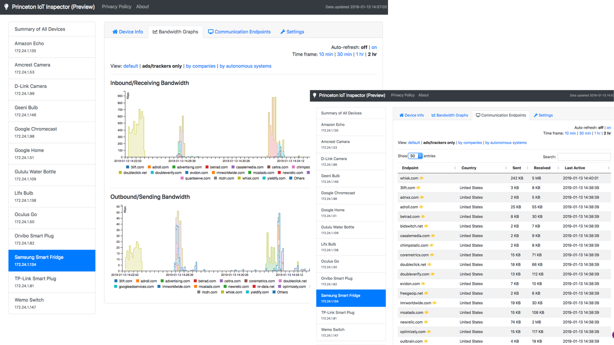{width="80%" fig-align="center"}

::: {.notes}
Screenshots of your Samsung fridge, which actually talks to a whole bunch of
trackers, including Nielsen! (The original slide has no title; this one is
taken from its speaker note.)
:::

## Naming a Device in IoT Inspector

<!-- recovered from ppt-archive/10-IoT.pptx slide 39 -->
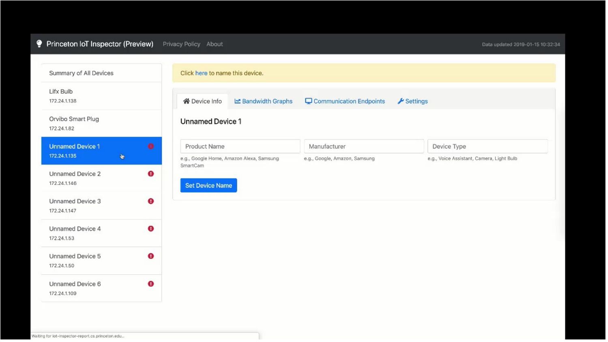{width="80%" fig-align="center"}

::: {.notes}
Users label each device with product name, manufacturer, and device type.
Mention price: streaming sticks are much cheaper than a smart TV or a PC, and
they give you access to thousands of apps on Roku and Amazon. (The original
slide has no title; this one describes the screenshot.)
:::

## Summary of Insights

::: {.columns}
::: {.column width="45%"}
**Privacy**

- Tracking/ads on TVs
- Data aggregators on IoTs
:::
::: {.column width="55%"}
**Security**

- Anomaly detection
- TLS (encryption) analysis, e.g.,
  - TLS 1.0: Samsung Smart Cam; Amazon Prime Video on Roku
  - Insecure cipher suites: D-Link camera: **13**; Amcrest camera: **21**
:::
:::

## Summary

- Security challenges in smart homes due to lack of isolation of devices from one another
  - Web-based discovery and control
- Privacy challenges due to pervasive tracking, lack of encryption

## Streaming Devices

<!-- recovered from ppt-archive/10-IoT.pptx slide 42 -->
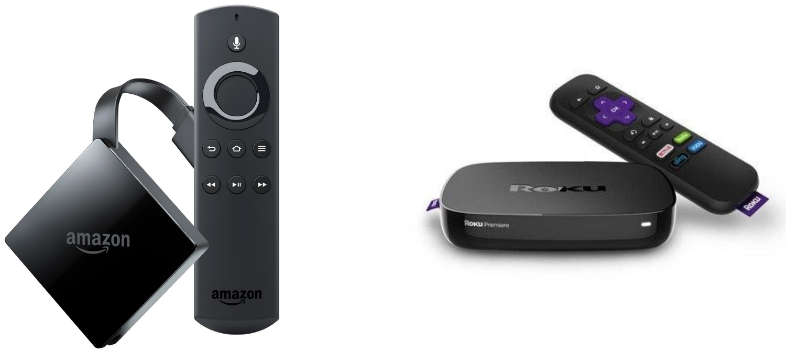{width="70%" fig-align="center"}

::: {.notes}
Mention this is the first study on OTT (over-the-top) streaming devices.
:::

## Cord-Cutting: Two Primary Options

::: {.columns}
::: {.column width="45%"}
Two primary options

- Over-the-air HDTV
  - HDTV antenna
- Streaming
  - PC
  - Streaming devices
:::
::: {.column width="55%"}
<!-- recovered from ppt-archive/10-IoT.pptx slide 43 -->
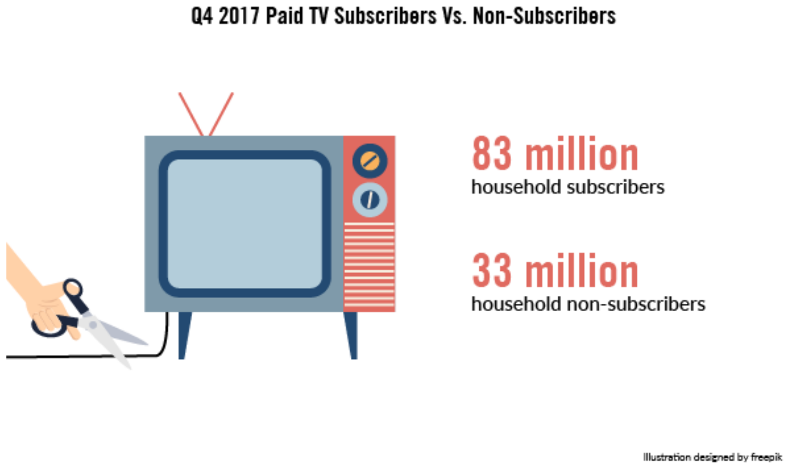{width="100%"}
:::
:::

## Cord-Cutting: Household Penetration by Device

<!-- recovered from ppt-archive/10-IoT.pptx slide 44 -->
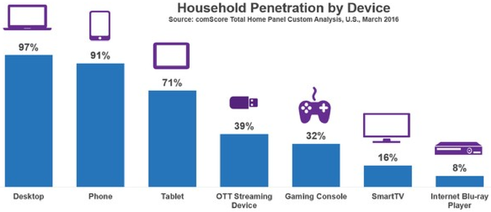{width="82%" fig-align="center"}

comScore Total Home Panel custom analysis, U.S., March 2016.

## Cord-Cutting: New Privacy Concerns

Streaming devices introduce new privacy concerns

- Open ecosystem may allow significantly more third parties
- Streaming devices can report viewing history and other identifiers
- Third-party apps can potentially include their own ad libraries

::: {.notes}
Contrast studies from web and mobile to this study.

Paper: Mohajeri Moghaddam, Acar, Yu, Li, Vallina-Rodriguez, Feamster,
"Watching You Watch: The Tracking Ecosystem of Over-the-Top TV Streaming
Devices," ACM CCS 2019 — the first large-scale measurement of thousands of
channels on Roku and Amazon Fire TV. Contrast with the in-the-wild IoT
Inspector study: here we go into the lab to decrypt and read content, trading
scale for depth. Motivate why streaming is worth a whole study — it's the
most-used IoT device in most homes and the ecosystem is wide open, with any
channel able to bundle its own ad and tracking libraries. Ask: what's the
equivalent of the app-store review process for a Roku channel? Effectively
nothing, and that's why this study matters.
:::

## Cord-Cutting: Device Share Among OTT Streaming Devices

<!-- recovered from ppt-archive/10-IoT.pptx slide 46 -->
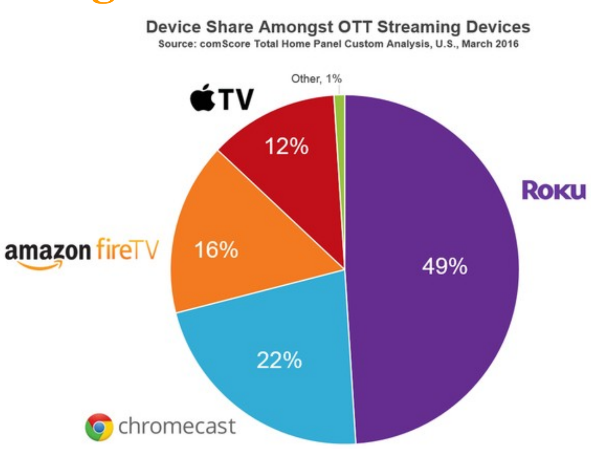{width="52%" fig-align="center"}

comScore Total Home Panel custom analysis, U.S., March 2016.

## Hidden Data Flows

<!-- recovered from ppt-archive/10-IoT.pptx slide 47 -->
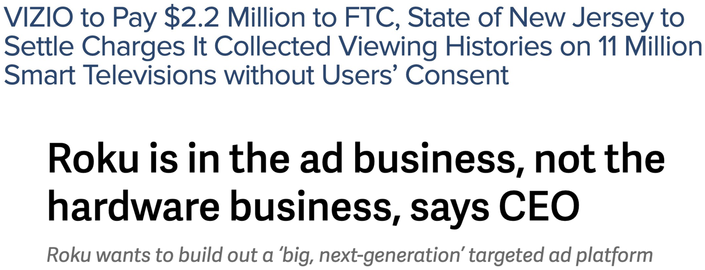{width="88%" fig-align="center"}

::: {.notes}
Selenium, Monkey. Mention what the plaintext gives, in case someone doesn't
know. We need to decrypt to get the content that is being sent to these
parties.
:::

## Research Questions

Which parties do streaming devices contact?

- Tracker ecosystems
- Information being shared
- Effectiveness of the platform privacy options

## Results

- Most channels are contacting known trackers
  - **89%** of Amazon Fire TV channels
  - **69%** of Roku channels
- Platform privacy options largely ineffective
- Channels leak video titles to trackers

## Challenges

1. Difficult to automate input
   - Web & mobile: known tools with feedback
   - Streaming devices: no known tools, no feedback
2. Difficult to decrypt traffic to see content flows
   - Web & mobile: add self-signed certificate to certificate store
   - Streaming devices: hard to change certificate store

## Overview of Method

1. **Develop crawler for streaming devices**
   - Simulate a user interacting with channels
   - Intercept traffic the streaming device generates
2. Collect data on Amazon and Roku platforms
3. Analyze data

::: {.notes}
Don't mention HDCP or adb. Make clear that mitmproxy is running on the
desktop.
:::

## System Design of Crawler

<!-- recovered from ppt-archive/10-IoT.pptx slide 55 -->
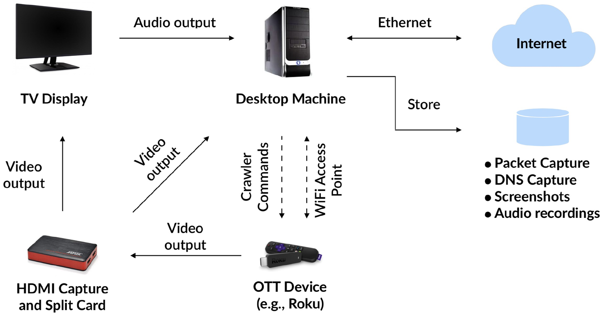{width="76%" fig-align="center"}

::: {.notes}
Built up over four slides in the original: desktop machine on Ethernet to the
Internet, with crawler commands and a Wi-Fi access point down to the OTT
device; then the HDMI capture and split card taking the device's video output;
then the TV display and audio output back to the desktop; finally the store of
packet captures, DNS captures, screenshots, and audio recordings.
:::

## Intercepting Traffic

**Roku**

- Best-effort interception
  - Proxy traffic between the streaming device and the Internet
  - Sign TLS traffic with self-signed cert
- Best-effort MITM proxy

**Amazon**

- Rooted (k4y0z method¹); changed certificate
- Frida to bypass channel-level pinning

¹ https://forum.xda-developers.com/fire-tv/development/unlock-fire-tv-stick-2nd-gen-tank

::: {.notes}
Four slides in the original (56, 59, 60, 62) that fill in the Roku side, then
the Amazon side. Add a table of crawls, then say you are going to present a
subset.
:::

## Best-Effort Traffic Interception

**Challenges**

- Channel may validate certs for some or all connections
- Failed validation ⇒ cannot launch channel

**Solution**

- Extends original mitmproxy
- Warm-up; remember failed connections

## Rooting Fire TV

::: {.columns}
::: {.column width="50%"}
Install Team Win Recovery Project (TWRP)

- Short CLK to GND
- Replace bootloader with unlocked fastboot version

Use TWRP

- Flash super-user binary
:::
::: {.column width="50%"}
<!-- recovered from ppt-archive/10-IoT.pptx slide 61 -->
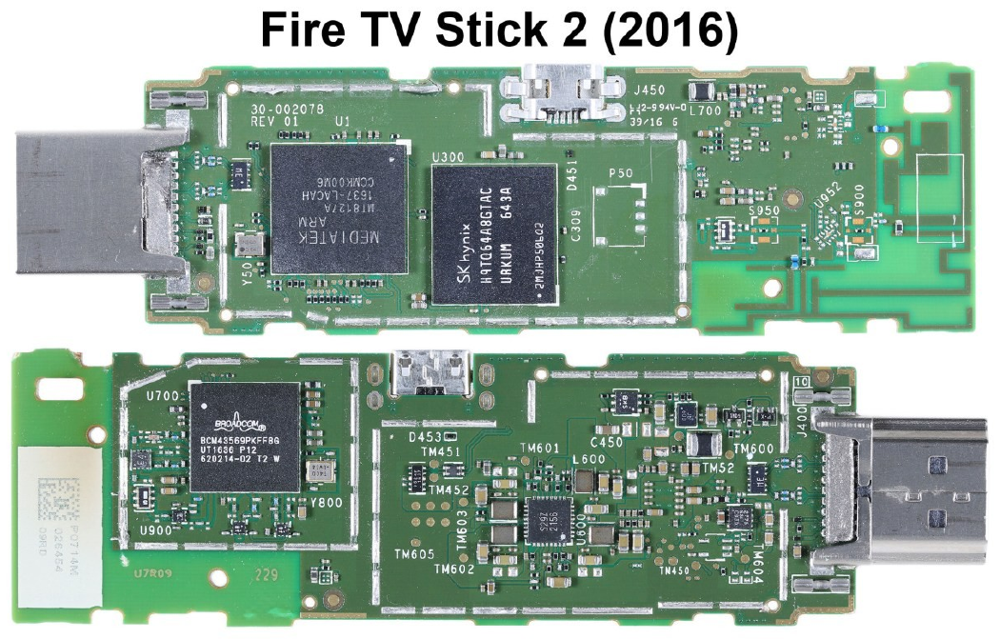{width="100%"}
:::
:::

## Automatically Interacting with Channels

::: {.columns}
::: {.column width="38%"}
1. Install channel
2. Launch channel
3. Navigate to video
4. Play video
5. Uninstall channel
:::
::: {.column width="62%"}
<!-- recovered from ppt-archive/10-IoT.pptx slide 65 -->
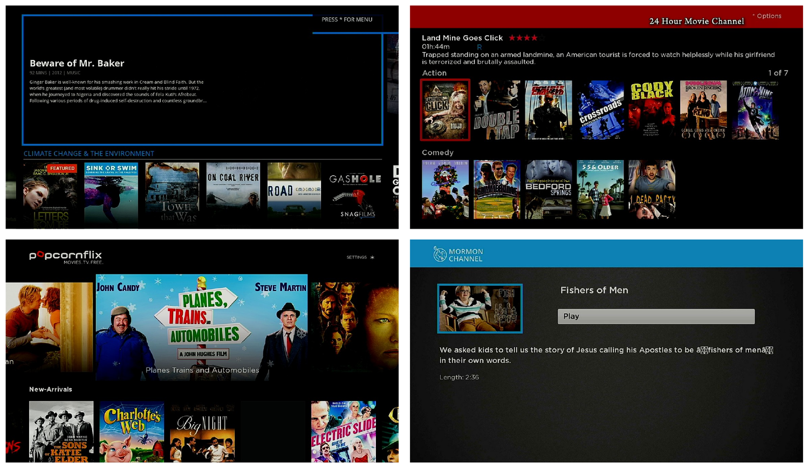{width="100%"}
:::
:::

::: {.notes}
Ten slides in the original step through the list with a screenshot for each:
the Roku channel store for install, a channel's home screen for launch, the
navigation screens shown here, playback screens (a Lego video, Scottsdale
Academy, NASA), and the Roku "Remove channel" menu for uninstall.
:::

## Automatically Interacting with Channels: Navigation and Playback

::: {.columns}
::: {.column width="38%"}
1. Install channel
2. Launch channel
3. **Navigate to video**
4. **Play video**
5. Uninstall channel
:::
::: {.column width="62%"}
**Common key sequences:**

- [OK, OK, OK]
- [Down, OK, OK]
- [OK, OK, Down, OK, Down, OK]

**Audio detection**

- Videos on 62% Roku, 51% Amazon
- Correct detection: 144 / 150 (96%)

**Fast forward**
:::
:::

::: {.notes}
We wanted to study these channels at scale, and the goal of the crawler is to
launch an app, simulate a user's behavior, and get to a video. Explain how
the channel lists are created (next slides).
:::

## Automatically Interacting with Channels: Uninstall

::: {.columns}
::: {.column width="38%"}
1. Install channel
2. Launch channel
3. Navigate to video
4. Play video
5. **Uninstall channel**
:::
::: {.column width="62%"}
<!-- recovered from ppt-archive/10-IoT.pptx slide 72 -->
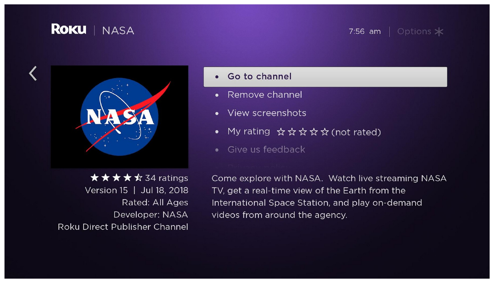{width="100%"}
:::
:::

::: {.notes}
The last step: the Roku channel menu with "Remove channel," so the next
channel starts from a clean device.
:::

## Overview of Method: Collect Data

1. Develop crawler for streaming devices
2. **Collect data on Amazon and Roku platforms**
   - Create channel lists
   - Crawl channels
   - Test platform privacy options
3. Analyze data

## Channel Lists

::: {.columns}
::: {.column width="55%"}
- Generated from vendor channel stores
- Multiple channel lists used in paper

Channel lists used in presentation

- Top 1000 channels
- Top 100 channels
  - Privacy options enabled
  - Privacy options disabled
:::
::: {.column width="45%"}
<!-- recovered from ppt-archive/10-IoT.pptx slide 75 -->
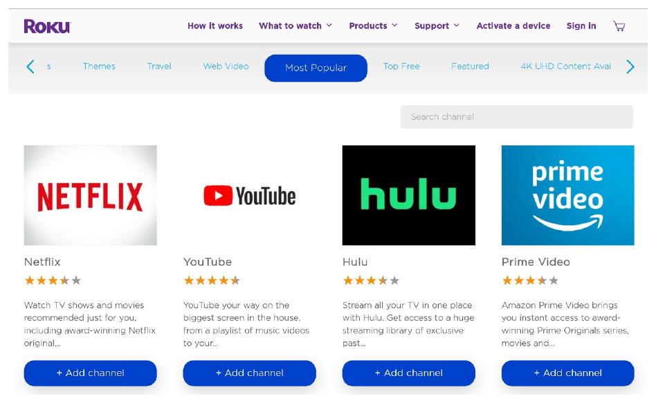{width="100%"}
:::
:::

::: {.notes}
We only used domain-based filters since we don't have JavaScript.
:::

## Overview of Method: Analyze Data

1. Develop crawler for streaming devices
2. Collect data on Amazon and Roku platforms
3. **Analyze data**
   - Trackers
   - Identifiers
   - Video titles

## Tracking Domains

Compared destination of requests to tracking protection lists

- EasyList
- EasyPrivacy
- Disconnect
- Ghostery
- Pi-hole

## 3rd-Party Trackers {.smaller}

<!-- recovered from ppt-archive/10-IoT.pptx slide 79 -->
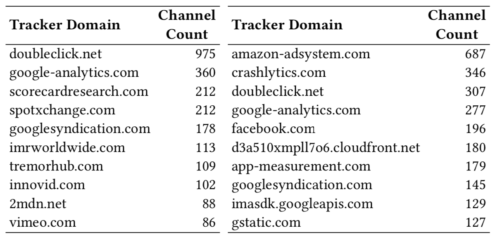{width="62%" fig-align="center"}

- **89%** of Amazon Fire TV channels and **69%** of Roku channels contact a **known tracker**
- The usual web/mobile players dominate: **doubleclick**, **google-analytics**,
  **scorecardresearch**, **amazon-adsystem**
- Some channels leak **video titles** and **persistent IDs** to third parties

::: {.notes}
Two things to draw out. First: the same tracking oligopoly that runs the web
has colonized your TV — DoubleClick, google-analytics, ScorecardResearch,
amazon-adsystem. These aren't exotic adversaries; they're the same firms from
last lecture. Second: the team also found previously unknown trackers —
domains that received the Ad ID or device serial, were contacted by multiple
independent channels, and appeared on no standard filter list. That last
point is the structural finding: blocklists miss new entrants by construction,
because they only know about what someone has already reported. Cross-reference
back to the "list-based blocking" defense from Meeting 9 — same limitation,
new setting. This is why measurement studies keep needing to be redone.
:::

## Previously Unknown Trackers

Generated list of domains that

- Receive Ad ID or device serial number
- Contacted by more than one channel
- Not found in five previous lists

Manually removed false positives

## Previously Unknown Trackers: Roku

<!-- recovered from ppt-archive/10-IoT.pptx slide 81 -->
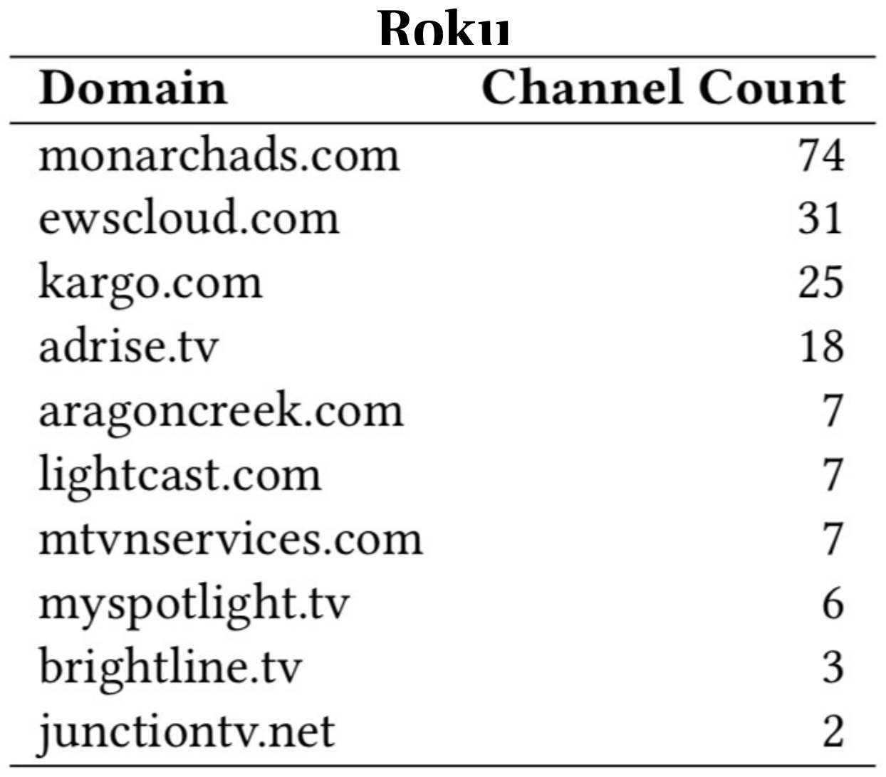{width="46%" fig-align="center"}

## Device and Location Identifiers

Compiled list of possible identifiers

- Account information
- Manual analysis of PCAP files

Searched traffic captures for

- Plain text
- Encoded versions
- Hashed versions

## Device and Location Identifiers: Roku and Amazon

<!-- recovered from ppt-archive/10-IoT.pptx slide 83 -->
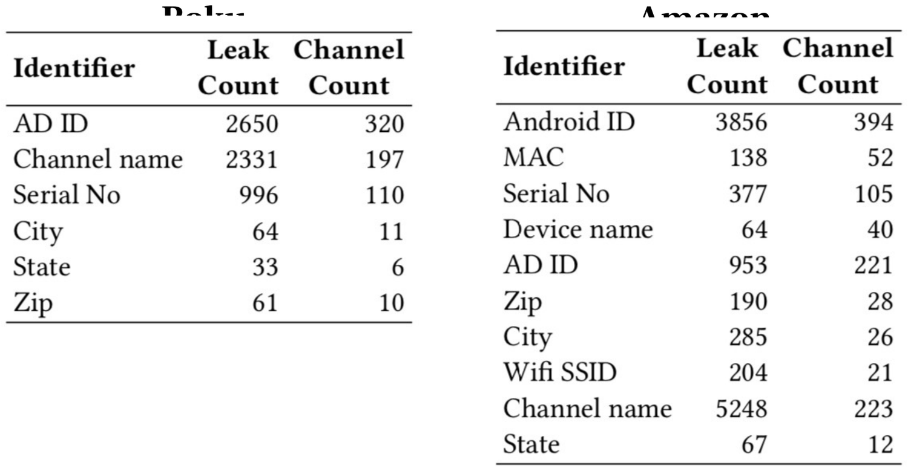{width="84%" fig-align="center"}

## Video Titles Shared with 3rd-Party Trackers

- Manually tagged 150 video titles on both platforms
- Searched traffic captures for
  - Plain text
  - Encoded versions
  - Hashed versions

## Video Titles Shared with 3rd-Party Trackers: Roku

<!-- recovered from ppt-archive/10-IoT.pptx slide 85 -->
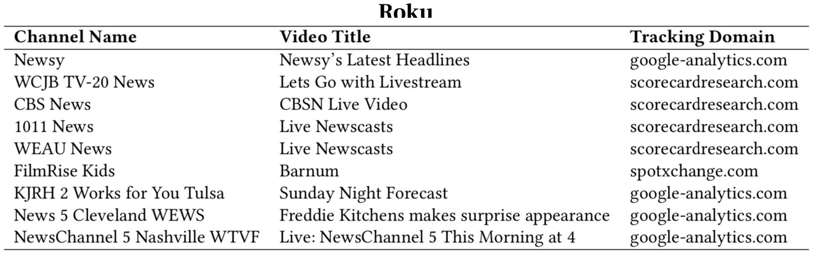{width="100%" fig-align="center"}

## Platform Privacy Options

<!-- recovered from ppt-archive/10-IoT.pptx slide 86 -->
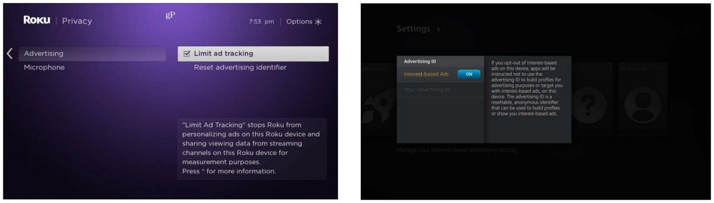{width="96%" fig-align="center"}

::: {.notes}
Limit Ad Tracking on Roku, and the interest-based ads switch on Amazon: a
similar concept to Do Not Track. I've presented some pretty nasty tracking,
but it turns out that these platforms offer options. Do Not Track is
ineffective; there is very little users can do in the near term to protect
themselves. Pi-hole is effective to some extent. We can have long-term impact
through regulation. Remember to talk about news agencies: a lot of the
trackers we saw are also very pervasive in the web and mobile ecosystems.
:::

## Platform Privacy Options: Roku and Amazon

::: {.columns}
::: {.column width="50%"}
**Roku**

| | Track (default) | Privacy (enabled) |
|---|---|---|
| Ad ID | 30 | 0 |
| Serial No. | 14 | 13 |
:::
::: {.column width="50%"}
**Amazon**

| | Track (default) | Privacy (enabled) |
|---|---|---|
| Ad ID | 35 | 16 |
| Android ID | 69 | 65 |
| Serial No. | 33 | 24 |
| MAC Addr | 3 | 3 |
:::
:::

## Implications

- Users' attempts to block tracking through platform options would have minimal effect
- Platform restrictions make it difficult for users to prevent tracking using conventional approaches
- Previously unknown trackers would likely evade most filters

## Contributions

Developed an open-source automatic smart TV crawler that

- Simulates a user interacting with channels
- Intercepts traffic the streaming device generates

First study of thousands of channels on Roku and Amazon Fire TV

- Found evidence of pervasive tracking
- Numerous identifiers shared with trackers
- Platform privacy options largely ineffective

## Future Work

- Child privacy protection law (e.g., COPPA) violations
- Classifying channel traffic versus platform operating-system traffic
- Expand study to additional devices
  - Smart TVs may have additional privacy concerns

## Crawler and Data Released

Crawler code

- https://tv-watches-you.princeton.edu/

Data

- tvwatchesyou@princeton.edu

## CBS Watches Me Watching CBS

<!-- recovered from ppt-archive/10-IoT.pptx slide 92 -->
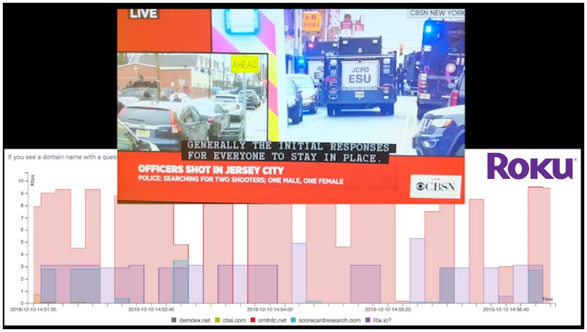{width="80%" fig-align="center"}

## Consumers Face a Large Variety of Security and Privacy Threats

<!-- recovered from ppt-archive/10-IoT.pptx slide 93 -->
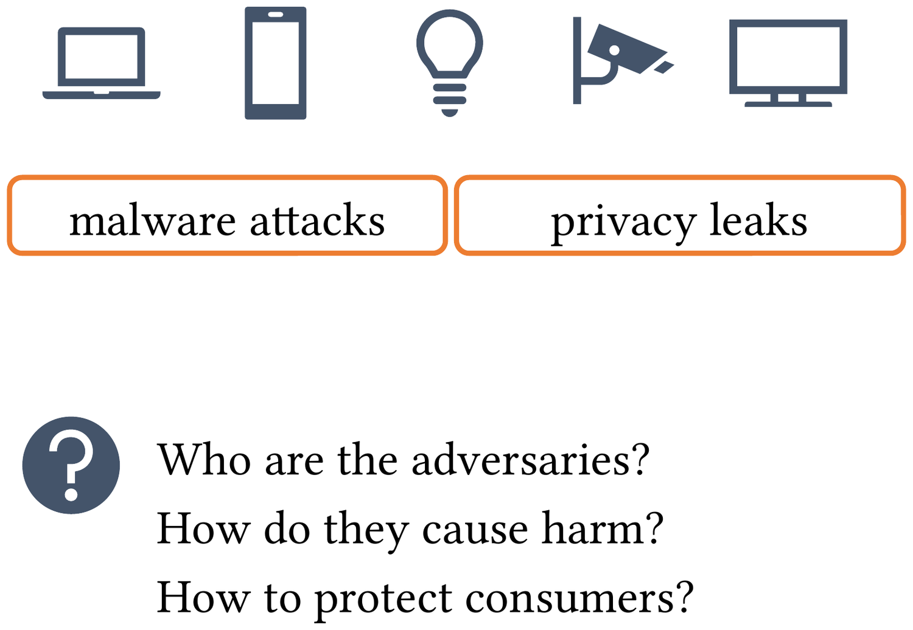{width="62%" fig-align="center"}

## Challenges for Empirically Studying Security & Privacy Threats

<!-- recovered from ppt-archive/10-IoT.pptx slide 94 -->
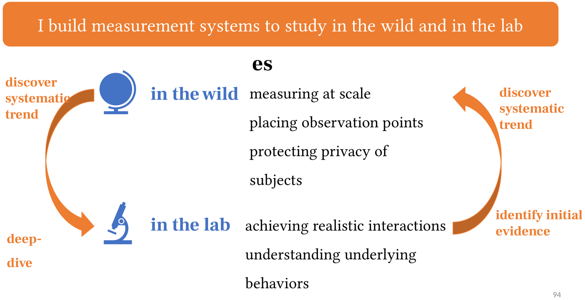{width="86%" fig-align="center"}

::: {.notes}
In the wild: measuring at scale, placing observation points, protecting the
privacy of subjects; this discovers systematic trends. In the lab: achieving
realistic interactions, understanding underlying behaviors; this is the deep
dive, and it identifies initial evidence that sends you back into the wild.
:::

## Smart Home IoT Security & Privacy

<!-- recovered from ppt-archive/10-IoT.pptx slide 95 -->
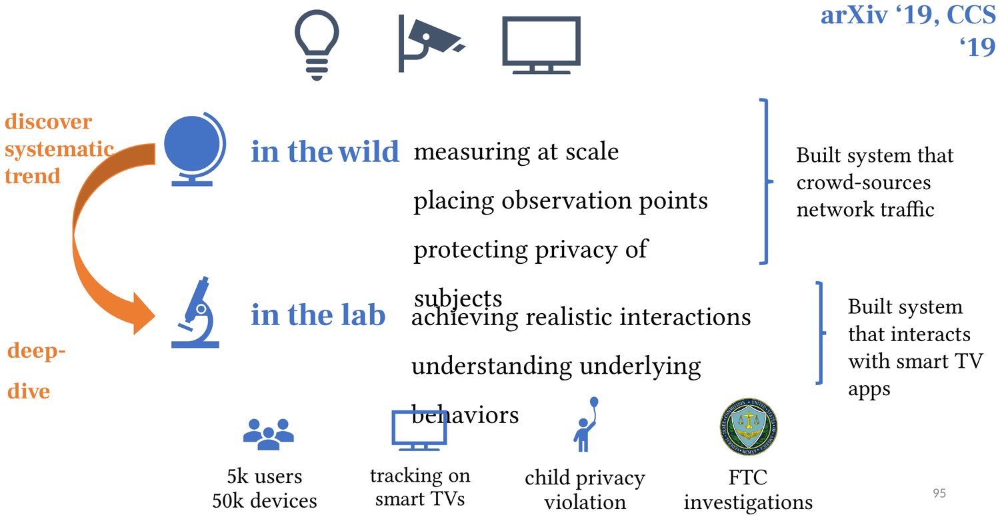{width="86%" fig-align="center"}

## Studying the Cyber-Criminal Ecosystem

<!-- recovered from ppt-archive/10-IoT.pptx slide 96 -->
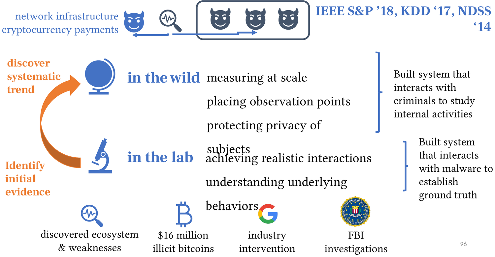{width="86%" fig-align="center"}

::: {.notes}
The same in-the-wild / in-the-lab loop applied to a different problem: a
system that interacts with criminals to study internal activities, and a
system that interacts with malware to establish ground truth (IEEE S&P 2018,
KDD 2017, NDSS 2014); network infrastructure and cryptocurrency payments;
$16 million in illicit bitcoins; FBI investigations and industry
intervention.
:::

## Focus of the Talk: Smart Home IoT Security & Privacy

<!-- recovered from ppt-archive/10-IoT.pptx slide 97 -->
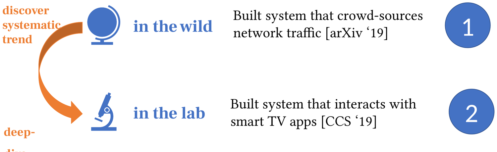{width="86%" fig-align="center"}

# Discovering Smart Home IoT Security & Privacy Threats in the Wild {.center}

Danny Yuxing Huang, Noah Apthorpe, Gunes Acar, Frank Li, Nick Feamster

arXiv '19 (in submission)

## Many Smart Home IoT Devices, but Few Systematic Insights

<!-- recovered from ppt-archive/10-IoT.pptx slide 99 -->
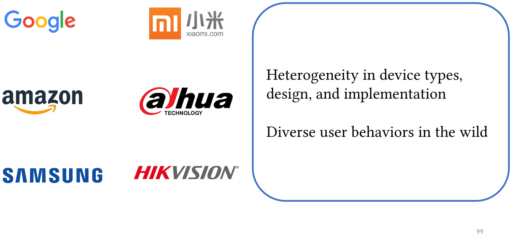{width="86%" fig-align="center"}

## Studying IoT Is Genuinely Hard

- **Anecdotal reports** don't generalize — one teardown of one camera tells you little
- **Internet-wide scans** (Shodan-style) see only what's *exposed* to the public internet
- The interesting traffic happens *inside* **home and enterprise networks** — proprietary,
  unobservable, behind NAT
- Heterogeneity: thousands of device types, vendors, and protocols (Wi-Fi, **Z-Wave**,
  Zigbee, BLE)

The core methodological problem: **how do you observe real devices in real homes, at scale,
without violating users' privacy?**

::: {.notes}
Methodological setup — this is why measurement is the whole contribution of the
lecture. You cannot study the smart home the way you study the web (crawlers)
or mobile (app stores plus instrumentation). Anecdotes don't generalize; Shodan
only sees what's exposed to the public internet, and the interesting traffic is
behind NAT. Add heterogeneity: Wi-Fi, Z-Wave, Zigbee, and BLE are all in the
same room, none of them observable the same way. The two systems in this deck —
IoT Inspector and the TV crawler — are direct answers to that observability
problem. Ask: if you wanted to know what your neighbor's smart speaker was
doing tonight, how would you find out without breaking any laws?
:::

## Challenges of Identifying IoT Security & Privacy Threats at Scale

<!-- recovered from ppt-archive/10-IoT.pptx slide 100 -->
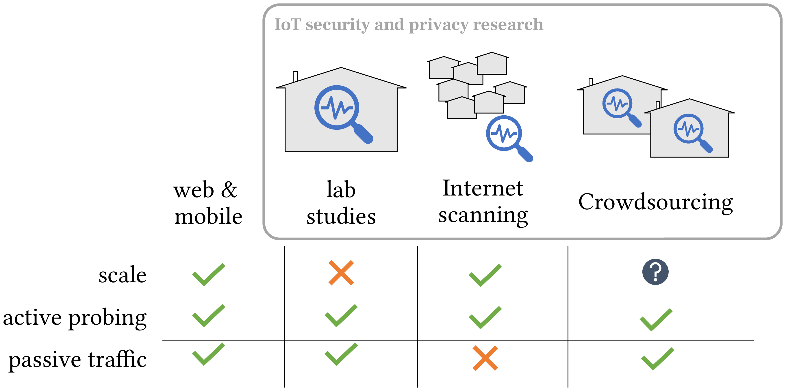{width="82%" fig-align="center"}

::: {.notes}
Web and mobile research gets scale, active probing, and passive traffic. Lab
studies: probing and passive traffic, no scale. Internet scanning: scale and
probing, no passive traffic. Crowdsourcing: probing and passive traffic, and
scale is the open question.

Static capture of the original build; walk the table a row at a time rather
than column by column. Scale: web and mobile have crawlers and app stores,
lab studies stop at the bench, Internet scanning scales but only over what is
exposed, and crowdsourcing's scale is the open question. Active probing: every
approach can poke a device. Passive traffic from real homes is what only the
lab and crowdsourcing see, and only crowdsourcing sees it at scale. The
question mark in the crowdsourcing cell is the research bet of IoT Inspector,
answered two slides on with 5,000 users and 50,000 devices.
:::

## Crowdsourcing IoT Network Traffic at Scale

::: {.columns}
::: {.column width="58%"}
**Vision**

Simple tool that anyone can use to identify the otherwise hidden activities of IoT devices

<!-- recovered from ppt-archive/10-IoT.pptx slide 101 -->
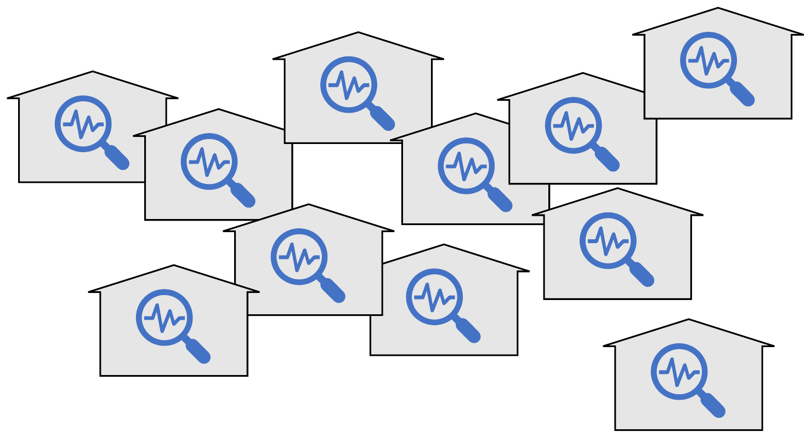{width="90%"}
:::
::: {.column width="42%"}
**Design Goals**

For recruiting users

- Easy to use
- Generates insights
- Protects privacy

For researchers

- Large, labeled dataset
:::
:::

## IoT Inspector: A System to Crowdsource IoT Traffic at Scale

::: {.columns}
::: {.column width="58%"}
**IoT Inspector** (iot-inspector.princeton.edu)

<!-- recovered from ppt-archive/10-IoT.pptx slide 102 -->
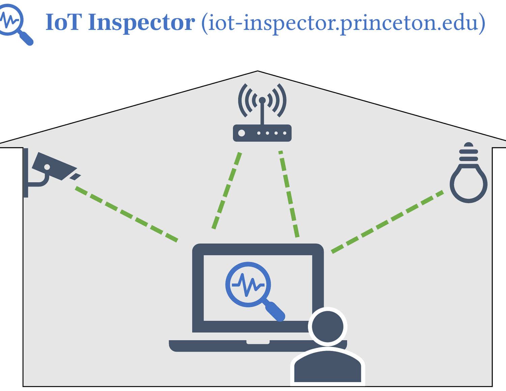{width="78%"}
:::
::: {.column width="42%"}
**Design Goals**

For recruiting users

- **Easy to use**
- Generates insights
- Protects privacy

For researchers

- Large, labeled dataset

*How to make IoT Inspector easy to use?*
:::
:::

## IoT Inspector Uses ARP Spoofing to Capture Traffic {.smaller}

::: {.columns}
::: {.column width="60%"}
<!-- recovered from ppt-archive/10-IoT.pptx slide 105 -->
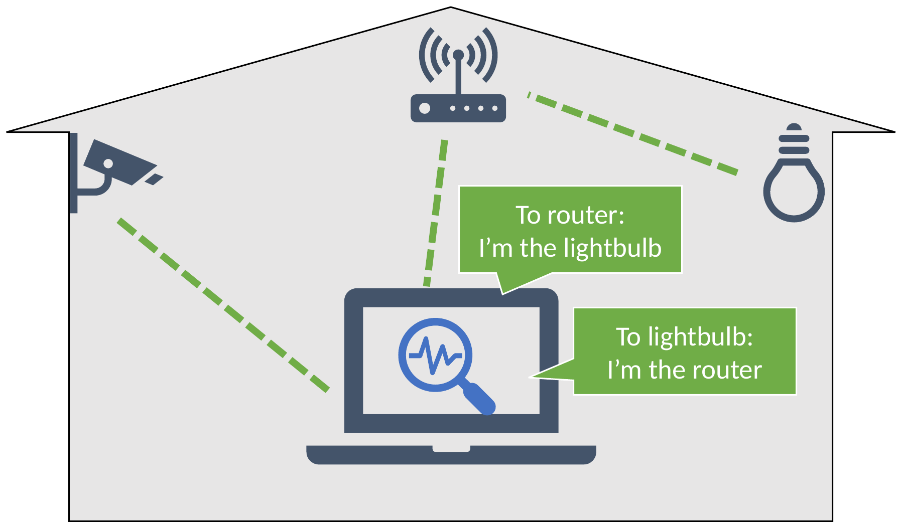{width="100%"}
:::
::: {.column width="40%"}
To router: *I'm the camera.* To camera: *I'm the router.*

To router: *I'm the lightbulb.* To lightbulb: *I'm the router.*

**Challenge**

Some IoT devices or routers do not accept spoofed ARP packets.
:::
:::

::: {.notes}
Three slides in the original: the camera spoofed, then the lightbulb, then the
challenge with a photo of a router that ignores spoofed ARP.

Recovered from the original deck; the two callouts appeared on successive
clicks, so say them in order. To the router: the lightbulb's IP is at my MAC.
To the lightbulb: the router's IP is at my MAC. Both now forward through the
laptop, which records and relays; the green dashed lines are the new paths,
and the same trick is played on the camera and every other device the user
selects. ARP (RFC 826) has no authentication, so neither side can tell. It is
the same primitive an attacker would use, run with the owner's consent on the
owner's network. Ask what it would take to make ARP safe (static tables,
802.1X, DHCP snooping on a managed switch) and why none of that exists on a
home router.
:::

## IoT Inspector Uses TCP Ack Numbers to Infer Traffic Rate

<!-- recovered from ppt-archive/10-IoT.pptx slide 107 -->
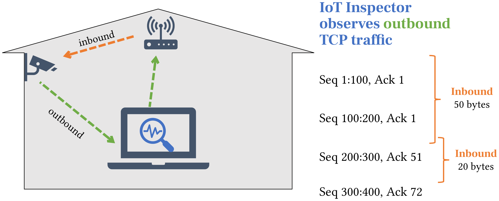{width="80%" fig-align="center"}

::: {.notes}
IoT Inspector observes outbound TCP traffic. Seq 1:100 Ack 1; Seq 100:200
Ack 1; Seq 200:300 Ack 51 (50 inbound bytes); Seq 300:400 Ack 72 (20 inbound
bytes).

Recovered from the original deck; the braces on the right built up one at a
time. Some routers accept the spoofed ARP in one direction only, so the tool
sees what the camera sends (green) but not what it receives (orange). Every
outbound TCP segment carries the camera's cumulative ACK number: Ack 1 to
Ack 51 means 50 inbound bytes arrived in between, Ack 51 to Ack 72 means 20
more. Differencing the ACKs over time gives the inbound data rate with no
inbound packets at all. It misses UDP and is coarse, but it is enough for the
bandwidth graph in the dashboard. Quick refresher on sequence and
acknowledgment numbers if the room needs it.
:::

## IoT Inspector: Usage Statistics

::: {.columns}
::: {.column width="55%"}
**IoT Inspector** (iot-inspector.princeton.edu)

<!-- recovered from ppt-archive/10-IoT.pptx slide 102 -->
{width="72%"}
:::
::: {.column width="45%"}
**Usage statistics**

- Publicly released in May '19
- 5k+ users worldwide
- 50k+ devices
  - Passive traffic
  - Device labels
  - Examples: smart TVs, plugs, lightbulbs, cameras, Tesla
:::
:::

## Design Goal: Generates Insights

::: {.columns}
::: {.column width="62%"}
<!-- recovered from ppt-archive/10-IoT.pptx slide 109 -->
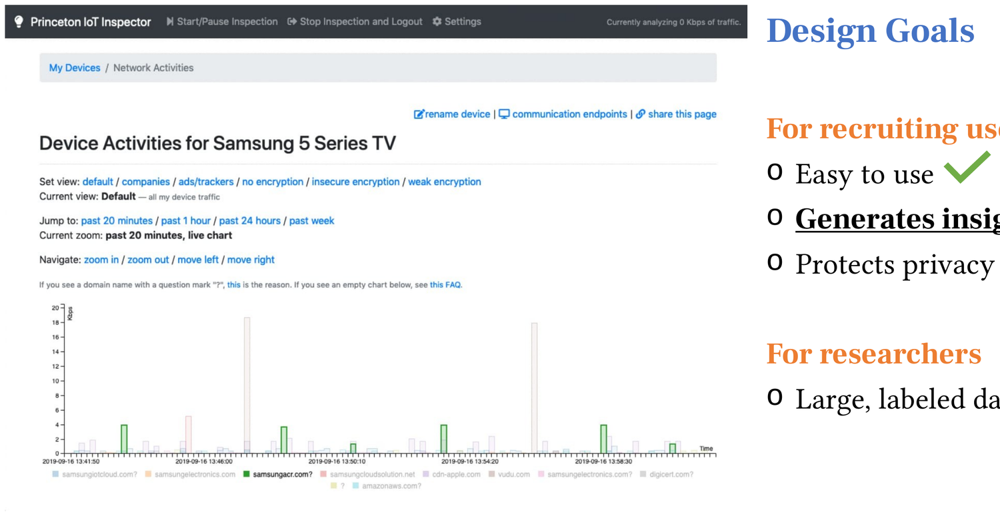{width="100%"}
:::
::: {.column width="38%"}
**Design Goals**

For recruiting users

- Easy to use ✓
- **Generates insights**
- Protects privacy

For researchers

- Large, labeled dataset
:::
:::

## Screenshot of IoT Inspector from a User: Science Friday

::: {.columns}
::: {.column width="60%"}
<!-- recovered from ppt-archive/10-IoT.pptx slide 110 -->
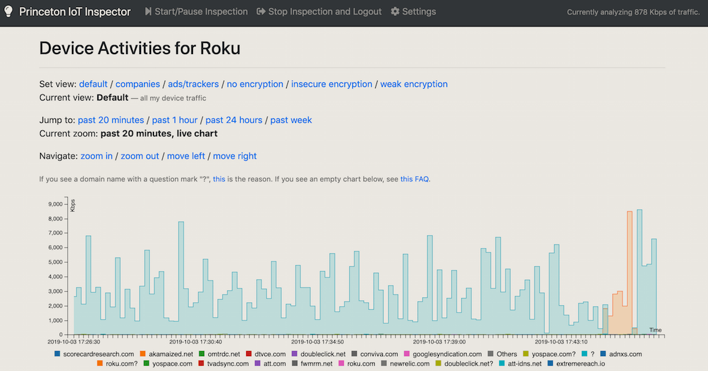{width="100%"}
:::
::: {.column width="40%"}
Ira Flatow, host of Science Friday (NPR):

> "Here is what the Princeton IoT Inspector tracked in a 20 minute time span on Ira's Roku."

(October 4, 2019)
:::
:::

::: {.notes}
This is the "aha" screenshot — Ira Flatow of Science Friday ran IoT Inspector
on his Roku in October 2019 and got exactly this graph on the air. A single
streaming session fans out to dozens of tracking domains: doubleclick,
scorecardresearch, Conviva, and more. Point at the "no encryption / insecure
encryption / weak encryption" view selectors at the top — the tool surfaces
TLS hygiene alongside third-party contact. This one image is worth a full
pause; students internalize that "my streaming stick" fans out to a whole
tracking ecosystem faster from the picture than from the numbers on the next
slide. Cold-call: which of these third-party domains do you recognize from
the web-tracking lecture?
:::

## Screenshot of IoT Inspector from a User: The Washington Post

::: {.columns}
::: {.column width="60%"}
<!-- recovered from ppt-archive/10-IoT.pptx slide 111 -->
{width="100%"}
:::
::: {.column width="40%"}
Geoffrey A. Fowler, technology columnist, The Washington Post:

> "Then using software from Princeton University called the IoT Inspector, I watched how each [TV] model transmitted data."

(September 18, 2019)
:::
:::

## Features of IoT Inspector

::: {.columns}
::: {.column width="40%"}
**Design Goals**

For recruiting users

- Easy to use ✓
- Generates insights ✓
- Protects privacy

For researchers

- Large, labeled dataset
:::
::: {.column width="60%"}
**Protects privacy**

- Trade-off between ease of use and abuse
- Detects non-IoT devices based on heuristics

**Large, labeled dataset**

- User encouraged to label devices
- 50k devices, 20% of devices labeled
:::
:::

## Findings from 50,000 Devices

::: {.columns}
::: {.column width="52%"}
**Privacy**

- Pervasive **third-party tracking** — even on a smart fridge (talks to Nielsen)
- **Smart TVs** routinely contact ad/tracking services
:::
::: {.column width="48%"}
**Security**

- **Ineffective encryption**: devices using TLS 1.0, or insecure cipher suites
  (one camera negotiated 13–21 weak suites)
- Plenty of **plaintext** still in the wild
:::
:::

The dashboard turns invisible network behavior into something a non-expert can *see* — and
gives researchers evidence that the problem is **systematic, not anecdotal**.

::: {.notes}
The whole point of the "at scale" framing: anecdotes don't move policy;
distributions do. "14.9% of smart TVs contact ad/tracking services" is the
kind of claim you can put in front of a regulator or a legislator. Note the
security findings too: TLS 1.0 in production, one camera negotiating 13–21
weak cipher suites, plenty of plaintext still in the wild. Segue: to know
what leaks (not just to whom), you need to decrypt — which motivates the
lab study on the next slide. Ask the room: which of these findings is a
security problem, which is a privacy problem, and which is both? Most are both.
:::

## Findings: Ineffective Encryption on IoT Devices

<!-- recovered from ppt-archive/10-IoT.pptx slide 113 -->
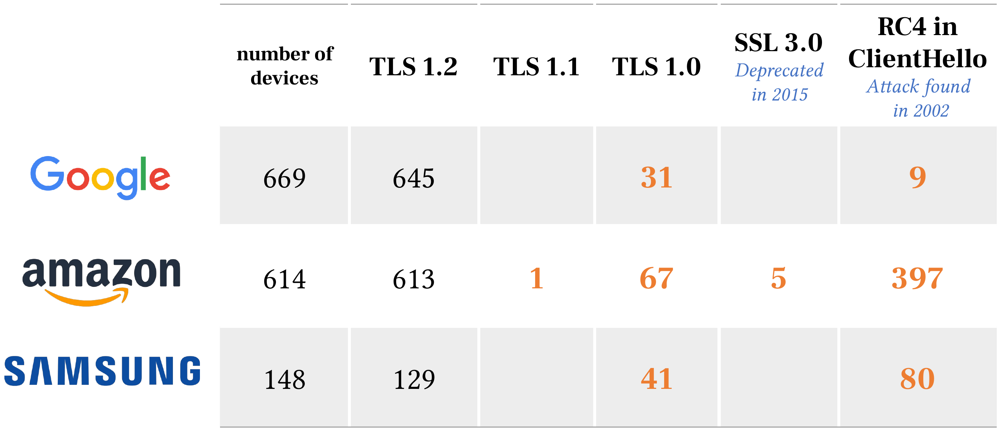{width="80%" fig-align="center"}

::: {.notes}
Number of devices, and how many offered TLS 1.2, 1.1, 1.0, SSL 3.0
(deprecated in 2015), and RC4 in the ClientHello (attack found in 2002):
Google 669 devices, 645 TLS 1.2, 31 TLS 1.0, 9 RC4; Amazon 614, 613, 1, 67,
5 SSL 3.0, 397 RC4; Samsung 148, 129, 41 TLS 1.0, 80 RC4.

Recovered from the original deck; no build. IoT Inspector records the TLS
ClientHello, so this is what each device offers before any negotiation:
TLS 1.0 from 31 Google, 67 Amazon, and 41 Samsung devices; SSL 3.0 from five
Amazon devices, deprecated in 2015 after POODLE; RC4, broken since 2002,
offered by 397 of 614 Amazon devices and 80 of 148 Samsung devices. Be
precise: offered, not necessarily negotiated. A server that refuses RC4
protects the device anyway, but a device that offers it is one downgrade away
from using it. Brand is no proxy for crypto hygiene. Segue to the lab study:
to know what is inside those connections you have to decrypt them, which is
the next part.
:::

## Finding: Smart TVs Communicate with 3rd-Party Ad/Tracking Services

<!-- recovered from ppt-archive/10-IoT.pptx slide 114 -->
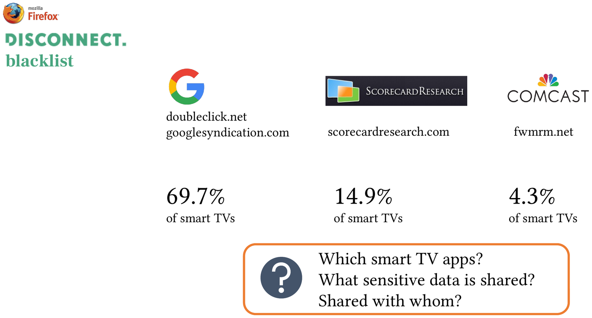{width="72%" fig-align="center"}

::: {.notes}
Against the Firefox Disconnect blacklist: 69.7% of smart TVs contact
doubleclick.net or googlesyndication.com, 14.9% scorecardresearch.com, 4.3%
fwmrm.net (Comcast FreeWheel). Which smart TV apps? What sensitive data is
shared? Shared with whom?
:::

## Opportunities for Further Research

<!-- recovered from ppt-archive/10-IoT.pptx slide 115 -->
{width="76%" fig-align="center"}

::: {.notes}
Device identification, anomaly detection, third-party identification,
healthcare; collaborators at Chicago, Illinois, Columbia, Carnegie Mellon,
NC State, and Northwestern.
:::

## Summary of IoT Inspector

<!-- recovered from ppt-archive/10-IoT.pptx slide 116 -->
{width="90%" fig-align="center"}

::: {.notes}
Built a system to gather empirical evidence of security and privacy threats
from 50k+ devices and 5k users. Empowers consumers with a simple tool; helps
journalists raise awareness; facilitates investigations to push for policy
changes; provides researchers with new insights. Which smart TV apps track
users? What sensitive data is shared, and with whom?
:::

## Summary of the Talk: Smart Home IoT Security & Privacy

<!-- recovered from ppt-archive/10-IoT.pptx slide 117 -->
{width="86%" fig-align="center"}

# Analyzing Tracking on Smart TVs {.center}

Hooman Mohajeri Moghaddam, Gunes Acar, Arunesh Mathur, Ben Burgess, Danny Yuxing Huang, Prateek Mittal, Nick Feamster, Arvind Narayanan, Edward Felten

ACM Conference on Computer and Communications Security (CCS), 2019

## Recap: Using IoT Inspector to Watch CBS

<!-- recovered from ppt-archive/10-IoT.pptx slide 119 -->
{width="80%" fig-align="center"}

::: {.notes}
What sensitive data is shared? From which smart TV apps? Shared with whom?
:::

## Challenges of Analyzing Smart TV Traffic in Lab

<!-- recovered from ppt-archive/10-IoT.pptx slide 121 -->
{width="82%" fig-align="center"}

::: {.notes}
Two slides in the original: a Roku behind a laptop running tcpdump, then the
SpotX request with the channel name, device make, IP address, movie title,
and device ID highlighted. How to analyze the traffic of channels at scale?
How to decrypt traffic?
:::

## Building a Smart TV Crawler

::: {.columns}
::: {.column width="45%"}
**Design Goals**

Automate TV interactions

- Install and launch channels (apps)
- Play videos

Detect privacy leaks

- Decrypt traffic
- Identify sensitive information
:::
::: {.column width="55%"}
**Challenges**

| | web & mobile | smart TV |
|---|---|---|
| Automation | known tools (Selenium, adb) | limited API |
| Decryption | allows changing root cert | prohibits changing root cert |
:::
:::

::: {.notes}
The engineering is the contribution: how do you watch a thousand apps
automatically when there's no Selenium for a TV? Audio detection as a
playback oracle is the clever bit — 96% accuracy, roughly 144 out of 150
trials. Decryption is the hard part; certificate pinning means TLS is often
unreadable to a MITM proxy. They rooted Fire TV and used Frida — the
dynamic-instrumentation toolkit — to defeat per-channel certificate pinning,
and still only decrypted at least one connection from about 5% of channels
on the harder platform. Be honest about that limitation when you present the
findings on the next slide. The methodological point matters: measurement
studies live and die on how believable the coverage numbers are.
:::

## Our Contributions

::: {.columns}
::: {.column width="45%"}
**Design Goals**

Automate TV interactions

- Install and launch channels (apps)
- Play videos

Detect privacy leaks

- Decrypt traffic
- Identify sensitive information
:::
::: {.column width="55%"}
**Contributions**

- Built general-purpose smart TV crawler
- First large-scale analysis of channels (Roku, Amazon)
- Sensitive info shared with 3rd-party ad/tracking services
- Tracking on children without consent (FTC)
:::
:::

## Automating Interactions with Smart TVs

<!-- recovered from ppt-archive/10-IoT.pptx slide 124 -->
{width="76%" fig-align="center"}

::: {.notes}
Design goals: automate TV interactions, install and launch channels, play
videos. Remote-control commands go to the stick; its HDMI output goes to an
HDMI capture card, which returns video and audio over USB; the stick's network
traffic goes through the laptop.

Recovered from the original deck; the arrows appeared one build step at a
time, so trace them: remote-control commands down to the stick, HDMI out to
the capture card, video and audio back over USB, network traffic through the
laptop. A web crawler gets the DOM, screenshots, and a network log for free;
for a device with no automation API all three had to be rebuilt from
hardware. The capture card is the key piece: without it the crawler is blind
and deaf and cannot tell whether a channel ever played anything, which is
what the next slide measures.
:::

## TV Crawler Interacting with a Single Channel

<!-- recovered from ppt-archive/10-IoT.pptx slide 125 -->
{width="62%" fig-align="center"}

::: {.notes}
The next slide in the original, "TV crawler interacting with channels," was a
video; it is not reproduced here.
:::

## Challenges of Automatic Interactions with Channels

::: {.columns}
::: {.column width="50%"}
**Navigating to video**

Sample 100 channels and find popular key sequences:

- [OK, OK, OK]
- [Down, OK, OK]
- [OK, OK, Down, OK, Down, OK]

Crawler brute-forces key sequences
:::
::: {.column width="50%"}
**Detecting video playback**

Detect at least 5 seconds of audio playback
:::
:::

## Detecting Video Playback

<!-- recovered from ppt-archive/10-IoT.pptx slide 129 -->
{width="84%" fig-align="center"}

::: {.notes}
Roku: audio detected (62%), of which a manual sample is correct (96%), the
rest false positives; no audio detected (38%), of which a manual sample shows
stuck (75%) and the rest no video.

Recovered from the original deck; the lower boxes appeared on successive
clicks. There is no API that says a video is playing, so the crawler listens
for five seconds of audio on the HDMI capture. On Roku, audio was detected in
62% of visits; a manual sample found 96% of those were real playback. Of the
38% with no audio, about three quarters were channels the brute-force
navigation got stuck in and the rest had no video to play. The honest
coverage number is what makes the tracker percentages on the later slides
believable. Ask what a channel could do to fool this oracle (silent video, a
menu with background music) and why no channel bothers.
:::

## Detecting Privacy Leaks

::: {.columns}
::: {.column width="42%"}
**Design Goals**

Automate TV interactions ✓

- Install and launch channels (apps)
- Play videos

**Detect privacy leaks**

- Decrypt traffic
- Identify sensitive information
:::
::: {.column width="58%"}
<!-- recovered from ppt-archive/10-IoT.pptx slide 131 -->
{width="100%"}
:::
:::

::: {.notes}
Man-in-the-middle the connection; set up a fake account. The original has a
transition slide (130) with the same design-goal list and "automate TV
interactions" checked off; it is folded in here.
:::

## Man-in-the-Middling Traffic

<!-- recovered from ppt-archive/10-IoT.pptx slide 132 -->
{width="82%" fig-align="center"}

::: {.notes}
Amazon: rooted device, changed to our certificate, used Frida to bypass
channel-level certificate pinning, decrypted almost all connections. Roku:
unable to root the device, so opportunistic man-in-the-middling: some servers
validate the cert and some do not; decrypted at least one connection from 5%
of the channels.
:::

## Findings: Ad/Tracking Companies

::: {.columns}
::: {.column width="50%"}
**Roku**

| | % channels |
|---|---|
| Google (DoubleClick) | 98% |
| Google Analytics | 36% |
| ScorecardResearch | 21% |
| SpotXchange | 21% |
| Innovid | 10% |
:::
::: {.column width="50%"}
**Amazon**

| | % channels |
|---|---|
| Crashlytics | 35% |
| Google (DoubleClick) | 31% |
| Google Analytics | 28% |
| Facebook | 20% |
| App-Measurement.com | 18% |
:::
:::

## Findings: Sensitive Data Shared with Ad/Tracking Services

::: {.columns}
::: {.column width="50%"}
**Roku**

| | % channels |
|---|---|
| Ad ID | 32% |
| Channel name | 20% |
| Serial number | 11% |
| Zip code | 1% |
| City or state | 1% |
:::
::: {.column width="50%"}
**Amazon**

| | % channels |
|---|---|
| Android ID | 39% |
| Ad ID | 22% |
| Serial number | 10% |
| MAC address | 5% |
| **Wi-Fi SSID** | **2%** |
:::
:::

## Privacy for Children?

<!-- recovered from ppt-archive/10-IoT.pptx slide 137 -->
{width="62%" fig-align="center"}

September 4, 2019. The "FTC and New York Attorney General allege that YouTube violated the COPPA Rule by collecting personal information, in the form of persistent identifiers that are used to track users across the Internet, from viewers of child-directed channels, without first notifying parents and getting their consent."

::: {.notes}
Anchor case: FTC and NY AG v. Google & YouTube, September 4, 2019 — a
record $170M COPPA settlement for collecting persistent identifiers from
viewers of child-directed channels without parental consent. The TV crawler
found the same pattern on streaming platforms. Follow-on IoT precedent: on
May 31, 2023 the FTC settled with Amazon over Ring and Alexa for $31M total —
Ring paid $5.8M for letting employees browse customer bedroom cameras; Alexa
paid $25M for indefinite retention of children's voice recordings, and Amazon
was barred from training models on data users deleted. This is the bridge to
the privacy-law lecture: a technical measurement finding maps directly onto a
legal regime (COPPA) and a concrete penalty. Cross-reference the companion
IoT breakout. Debate hook: is a $170M fine a deterrent, a cost of doing
business, or a subsidy for a regulator?
:::

## Findings: Privacy Leaks in Child-Directed Channels

<!-- recovered from ppt-archive/10-IoT.pptx slide 138 -->
{width="74%" fig-align="center"}

::: {.notes}
Number of channels: 1,882 Roku, 1,183 Amazon. Number of child-directed
channels: 470 and 220. Number of child-directed channels that leaked
persistent IDs: 34 and 23.

Recovered from the original deck; no build. Of the crawled channels, 470 on
Roku and 220 on Fire TV sat in the platforms' own kids categories; 34 and 23
of those sent a persistent identifier to a third party during one video play,
with no parental consent asked. The original slides say the team was
"working with the FTC for further investigations." Small absolute numbers,
but COPPA is strict about consent, and the platform's own category label is
what makes a channel child-directed. The YouTube $170M settlement on the
previous slide is the price of the same conduct on the web.
:::

## Examples of Persistent IDs in Child-Directed Channels: Amazon

<!-- recovered from ppt-archive/10-IoT.pptx slide 139 -->
{width="82%" fig-align="center"}

::: {.notes}
PBS Kids Video leaked the Android ID; Fun with Roblox by HappyKids.tv leaked
the Android ID and the serial number.
:::

## Examples of Persistent IDs in Child-Directed Channels: Roku

<!-- recovered from ppt-archive/10-IoT.pptx slide 140 -->
{width="82%" fig-align="center"}

::: {.notes}
PBS Kids and Nickelodeon on Roku each leaked the Ad ID and the serial number.
"We are currently working with the FTC for further investigations."
:::

## DNS-Based Block Lists May Cause Some Channels to Crash

<!-- recovered from ppt-archive/10-IoT.pptx slide 141 -->
{width="38%" fig-align="center"}

## Limited Ad Tracking (Roku) / No Interest-Based Ads (Amazon)

<!-- recovered from ppt-archive/10-IoT.pptx slide 142 -->
{width="80%" fig-align="center"}

## Finding: Channels Still Shared Persistent IDs Under "Limited Ads"

<!-- recovered from ppt-archive/10-IoT.pptx slide 145 -->
{width="84%" fig-align="center"}

::: {.notes}
Built up over three slides in the original: the empty table, the default
column (Roku Ad ID 30%, serial number 14%; Amazon Ad ID 35%, Android ID 69%,
serial number 33%, MAC address 3%), then the limited-ads column (Roku 0% and
13%; Amazon 16%, 65%, 24%, 3%).

Recovered from the original deck; no build. The crawl was repeated with the
two toggles on. Roku's Ad-ID sharing went from 30% to 0%, which is the one
thing the toggle does well, but serial-number sharing barely moved, 14% to
13%. On Fire TV, Ad-ID sharing halved, 35% to 16%, while the Android ID still
left from 65% of channels and serial number and MAC address were untouched.
The toggle governs the one identifier the platform mints and can reset; it
cannot reach the hardware identifiers that channels and their SDKs read for
themselves, and those are the ones that cannot be reset. This is the
technical core of the "opt-outs are theater" argument on the previous slide
and the hook for the debate.
:::

## The Opt-Outs Don't Really Work

Both platforms offer a privacy toggle — Roku's **"Limit Ad Tracking,"** Amazon's
**"No interest-based ads"** — marketed like Do-Not-Track.

The measurement verdict: **largely ineffective.**

- Channels **still shared persistent IDs** even with "limited ads" enabled
- Platform restrictions make it hard to block tracking with conventional tools; **DNS
  blocklists** (Pi-hole) can crash some channels
- **Previously unknown trackers** evade every standard filter list

**Takeaway:** individual self-help has sharp limits — meaningful protection needs
**regulation and platform-level defaults**, not buried toggles.

::: {.notes}
This is the policy punchline of the whole deck. The honest finding is that
the controls users are given — Roku's "Limit Ad Tracking" and Amazon's "No
interest-based ads" — are theater. Channels still shared persistent IDs even
with the toggles on; Pi-hole DNS blocking crashes some channels, and
previously unknown trackers evade every standard filter list. That hands you
the debate question: should the burden be on the consumer (notice-and-choice)
or on the platform/regulator (defaults plus enforcement)? Cross-reference the
IoT debate directly — this is the framing question. Tie to the privacy-law
unit: this is exactly the argument the CCPA GPC requirement was designed to
answer. Individual self-help has sharp limits when the platform is hostile.
:::

## A 2026 Vignette: States Go After Your TV {.smaller}

::: {.vignette}
On **December 15, 2025**, Texas AG Ken Paxton sued **five TV makers** — Samsung, Sony, LG,
Hisense, and TCL — over **Automatic Content Recognition (ACR)**: software that fingerprints
*everything on screen* (the complaints allege screenshots as often as **every 500 ms**, and
for one vendor "every sound and image every 10 ms") and sells the viewing data without
clear consent. A court issued the **first-ever TRO against a TV maker** two days later.
**Samsung settled Feb 26, 2026** (express consent, no fine); **LG settled May 11, 2026**
with an added no-transfer-to-CCP clause. Sony, Hisense, and TCL are still fighting.
**Kentucky** passed the first ACR-specific consent statute.
:::

This is the same finding the **2019** TV-crawler study made — now driving **state
enforcement** and **new statutes**.

::: {.notes}
This is the freshest hook and the strongest research-to-policy arc in the
course: an academic measurement result (your TV watches you) became, six years
later, a wave of AG lawsuits and the first ACR consent law. Timeline to say
out loud: Texas AG Ken Paxton sued Samsung, Sony, LG, Hisense, and TCL on
December 15, 2025; a court issued the first-ever TRO against a TV maker
(Hisense) two days later; Samsung settled February 26, 2026 with express
consent and no fine; LG settled May 11, 2026 with an added no-transfer-to-CCP
clause; Sony, Hisense, and TCL are still fighting as of mid-2026. Kentucky
passed the first ACR-specific consent statute. The precedent to recall is
the Vizio $2.2M FTC and NJ settlement, February 2017. Ask: why did it take
state AGs, not the FTC, this time? Connect to the state-vs-federal privacy
patchwork you'll see in Meeting 11.
:::

## Summary of Tracking on Smart TVs

Built Smart TV Crawler, a system to gather empirical evidence of privacy threats from smart TVs

- Automatic interactions with channels at scale
- Man-in-the-middling (decrypting) channel traffic

First large-scale analysis of smart TV channels

- Channels shared sensitive info with 3rd-party ad/tracking services
- Potential violations of online privacy laws for children

Working with FTC for further investigation

## Putting It Together {.smaller}

::: {.columns}
::: {.column width="50%"}
**Security**

- IoT lacks **isolation** — a web page can discover and control devices on your LAN
- Old attacks (DNS rebinding) work because devices have **no auth, no TLS, no Host checks**
:::
::: {.column width="50%"}
**Privacy**

- **Pervasive tracking** + weak/absent encryption across devices and streaming platforms
- **User-facing privacy controls are largely ineffective**
:::
:::

**Method matters:** measurement systems (**IoT Inspector** in the wild, the **TV crawler**
in the lab) turn anecdotes into evidence — and evidence is what moves **regulators**.

::: {.notes}
Land the three threads. First: the LAN must be treated as untrusted, because a
web page can discover and control devices on it. Second: the tracking economy
followed us from web to mobile to home to TV, and the same handful of firms
show up at every layer. Third: the contribution that lets you say anything
policy-relevant is measurement at scale. Preview the privacy-law and
consumer-protection lectures where these findings become legal arguments.
Regulatory horizon worth naming: the EU Cyber Resilience Act came into force
December 10, 2024, with reporting duties from September 11, 2026 and full
obligations December 11, 2027; connected toys are Class I "important products
with digital elements." The EU AI Act, as amended by the June 2026 "Digital
Omnibus on AI," brings AI-enabled toys under its high-risk regime with
application dates now August 2, 2027 and December 2, 2027. U.S. side: the
U.S. Cyber Trust Mark is a voluntary label, not a mandate. Cross-reference
the IoT debate as the discussion prompt for this arc.
:::

# Discussion {.center}

**Thought question:** you can't make your smart TV stop running ACR, and the opt-out
doesn't work. Where *should* the obligation sit — the **device maker**, the **platform**,
the **ISP/router**, or the **regulator**? Defend your answer.

::: {.notes}
Frame this as the debate seed for the IoT breakout later this week. Each of the
four candidate loci has a real argument. Device makers know the hardware and set
the defaults, but consumers can't credibly discipline them through market choice.
Platforms sit closest to the tracking, but the platform is often also the ad
seller. ISPs and router vendors could segment the LAN, but that shifts cost to
consumers who didn't ask for it. Regulators can set floors — see the Texas AG
Samsung and LG settlements from earlier in the deck — but move slowly and
patchwork. Encourage the class to defend one and steelman the strongest
objection. The purpose of the exercise is to sit with the fact that there is
no obviously right answer, only a set of trade-offs — which is exactly why the
policy landscape looks so uneven right now.
:::

