## From Law on the Books to Law in Action {.center}

A privacy statute grants rights. But do those rights **actually work**
when a consumer tries to exercise them on a real website?

This lecture moves from **what the law says** (CCPA / CPRA) to **what
measurement finds**, and the gap between them.

::: {.notes}
Frame the whole class as the gap between text and practice. The privacy-law meeting
taught the FIPPs and the structure of US privacy law; this one asks the empirical
question: when the law says "you have a right to opt out," can you actually do it?
Two studies from our own group answer that: Van Tran et al. at CHI 2024 measured
whether the link even appears, and the follow-on 1,000-site study measured whether the
request actually resolves. Cold-call to open: raise your hand if you have ever
successfully completed a "Do Not Sell" opt-out on any site. Very few hands. Flag now
that dark-pattern categories are exam material. Point at the hands-on Web Tracking
activity as the do-it-yourself version of these studies.
:::

# Study 1: Measuring Compliance with the California Consumer Privacy Act Over Space and Time {.center}

Van Tran, Aarushi Mehrotra, Marshini Chetty, Nick Feamster, Jens Frankenreiter,
Lior Strahilevitz

::: {.notes}
Title slide of the first study (University of Chicago; Jens Frankenreiter at
Washington University in St. Louis). The study measures, from five US states over
seven months, whether websites actually show the opt-out link that the CCPA requires.
:::

## Where Does Our Data Go?

<!-- recovered from ppt-archive/12-Compliance.pptx slide 2 -->
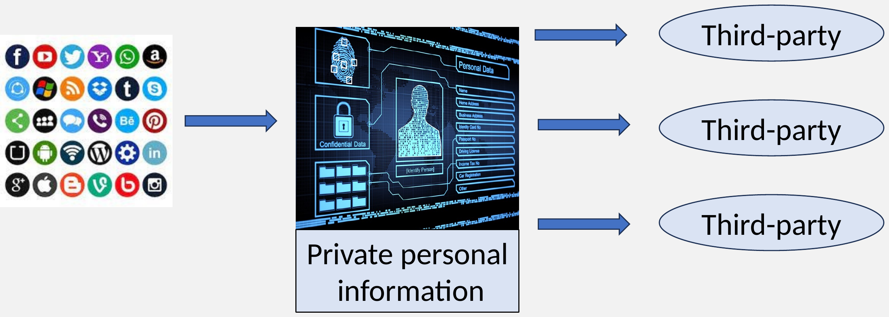{width="85%"}

- Sites and apps collect **identifiers**, **browsing history**, **preferences**;
  that data is **sold or shared** with third parties, often without **explicit consent**

::: {.notes}
Every day, we spend hours browsing on the internet. That also means that the websites
and apps that we use can collect vast amounts of our private personal data, including
our identifier information and other information such as browsing history, opinions,
and preferences. Often, the data collected does not just stay within the website or
app but is sold or shared with third parties to generate profits for these businesses.
This practice could be done without explicit user consent.

Teaching points: the business model of the modern web is data flowing outward to third
parties in real-time bidding. If you want a live demo, open nytimes.com with the
dev-tools Network tab open and count the third-party requests to Google, Meta, Amazon,
LiveRamp, OpenX in the first few seconds. The whole point of an opt-out right is to
give the consumer a lever on that outward flow. Ask the room: what would it take for
that lever to be real, a link? a working link? a signal your browser sends
automatically? That question sets up GPC later in the deck.
:::

## Potential Harms to Consumers

- Targeted advertising
- Consumer profiling
- Manipulation & influence
- Data breaches & identity theft

These are the harms the **right to opt out of sale/sharing** is meant to blunt.

::: {.notes}
The onward flow of personal data gives rise to many potential harms to consumers:
targeted advertising, consumer profiling, manipulation and influence, data breaches
and identity theft.

Teaching points: the FTC's 2024 Social Media Report, "A Look Behind the Screens", is
the canonical inventory of targeting, profiling, and manipulation aimed at teens;
Cambridge Analytica is still the sharpest manipulation example students recognize by
name. The opt-out right is a narrow lever aimed at exactly these harms, but only for
"sale" and "sharing"; it does not touch first-party collection or use, a common
misconception worth pre-empting now. Ask: which of these four harms would you actually
pay to avoid?
:::

## The California Consumer Privacy Act

- Signed **2018**; went into effect in **January 2020**
- Consists of **6 important privacy rights**, including the **right to opt out of
  sale** of personal information, the cornerstone provision
- Strengthened by the **California Privacy Rights Act (CPRA)**, passed 2020, which
  went into effect in **January 2023**
- CPRA extended opt-out to **sharing** (not just sale), created a **sensitive
  personal information** category, and was the **first US law to explicitly ban
  dark patterns**

::: {.notes}
The CCPA was introduced in 2018 to give California consumers more control over their
personal information. It went into effect in 2020 and consists of six important
privacy rights, including the right to opt out of the sale of personal information.
The CPRA aims to strengthen the CCPA and went into effect in January 2023. It extends
the right to opt out to include not just sale but also sharing of personal
information, revises the criteria for who is subject to the CCPA, and treats sensitive
personal information as a separate category.

Teaching points: watch the dates, they are commonly garbled and matter for the
empirical study. CCPA signed 2018, effective January 1, 2020. CPRA passed by ballot
initiative in November 2020, effective January 1, 2023; that date is the inflection
point in the RQ1 time series. "Sale" versus "share" matters because most third-party
tracking is technically sharing for cross-context behavioral advertising, not a cash
sale: a site that says "we don't sell" may still be sharing. CPRA also created the
California Privacy Protection Agency, the first US privacy-only regulator. We use
"CCPA" loosely for the whole CCPA+CPRA framework. Cold-call: why did California, and
not Congress, produce the first comprehensive US privacy law?
:::

## Who Is Subject to the CCPA?

Any **for-profit** entity that does business in California and satisfies **at
least one** of the following thresholds:

1. Annual gross revenues **> \$25 million**
2. Buy or sell **or share** personal information of **≥ 100,000** Californian
   consumers *(before the CPRA: buy or sell personal information of ≥ 50,000)*
3. **> 50%** of annual revenue from selling consumer personal data

::: {.notes}
The original slide builds: threshold 2 first reads "buy or sell personal information
of at least 50,000 Californian consumers" (the pre-CPRA rule), then is replaced on a
click by "buy or sell or share personal information of at least 100,000 Californian
consumers". Both versions are on this slide.

Teaching points: students garble which threshold is which. Thresholds 2 and 3 use
data that is not public, how many California consumers a site touches and what
fraction of revenue comes from selling data. That matters directly for RQ4, where the
researchers have to approximate coverage from outside using for-profit status, revenue
estimates, and headquarters location; "likely subject to CCPA" is a proxy, not a
determination. Cold-call: how would you decide from the outside whether a mid-sized
regional news site is covered? Often you cannot, which is itself part of the
enforcement gap.
:::

## Opt-out Methods

::: {.columns}
::: {.column width="40%"}
**Before CPRA:**

- *Do Not Sell My Personal Information*
:::
::: {.column width="60%"}
**After CPRA (any of the three):**

- *Do Not Sell or Share My Personal Information*
   plus *Limit the Use of My Sensitive Personal Information*
- *Your Privacy Choices*
  {height="1.1em" style="vertical-align:middle"}
- Frictionless opt-out preference signals (**GPC**), disclosed in the privacy policy
:::
:::

The link must sit in the **header or footer**; the icon is required with the
*Privacy Choices* wording.

::: {.notes}
Before the CPRA, websites were required to implement a link titled "Do Not Sell My
Personal Information" at the header or footer of the webpage. After the CPRA went into
effect, websites should no longer use that link; instead they have a few alternative
options. First, they can implement a link titled "Do Not Sell or Share My Personal
Information" at the header or footer. Because the CPRA distinguishes sensitive personal
information from general personal information, a business that processes sensitive
personal information must also implement a "Limit the Use of My Sensitive Personal
Information" link beside it. Alternatively, they can implement an alternative opt-out
link, "Your Privacy Choices", with the opt-out icon next to it, in lieu of the two
links. Finally, they can choose to honor frictionless opt-out preference signals:
signals the user's browser sends directly to the website to communicate opt-out
preferences. Depending on the browser, users may have to do different things to invoke
the signal: DuckDuckGo sends it automatically; Firefox requires changing a privacy
setting; Chrome requires installing a GPC extension. In this study we focus on
measuring the "Do Not Sell or Share My Personal Information" link and the "Privacy
Choices" link, which we call "the opt-out link", the more common opt-out method.

Teaching points: this slide is the rubric for "compliant appearance". The CCPA
regulations at 11 CCR §7014 specify the exact wording, the blue toggle icon, and the
header-or-footer placement, unusually prescriptive by American privacy-law standards.
That prescriptiveness is what makes automated measurement feasible: the statute hands
the researchers the keywords their crawler searches for. Cold-call: which of the three
paths would you pick to minimize compliance burden, and which to maximize user rights?
:::

## Global Privacy Control (GPC): Opt Out Once

- A **browser-level signal** that broadcasts "do not sell or share" to every site
- The **frictionless** alternative: opt out once, not site-by-site
- Invocation differs by browser: **built-in** (DuckDuckGo, Firefox setting) vs.
  **extension** (Chrome)
- Sites need not notify the user it was honored, but **must disclose** GPC support
  in the privacy policy

::: {.notes}
GPC is the technologist's answer to per-site opt-out fatigue: a browser-emitted HTTP
header and DOM property specified at globalprivacycontrol.org. Turn it on once and
every site you visit sees it. The Sephora settlement in September 2022 was the first
CCPA enforcement action to explicitly turn on GPC as the required signal; the AG's
press release named "failure to honor GPC" as a violation. Colorado's and
Connecticut's privacy laws now also require honoring universal opt-out mechanisms.
The disclosure-in-privacy-policy rule is what lets researchers measure GPC support at
scale, however imperfectly. Demo suggestion for the discussion slide at the end:
enable Firefox's or DuckDuckGo's GPC toggle live, then load a site and see if behavior
changes. Cold-call: if GPC works, why do sites still bother with per-site links at all?
:::

## A 2026 Enforcement Wake-Up Call {.smaller}

::: {.vignette}
California is now enforcing the *practice*, not just the *paperwork*. On **Feb 11,
2026**, AG Rob Bonta announced a **\$2.75M** settlement with **Disney** for failing
to honor opt-out preference signals (including **GPC**) across its streaming
services
([CA AG, Feb 11, 2026](https://oag.ca.gov/news/press-releases/california-wont-let-it-go-attorney-general-bonta-announces-275-million)).
On **May 8, 2026**, that record was eclipsed by a **\$12.75M** settlement with
**General Motors**, the largest CCPA penalty to date, and the first CCPA action
built on **data minimization and purpose limitation**, for selling OnStar
drivers' location and behavior data to LexisNexis and Verisk without notice or
consent
([CA AG, May 8, 2026](https://oag.ca.gov/news/press-releases/when-it-comes-data-privacy-consumers-must-be-driver%E2%80%99s-seat-attorney-general)).
These follow earlier actions against **Healthline (\$1.55M, Jul 2025)**,
**Sephora**, **DoorDash**, and **Sling TV**.
:::

Regulators are explicit: they care whether consumer choices **actually work**
across real tech stacks, not "paper compliance."

::: {.notes}
Freshest hook of the deck and it ties directly to both studies. The Disney case
(Feb 11, 2026, $2.75M) turned on fragmented opt-out: each streaming app, each device
required a separate opt-out, and GPC was not honored across services. Anticipate
Disney's defense: identity-based opt-out was "technically impossible." AG Bonta
rejected that flatly; quote the press release: "if a business can associate a
consumer's devices with the consumer for advertising purposes, it can and must
associate those devices with the consumer for honoring opt-out rights." The GM case
(May 8, 2026, $12.75M) is bigger and different: the first CCPA action on data
minimization and purpose limitation, both CPRA additions effective 2023. OnStar
collected precise geolocation, hard-braking, seatbelt, and speed data and sold it to
LexisNexis and Verisk for insurance rate-setting, $20M in unconsented data-broker
sales from 2020 to 2024. Healthline ($1.55M, July 2025) was the record until Disney;
Sephora, DoorDash, Sling TV are the earlier line. Cold-call: why is a $12.75M fine
still small relative to the data economy, and would $128M change behavior? What does
"paper compliance" mean, and how would a regulator detect it at scale? That last
question is exactly what the two studies answer.
:::

## Research Questions {.smaller}

- **RQ1:** How does the implementation of the CCPA's opt-out requirements change
  over time?
- **RQ2:** Are websites complying with the CCPA's opt-out requirements?
- **RQ3:** Do the businesses that implement the opt-out link for the sale and
  sharing of personal data also let non-Californian consumers opt out?
- **RQ4:** Do businesses that fail to provide opt-out links on their home page
  offer other opt-out methods, or are they not subject to the CCPA?

::: {.notes}
To the best of our knowledge, our work is one of the first to measure the impact of
the CPRA on the behavior of businesses. Understanding whether the CPRA has an impact
can help policy makers and law enforcement make better decisions about how to protect
consumers' privacy. RQ1: how has the implementation of the CCPA's opt-out requirements
changed over time? Interesting because the CPRA revised the criteria for who is
subject to the CCPA, so we would like to see whether this affects the number of
websites implementing the opt-out link. RQ2: are websites complying with the CCPA's
opt-out requirements? The appearance of the link cannot say exactly whether a website
fully meets the requirements, but because the CCPA and CPRA differ in what the link
must look like, we can see whether websites are at least modifying its appearance.
RQ3: can non-Californians exercise the opt-out as California residents can? If
websites extend the opt-out right even to states where they do not have to, it might
be more beneficial for consumers to pass stringent state privacy laws than a weaker
national law. RQ4: do businesses that fail to provide the link on their home page
offer other opt-out methods, or are they not subject to the CCPA at all?

Teaching points: RQ3 is the policy-interesting one; if firms extend California rights
to non-California users anyway, that weakens the case for a single federal privacy law
and strengthens the "California effect" argument that strong state law sets a de facto
national floor. Route the omnibus-federal-law debate here if it comes up. RQ4,
coverage estimation, is the methodologically hardest. Preview the arc: RQ1 shows
things getting better over time; RQ2 shows appearance still fails; RQ3 shows
spillover; RQ4 shows an irreducible fraction just does not comply at all.
:::

## Outline {visibility="hidden"}

- **A.** Vantage Point & Dataset Selection
- **B.** Methodology
- **C.** Findings
- **D.** Limitations

::: {.notes}
The outline of the first study: dataset and vantage-point selection, methodology,
findings, and limitations.
:::

## A. Vantage Point & Dataset Selection

| Vantage point | State privacy law in effect |
|---|---|
| **CA** | 1/1/2020 |
| **VA** | 1/1/2023 |
| **CO** | 7/1/2023 |
| **UT** | 12/31/2023 |
| **IL** | No state-specific privacy law |

::: {.notes}
We conduct our measurements from five vantage points. California's CCPA went into
effect on January 1, 2020. Virginia, Colorado, and Utah also have state privacy laws
resembling the CCPA, but they went into effect on different dates. There are also
differences between these laws and the CCPA: unlike the CCPA, which specifies exactly
how businesses should implement the opt-out method, these laws only require businesses
to disclose and offer consumers a method to opt out, without specifying what the method
should be. This may allow businesses to offer opt-out methods that are difficult to
execute. Finally, we include Illinois, a state with no state-specific privacy law, as a
contrast vantage point, to see the spillover effects of the CCPA on states where
websites do not have to offer any opt-out method at all.

Teaching points: the five-state design is the clever methodological move. California
is the treatment; Virginia, Colorado, and Utah are a natural pre/post experiment on
top of it; Illinois is the control (it has BIPA for biometrics but no comprehensive
law, so a link appearing to an Illinois vantage point is spillover, not compliance).
:::

## A. Vantage Point & Dataset Selection {visibility="hidden"}

- Measured **twice per month** from **1/2023 to 7/2023**
- **1016** unique websites

::: {.notes}
For each state, we measured twice per month from January 2023 to the end of July
2023. Our dataset consists of 1016 unique websites, taken from a popular website
ranking site. We selected top websites from 80 categories to create a diverse set.
The seven-month window straddles the CPRA effective date.
:::

## B. Methodology {visibility="hidden"}

<!-- recovered from ppt-archive/12-Compliance.pptx slide 11 -->
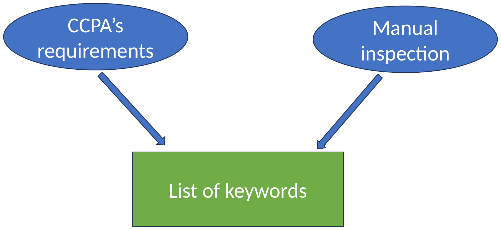{width="60%"}

::: {.notes}
From the requirements of the CCPA, we first came up with a list of keywords to identify
the opt-out link. To make sure we do not miss opt-out links just because they use
different wording, we also did a manual check in January 2023 and augmented the list
of keywords with the opt-out wordings we found. The statute handing us the exact
phrases ("Do Not Sell or Share My Personal Information", "Your Privacy Choices") is
what makes this automatable at all; a vague statute would defeat the whole method.
:::

## B. Methodology {.smaller visibility="hidden"}

<!-- recovered from ppt-archive/12-Compliance.pptx slide 12 -->
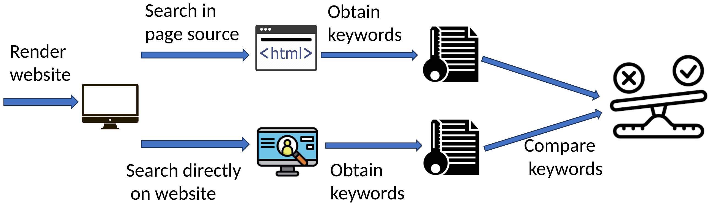{width="88%"}

- Render each site, then search for the keywords **two ways**: in the raw **page
  source** and **on the rendered page** (screenshot + OCR); compare the two keyword
  lists and send disagreements to a human
- Why both? Some links exist only in the rendered DOM; others only in the source

::: {.notes}
We measure the presence of the opt-out link over time based on the list of keywords.
The original slide builds this pipeline in stages; walk it left to right. We first
render each website using Selenium. Next we search the page source for elements with
tag names such as anchor, span, button, and so on that contain the keywords. One
limitation: some websites implement the opt-out link as a dynamic element, so the link
cannot always be found in the page source; examples on the next slides. In addition, we
search directly on the rendered website using the browser's search bar. For each
keyword searched, we capture a screenshot, crop out the search bar, and convert the
image to text with an OCR library; from that text we infer whether the keyword is
present. We then compare the keywords found by the two approaches, and manually check
when they disagree. Cold-call: if you could only afford one path, which would you pick,
and what kind of site would you systematically miss?
:::

## Verify Methods {visibility="hidden"}

::: {.columns}
::: {.column width="50%"}
**False positive cases**

> We **do not sell** OEM (Original Equipment Manufacturer) cartridges on this
> website.

> … your settings **and privacy choices**, and to support our marketing and sales
> efforts.
:::
::: {.column width="50%"}
**False negative cases**

> My Privacy and Ad Choices

> Your California Privacy Rights
:::
:::

::: {.notes}
To verify our method, we randomly chose a date, manually checked each website from the
California vantage point on that date, and compared the results against those from our
method. This yielded two false positive cases and two false negative cases, shown here.
:::

## Verify Methods {visibility="hidden"}

::: {.columns}
::: {.column width="50%"}
**2 cases** present in page source but not in screenshot

:::
::: {.column width="50%"}
**14 cases** present in screenshot but not in page source

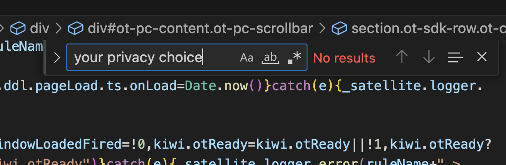
:::
:::

::: {.notes}
In addition, there were two cases where the page source had the link but the
screenshot did not (for example, a link with display:none), and fourteen cases where
the screenshot had the link but the page source did not (a dynamically injected
element that a search of the page source does not find). This is why both detection
paths exist.
:::

## Outline {visibility="hidden"}

- A. Vantage Point & Dataset Selection
- B. Methodology
- **C. Findings**
- D. Limitations

::: {.notes}
To answer these research questions, we now turn to the findings.
:::

## Research Questions {.smaller visibility="hidden"}

- [**RQ1:** How does the implementation of the CCPA's opt-out requirements change
  over time?]{style="color:#c00000"}
- **RQ2:** Are websites complying with the CCPA's opt-out requirements?
- **RQ3:** Do the businesses that implement the opt-out link for the sale and
  sharing of personal data also let non-Californian consumers opt out?
- **RQ4:** Do businesses that fail to provide opt-out links on their home page
  offer other opt-out methods, or are they not subject to the CCPA?

::: {.notes}
We are really interested in whether and how much impact these privacy laws have on
websites. First, how has the implementation of the CCPA's opt-out requirements changed
over time, especially after the CPRA went into effect? Next, are the implementations
of the opt-out links meeting the requirements of the CCPA? Next, although the CCPA
only requires businesses to offer opt-out rights to California consumers, are
non-California consumers benefiting from the CCPA? Last, what are the reasons for the
absence of the opt-out links? (In the original talk, RQ2 was skipped for time.)
:::

## RQ1: How Does the Implementation of the Opt-Out Requirements Change Over Time? {.smaller}

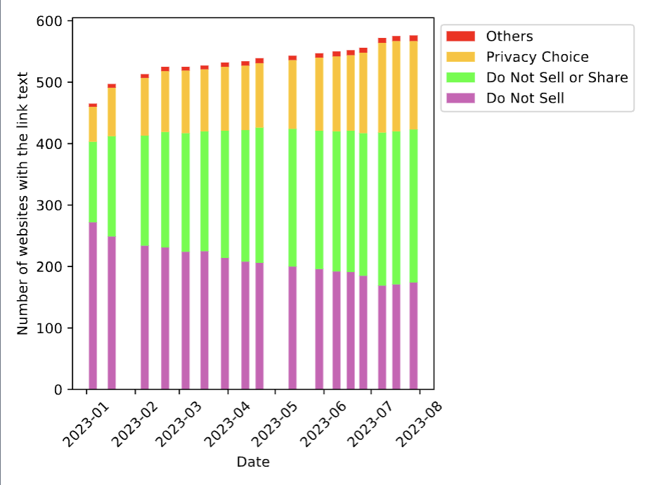{width="62%"}

**Websites are increasingly but not fully complying with the CCPA's requirements.**
The outdated *"Do Not Sell"* wording shrinks; compliant wordings grow, with a jump
around **Jan 2023** (CPRA).

::: {.notes}
For the first question, we see that the number of websites where the opt-out link has
been seen increases over time, and the increase is more pronounced around January 2023
than in other months. We also see a decrease in the number of websites using the
outdated terminology "Do Not Sell My Personal Information" and an increase in the
number with CCPA-compliant wordings such as "Do Not Sell or Share My Personal
Information" or "Privacy Choices". Websites are increasingly, but not fully, complying
with the CCPA's opt-out requirements.

Teaching points: the visible inflection in January 2023 is the CPRA effective date;
some sites migrated wording immediately, others took six months or more. Ask: why the
lag? The paper's discussion names small e-commerce and regional media as slow movers.
Cold-call: what does it say about a site that took 200 days to change three words on
its footer? This measures only whether the link exists with the right wording, not
whether it is in the right place, has the icon, or works.
:::

## Research Questions {.smaller visibility="hidden"}

- **RQ1:** How does the implementation of the CCPA's opt-out requirements change
  over time?
- [**RQ2:** Are websites complying with the CCPA's opt-out requirements?]{style="color:#c00000"}
- **RQ3:** Do the businesses that implement the opt-out link for the sale and
  sharing of personal data also let non-Californian consumers opt out?
- **RQ4:** Do businesses that fail to provide opt-out links on their home page
  offer other opt-out methods, or are they not subject to the CCPA?

::: {.notes}
Now the second research question: are websites complying with the CCPA's opt-out
requirements? Checking compliance involves several steps: whether the opt-out link is
present; if present, whether it meets the requirements for how it should look; and
whether the link is actually functional and the opt-out process meets the
requirements. Checking whether the link is functional is very challenging, because
websites implement their opt-out processes very differently. In this study we focus on
whether the link is present and whether its appearance meets the requirements. This is
the first step toward checking the other requirements: if websites fail this first
step, it is unlikely they fulfil the others.
:::

## Opt-out Methods {visibility="hidden"}

::: {.columns}
::: {.column width="40%"}
**Before CPRA:**

- *Do Not Sell My Personal Information*
:::
::: {.column width="60%"}
**After CPRA (any of the three):**

- *Do Not Sell or Share My Personal Information*
   plus *Limit the Use of My Sensitive Personal Information*
- *Your Privacy Choices*
  {height="1.1em" style="vertical-align:middle"}
- Frictionless opt-out preference signals (**GPC**)
:::
:::

::: {.notes}
Recap of the requirements before the RQ2 result. The CCPA spells out clearly how the
opt-out link should look. It should be placed at the header or footer of the website.
It should be titled "Do Not Sell or Share My Personal Information" or "Your Privacy
Choices". If it is titled "Your Privacy Choices", it also needs the opt-out icon next
to it.
:::

## RQ2: Are Websites Complying With the CCPA's Opt-Out Requirements? {.smaller}

::: {.columns}
::: {.column width="64%"}
<!-- recovered from ppt-archive/12-Compliance.pptx slide 20 -->
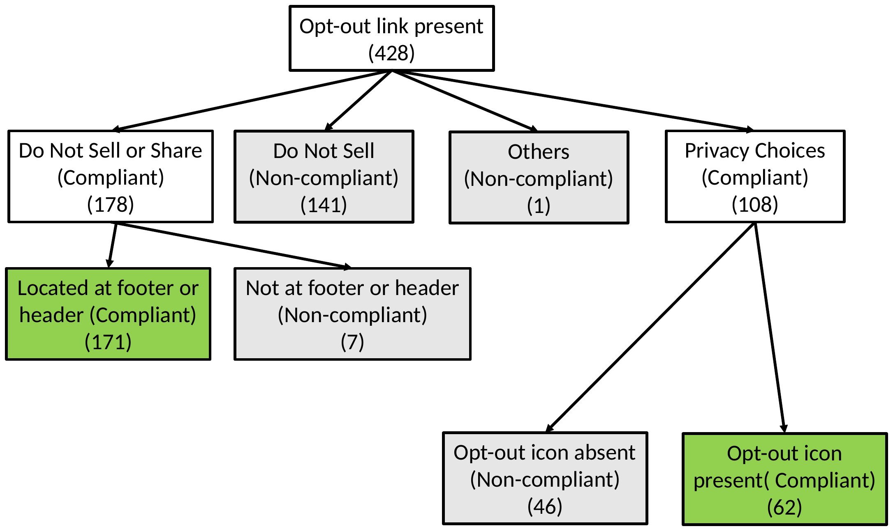
:::
::: {.column width="36%"}
- Opt-out link present: **428** (CA, July 2023)
- *Do Not Sell or Share* (compliant): 178, of which 171 at footer or header
  (compliant) and 7 not (non-compliant)
- *Privacy Choices* (compliant): 108, of which 62 with the opt-out icon
  (compliant) and 46 without (non-compliant)
- *Do Not Sell* (non-compliant): 141; others (non-compliant): 1
- Green leaves: 171 + 62 = **233** fully compliant

**~45% fail to comply fully with the CPRA's requirements.**
:::
:::

::: {.notes}
To check whether websites meet the requirements for the appearance of the opt-out
link, we manually visited each website that had the link on July 10, 2023 from the
California vantage point, and successfully accessed 428 of them. By this date, 142
websites, over 30% of websites with the link, still used the outdated wording "Do Not
Sell My Personal Information" or non-compliant wordings. A few websites using the "Do
Not Sell or Share" wording fail the requirement on the location of the link. And over
40% of websites using the "Privacy Choices" wording fail to implement the opt-out icon
next to the link. Overall, 45% of websites that implement the opt-out link fail to
comply fully with the CPRA's requirements for its appearance. The original slide
reveals the 45% callout on a click, after walking the tree.

Teaching points: walk the tree top down so students see how the 45% is computed
rather than take it on faith: wording first, then placement for the "Do Not Sell or
Share" branch, then the icon for the "Privacy Choices" branch; only the two green
leaves survive every test. Each test is cheap and mechanical, which is why a crawler
can do it, and none says anything about whether the link works. If a site cannot get
the cosmetic requirements right, it is unlikely to nail the functional ones; that is
what motivates Study 2. Cold-call: what drives a site to keep the outdated "Do Not
Sell" wording 190 days into the CPRA? Vendor template not updated, no compliance
staff, or a bet that enforcement is unlikely. Which single rule change would move the
most sites into the green?
:::

## Research Questions {.smaller visibility="hidden"}

- **RQ1:** How does the implementation of the CCPA's opt-out requirements change
  over time?
- **RQ2:** Are websites complying with the CCPA's opt-out requirements?
- [**RQ3:** Do the businesses that implement the opt-out link for the sale and
  sharing of personal data also let non-Californian consumers opt out?]{style="color:#c00000"}
- **RQ4:** Do businesses that fail to provide opt-out links on their home page
  offer other opt-out methods, or are they not subject to the CCPA?

::: {.notes}
Next, we are interested in whether businesses that implement the opt-out link also let
non-California consumers opt out. Checking this involves several steps: whether the
link is present from a non-California vantage point, and, if it is, whether a
non-Californian can successfully opt out just like a California resident. That is
again a challenging task, so we use the presence of the opt-out link as a potential
indication that non-California consumers can benefit from the CCPA.
:::

## RQ3: Do Businesses That Implement the Opt-Out Link Also Let Non-Californians Opt Out? {.smaller}

::: {.columns}
::: {.column width="58%"}
<!-- recovered from ppt-archive/12-Compliance.pptx slide 22 (chart state, before the table overlay) -->
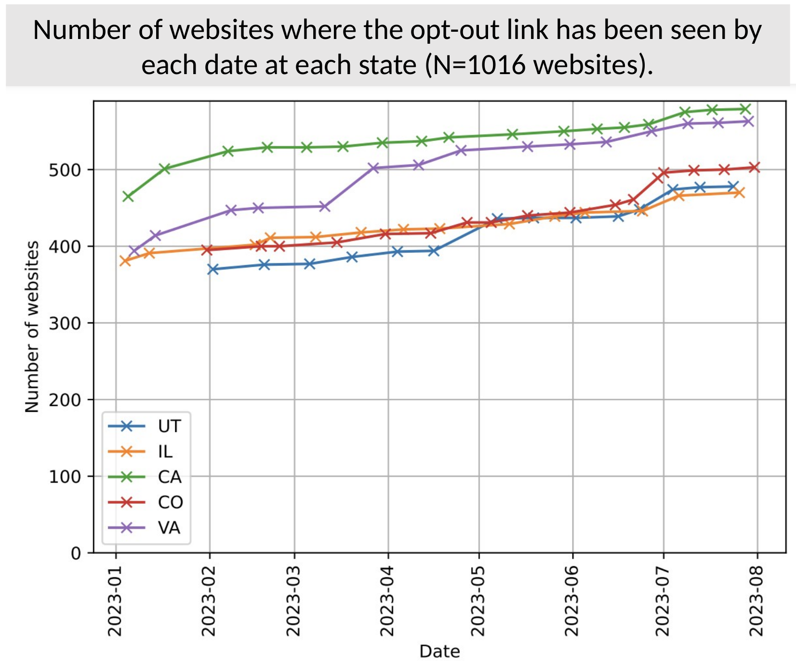{width="88%"}
:::
::: {.column width="42%"}
Privacy-law dates marked on the original slide:

- **CA:** January 2020 (before the window)
- **VA:** January 2023 (start of the window)
- **CO:** July 2023 (end of the window)
- **UT:** December 2023 (after the window)
:::
:::

::: {.notes}
To see whether websites extend the opt-out right to non-California consumers, we plot
the number of websites with the opt-out link seen by each date, for each vantage
point. The number increases for all states. California always has the largest number,
followed by Virginia; Virginia starts to catch up with California around April 2023.
Colorado and Utah were slightly behind Illinois in the early months of 2023, but from
May onward Colorado takes the lead among the three, with Utah behind it. The original
slide builds the four law-date annotations one click at a time, then replaces the chart
with the table on the next slide.
:::

## RQ3: Do Businesses That Implement the Opt-Out Link Also Let Non-Californians Opt Out? {.smaller visibility="hidden"}

::: {.columns}
::: {.column width="58%"}
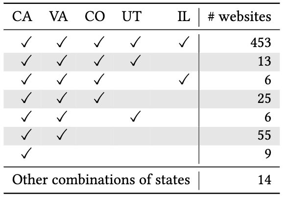
:::
::: {.column width="42%"}
**453 (78%)** of websites that implement the opt-out link in CA also implement it
across **all states**, **including Illinois, which has no privacy law**.

Strong evidence of **spillover**: it is often cheaper to comply everywhere.
:::
:::

::: {.notes}
Now we look at each website closely to see which states it implements the opt-out link
for. The majority implement the link across all five states, including Illinois, which
has no state-specific privacy law. About 10% of websites that implement the link in
California implement it only in California and Virginia. 25 websites implement it only
in states where the privacy laws were in effect, and 13 in states that have privacy
laws. Although we have not looked at whether the presence of the link in non-California
states really means non-California residents can successfully opt out, it suggests that
non-Californians potentially benefit from the spillover effects of the CCPA.

Teaching points: this is the policy-load-bearing result. An Illinois resident cannot
legally demand the opt-out; the site shows it anyway because the marginal cost of
geo-gating is higher than the cost of complying nationwide. This is the "Brussels
effect" applied to interstate US privacy law: a strong state law can set a de facto
national floor, and it is the empirical anchor for the "do we need a federal privacy
law?" debate. Caveat before students overread it: a visible link in Illinois does not
prove an Illinois resident can complete the opt-out; the site may reject the request on
residency grounds once submitted. That gap is exactly what Study 2 investigates.
:::

## Research Questions {.smaller visibility="hidden"}

- **RQ1:** How does the implementation of the CCPA's opt-out requirements change
  over time?
- **RQ2:** Are websites complying with the CCPA's opt-out requirements?
- **RQ3:** Do the businesses that implement the opt-out link for the sale and
  sharing of personal data also let non-Californian consumers opt out?
- [**RQ4:** Do businesses that fail to provide opt-out links on their home page
  offer other opt-out methods, or are they not subject to the CCPA?]{style="color:#c00000"}

::: {.notes}
Last research question: do businesses that fail to provide opt-out links on their
home page offer other opt-out methods, or are they not subject to the CCPA?
:::

## Frictionless Opt-Out Preference Signals {.smaller}

::: {.columns}
::: {.column width="56%"}
<!-- recovered from ppt-archive/12-Compliance.pptx slide 24 -->
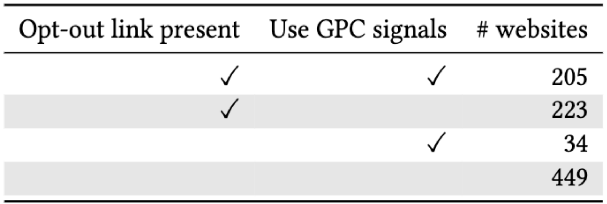
:::
::: {.column width="44%"}
Checked with the DuckDuckGo browser (sends GPC) on each site's **front page**,
**opt-out page** (after clicking the opt-out link), and **privacy policy**, N=911:

- **205** offer a link *and* say they honor GPC; **34** honor GPC with no link
  (a legal path post-CPRA); **223** link only; **449** neither
- GPC support is read from the **privacy-policy disclosure**, not by sending the
  signal: what sites *claim*, not what they *do*
:::
:::

::: {.notes}
Besides offering an opt-out link, websites can choose to honor opt-out preference
signals in a frictionless manner, so we want to know how often the signals are
implemented and which websites implement them. Websites are not required to notify
users whether a signal was honored, but they are required to say in their privacy
policy that they respect opt-out preference signals; so we treat any mention of GPC
signals as an attempt to respect them. We manually browsed each website using the
DuckDuckGo browser, which automatically sends an opt-out preference signal to every
website, and noted every notification and mention of GPC on the front page, the opt-out
page, and the privacy policy. Because this is manual and time-consuming, we did it
once, on July 10, 2023, at the end of the measurement period, when the CPRA had clearly
taken effect and become enforceable. Of 911 websites successfully visited from the
California vantage point, opt-out preference signals are not as popular as opt-out
links: about 23% implement both, 25% only the opt-out link, and about 4% only GPC. Only
a small percentage of websites implement the signal in place of the link. The original
slide shows the three boxes (front page, opt-out page, privacy policy) first and
replaces them with the table on a click.

Teaching points: 239 of 911 sites disclose honoring GPC, about 26%; 428 show a link,
matching the RQ2 denominator; the 449 with neither are the RQ4 population. Stress the
caveat: this is disclosure, not behavior; actually sending the GPC header and watching
whether tracking changes is a different experiment, and it is exactly what the Disney
settlement turned on. Cold-call: design the experiment that checks whether a disclosed
GPC promise is kept.
:::

## Who Is Subject to the CCPA? {visibility="hidden"}

Any **for-profit** entity that does business in California and satisfies **at
least one** of the following thresholds:

1. Annual gross revenues **> \$25 million**
2. Buy or sell or share personal information of **≥ 100,000** Californian consumers
3. **> 50%** of annual revenue from selling consumer personal data

::: {.notes}
A reminder of who is subject to the CCPA before the RQ4 result: for-profit businesses
that conduct business in California and satisfy at least one of the three criteria.
:::

## RQ4: Do Businesses Without an Opt-Out Link Offer Other Methods, or Are They Not Subject to the CCPA? {.smaller}

::: {.columns}
::: {.column width="58%"}
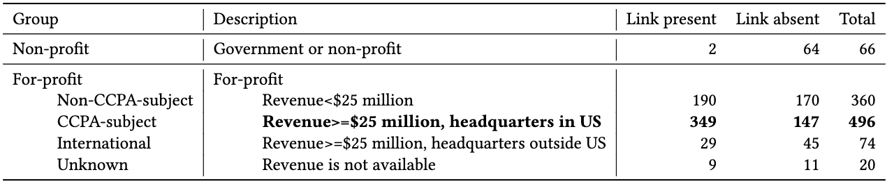
:::
::: {.column width="42%"}
**147 (30%)** of websites that are **likely subject to the CCPA** still do **not**
implement the opt-out link.

Coverage is estimated from outside (for-profit status, revenue, headquarters), because
the statute's thresholds use non-public data.
:::
:::

::: {.notes}
We first categorize websites by the likelihood that they are subject to the CCPA.
Websites subject to the CCPA are for-profit businesses that conduct business in
California and satisfy at least one of the three criteria: annual gross revenue of at
least 25 million dollars, buying or selling personal information of at least 100,000
California consumers, or deriving at least 50% of annual revenue from selling
consumers' personal information. Not all of this information is public; the number of
California consumers or the share of revenue from selling personal information is
often unavailable. So we based our categorization on other information: whether the
business is for-profit, its annual revenue, and its headquarters location. A
significant number of websites implement the opt-out link although they may not be
subject to the CCPA, including non-profits and for-profits with revenue under 25
million dollars. On the flip side, among websites that are likely CCPA-subject, 147
still do not implement the link, and we want to investigate why.

Teaching points: from outside, willful evasion and honest oversight are often
indistinguishable. Cold-call: if you were a state AG with 20 investigators, how would
you pick which 30 sites to open files on out of these 147? That is the concrete
enforcement-triage question.
:::

## Reasons for Potential Non-Compliance {.smaller}

::: {.columns}
::: {.column width="56%"}
<!-- recovered from ppt-archive/12-Compliance.pptx slide 27 -->
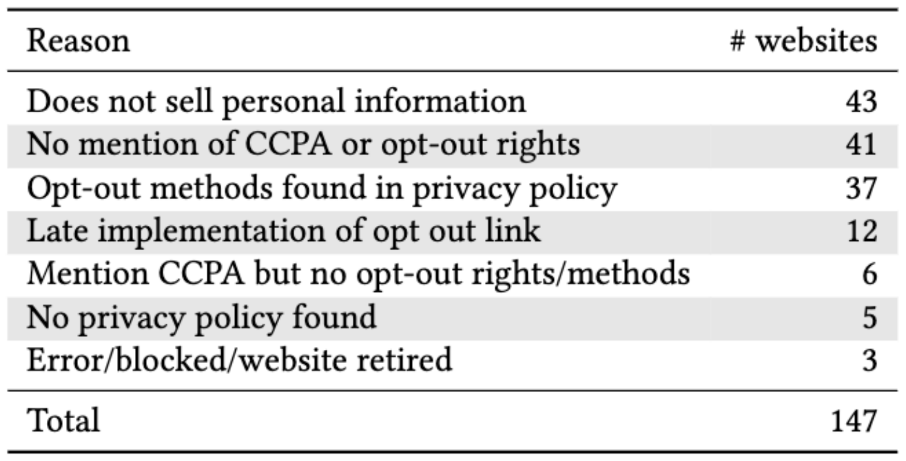
:::
::: {.column width="44%"}
- **43** say they "don't sell": a pre-CPRA defense that CPRA's *sharing* language
  closes
- **41** never mention the CCPA; **6** mention it but give no method
- **37** bury the method in the privacy policy (email, phone, form), which fails
  the header/footer rule
- **12** added the link late in the window

**Reasons for failure to comply with the CCPA are varied and ambiguous.**
:::
:::

::: {.notes}
To investigate potential non-compliance among these CCPA-subject websites, we manually
looked at their privacy policy pages. 43 websites claim that they do not sell personal
information; note that if they share personal information, they may still be subject
to the CCPA. 41 do not mention the CCPA or opt-out rights at all. Some offer other
opt-out methods such as an opt-out form, sending an email, or making a phone call.
Overall, the reasons for failure to comply with the CCPA are varied and still have a
lot of ambiguity.

Teaching points: "does not sell" was a plausible exemption under the 2020 CCPA, but
the CPRA extended the opt-out to sharing for cross-context behavioral advertising,
which nearly every ad-supported site does, so most of those 43 are probably wrong
about their own status. The 41 that never mention the CCPA are either not covered or
not paying attention; from outside you cannot tell. The 37 with a method buried in the
privacy policy are the most interesting enforcement target: they are trying, but the
statute requires a link in the header or footer. Cold-call: which row would you
prioritize as a regulator with limited staff, and why?
:::

## D. Limitations {visibility="hidden"}

- Presence of the opt-out link does **not** mean it is functional or compliant
  with the CCPA.
- Presence of the opt-out link at a non-CA vantage point does **not** mean
  non-CA residents can exercise opt-out rights.

::: {.notes}
We acknowledge that our study can suffer from several limitations. The presence of an
opt-out link does not mean it is functional or compliant with the CCPA. And the presence
of an opt-out link at a non-California vantage point does not mean non-California
residents can exercise opt-out rights.

The original deck keeps the full talk script in this slide's notes. Lightly cleaned:

Every day, we spend hours browsing on the internet. This means websites and apps are
collecting vast amounts of our private personal data, including identifier
information, browsing history, opinions, and preferences. Often the data does not stay
within the website but is sold or shared with third parties to generate more profit,
which gives rise to many potential harms: targeted advertising, consumer profiling,
manipulation and influence, data breaches and identity theft. The CCPA was introduced
in 2018 to give California consumers more control over their personal information. It
went into effect in 2020 and consists of six privacy rights, including the right to opt
out of the sale of personal information. The CPRA strengthens the CCPA and went into
effect in January 2023: it extends the opt-out right to sharing, revises who is subject
to the CCPA, and separates sensitive personal information. The old CCPA required a "Do
Not Sell My Personal Information" link; under the CPRA firms instead have three
options: a "Do Not Sell or Share My Personal Information" link at the top or bottom of
the site, an alternative "Privacy Choices" link with the opt-out icon, or respecting
opt-out preference signals (which must be mentioned in the privacy policy). We use
"opt-out link" for the first two. Four research questions: how the implementation
changes over time; whether websites comply; whether non-California consumers get the
opt-out too; and why links are missing. We measured from five states (Virginia,
Colorado, and Utah have laws resembling the CCPA with different effective dates;
Illinois has none and is the contrast) on 1016 websites, twice a month from January to
the end of July 2023. Method: a keyword list from the CCPA's wording plus manual
additions; render each site with Selenium; search the page source for anchor, button,
and span elements containing the keywords; also search the rendered page; compare and
manually resolve disagreements. Findings: the number of sites with the link rises over
time, steeper around January 2023, with outdated wording shrinking and compliant
wording growing; websites are increasingly but not fully complying. Across the five
states the count rises everywhere; California leads, Virginia closes the gap around
April 2023; Illinois led Utah and Colorado early in 2023 but by May and June Colorado
leads, then Utah, then Illinois; 78% of sites with the link in California show it in
all examined states. For RQ4, coverage uses for-profit status, headquarters, and
revenue because consumer counts and revenue shares are not public; many sites not
subject to the CCPA still show the link (non-profits, revenue under 25 million), while
30% of likely-subject sites do not. From their privacy policies: 43 claim not to sell
(which may exempt them from the old CCPA but not the CPRA, which covers sharing), 41
do not mention the CCPA or opt-out rights, and 37 describe opt-out methods in the
privacy policy that may not be acceptable (an embedded form, a phone call, an email).
Reasons are varied and ambiguous and need more investigation. Limitations as on the
slide. Summary: increasing but incomplete compliance; most sites with the link in
California show it everywhere; 30% of likely-subject sites have no link, for varied and
ambiguous reasons.
:::

## Summary {.smaller}

| Research question | Finding |
|---|---|
| **RQ1:** How does the implementation of the CCPA's opt-out requirements change over time? | Websites are increasingly but not fully complying with the CCPA's requirements. |
| **RQ2:** Are websites complying with the CCPA's opt-out requirements? | 45% fail to meet the requirements for the appearance of the opt-out link. |
| **RQ3:** Do businesses that implement the opt-out link also let non-Californian consumers opt out? | 453 (78%) websites that implement the opt-out link in CA also implement it across all states. |
| **RQ4:** Do businesses that fail to provide opt-out links offer other opt-out methods, or are they not subject to the CCPA? | 147 (30%) websites likely subject to the CCPA still do not implement the link; reasons are varied and ambiguous. |

::: {.notes}
Restate the four questions with their answers. First, how has the implementation of
the CCPA's opt-out requirements changed over time, especially after the CPRA went into
effect: increasing but not full compliance. Next, are the implementations meeting the
requirements: 45% fail on appearance alone. Next, are non-California consumers
benefiting from the CCPA: 78% of sites that show the link in California show it in all
five states. Last, the reasons for the absence of the link: 30% of likely-subject
sites have none, for varied and ambiguous reasons.
:::

## Future Direction {visibility="hidden"}

- Automatically measure whether opt-out methods are **functional**? Contain **dark
  patterns**?
- Measure whether the **spill-over effects** are "real"?
- How to measure whether websites are really **fulfilling their promise**?

::: {.notes}
Define what spill-over is: effects of the law outside its jurisdiction. The three
directions here are exactly what the second study takes up: whether the opt-out
actually works, and what dark patterns stand in the way.
:::

# Study 2: Dark Patterns in the Opt-Out Process and Compliance with the California Consumer Privacy Act (CCPA) {.center}

Van Tran, Aarushi Mehrotra, Marshini Chetty, Nick Feamster, Jens Frankenreiter,
Lior Strahilevitz

::: {.notes}
Title slide of the second study. Where the first study asked whether the link exists,
this one actually submits opt-out requests and follows them for two months.
:::

## Beyond the Link: Does Opt-Out Actually Work?

- Study 1 asked: **is there a link, and does it look right?**
- Study 2 asks: **can a real consumer actually complete the opt-out?**
- **Dark patterns** = manipulative interfaces that trick, deceive, or confuse users
  into acting against their own interest
- CPRA is the **first US law to explicitly ban** them in consent/opt-out flows

::: {.notes}
Conceptual bridge. Dark patterns, Harry Brignull's coinage, formalized in Gray et al.
"The Dark (Patterns) Side of UX Design," CHI 2018, are manipulative interfaces that
trick, deceive, or confuse users into acting against their own interest. CPRA was the
first US law to explicitly ban them in consent and opt-out flows, at 11 CCR §7004.
Connect back to informed consent from the ethics meeting: consent obtained through
deception is not meaningful consent; law and ethics overlap squarely here. The
paradigmatic modern enforcement example is the FTC's Amazon Prime "Iliad" settlement
in September 2024, about $2.5B, for the multi-page dark-pattern cancellation flow.
Cold-call: what's the difference between a dark pattern and just a bad UI? The answer
usually surfaces intent and asymmetry: the design privileges one outcome over another.
:::

## Summary of Findings {.smaller visibility="hidden"}

- **RQ1: Can consumers successfully exercise their opt-out rights?**
  Nearly 30% of the attempted opt-out requests could not be submitted, did not
  succeed, or had unclear status updates.
- **RQ2: What does it take for a consumer to submit an opt-out request? Do
  opt-out processes violate CCPA requirements?**
  The opt-out process varies widely depending on website categories, opt-out
  control methods, and third-party platforms handling the opt-out process on
  behalf of the websites. Some sites allow submission with just a few clicks,
  while others require a lengthy process and significant personal information.
- **RQ3: What types of dark patterns are used in the opt-out process? Are they
  violating CCPA requirements, or exploiting loopholes the CCPA has not addressed?**
  Multiple types of dark patterns are found in the opt-out process. Although some
  are clearly prohibited by the CCPA, others are not explicitly addressed by it.
- **RQ4: What are the characteristics of the websites that employ dark patterns?**
  Most websites implement at least one type of dark pattern. Sites with different
  opt-out control methods and third-party platforms tend to exhibit different
  types of dark patterns.

::: {.notes}
The findings up front, one per research question; the same slide closes the study.
:::

## The California Consumer Privacy Act (CCPA) {.smaller visibility="hidden"}

- Enacted in **2018**, a significant stride in US consumer privacy protection law
- The **right to opt out of sale/sharing** is a cornerstone provision
- CCPA-subject businesses are required to provide consumers with a method to opt out
- However, businesses often implement **dark patterns**: manipulative user
  interfaces designed to trick, deceive, or confuse users into taking actions that
  benefit businesses rather than the consumer
- This makes it difficult for consumers to opt out

::: {.notes}
The CCPA, enacted in 2018, is a significant stride in US consumer privacy law, and the
right to opt out of sale or sharing is its cornerstone. Businesses subject to it must
provide an opt-out method. But businesses often implement dark patterns, manipulative
interfaces designed to trick, deceive, or confuse users into actions that benefit the
business rather than the consumer, which makes it difficult to opt out.
:::

## The California Privacy Rights Act (CPRA) {visibility="hidden"}

- Went into effect in **January 2023**
- Introduces additional clarifications on opt-out requirements and **explicitly
  prohibits dark patterns**
- The **first US law to explicitly ban dark patterns**

::: {.notes}
However, questions remain about the law's effectiveness in preventing websites from
using these tactics. Since the CCPA serves as the overarching statutory framework
encompassing both the CCPA and the CPRA, we use the term "CCPA" to refer to the
comprehensive set of privacy regulations, including the opt-out requirements. (The
original slide said "January 2021"; the CPRA became operative on January 1, 2023, as
the first study's slides say.)
:::

## CCPA Opt-Out Requirements {.smaller visibility="hidden"}

> "at minimum, allow consumers to submit requests to opt-out of sale/sharing through
> an opt-out preference signal and at least one of the following methods: an
> interactive form accessible via the 'Do Not Sell or Share My Personal Information'
> link, the Alternative Opt-out link, or the business's privacy policy if the business
> processes an opt-out preference signal in a frictionless manner"

::: {.notes}
To implement the opt-out right, businesses subject to the CCPA that collect personal
information online shall, "at minimum, allow consumers to submit requests to opt out of
sale/sharing through an opt-out preference signal and at least one of the following
methods: an interactive form accessible via the 'Do Not Sell or Share My Personal
Information' link, the Alternative Opt-out link, or the business's privacy policy if
the business processes an opt-out preference signal in a frictionless manner." In this
study we use "opt-out link" for the opt-out method via the "Do Not Sell or Share" link
and the alternative opt-out link. Previous studies have noted that the opt-out process
via the link is often burdensome, and that websites implement the link more often
than frictionless preference signals, so this study focuses on the process via the
link.
:::

## Research Questions {.smaller visibility="hidden"}

1. Can consumers successfully exercise their opt-out rights?
2. What does it take for a consumer to submit an opt-out request?
3. What types of dark patterns are used in the opt-out process? Are these dark
   patterns violating CCPA requirements, or are they exploiting loopholes that have
   not been addressed by the CCPA?
4. What are the characteristics of the websites that employ dark patterns?

::: {.notes}
Specifically, we ask four questions: whether consumers can successfully exercise their
opt-out rights; what it takes to submit a request; what dark patterns appear in the
process and whether they violate the CCPA or exploit loopholes; and what characterizes
the websites that use them.
:::

## Outline {visibility="hidden"}

- Dataset selection
- Method
- Findings
  - Opt-out process
  - Dark patterns
- Discussion
- Summary

::: {.notes}
Outline of the second study.
:::

## Dataset Selection {.smaller visibility="hidden"}

::: {.columns}
::: {.column width="60%"}
<!-- recovered from ppt-archive/12-Compliance.pptx slide 38 -->
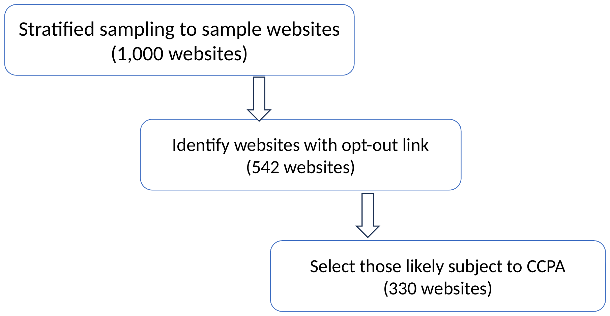
:::
::: {.column width="40%"}
- Stratified sample → **1,000** sites
- **542** have an opt-out link
- **330** likely subject to the CCPA → studied
- **Submit a real opt-out request** on each; track and **follow up for two months**
- Measure clicks, info required, control method, and dark patterns present
:::
:::

::: {.notes}
A three-step funnel: stratified sampling of 1,000 websites; 542 of them have an
opt-out link; 330 of those are likely subject to the CCPA and are the ones studied.

Teaching points: the methodological leap of Study 2 is to actually submit the
opt-out rather than look at the link. Each request uses a unique synthetic identity
per site, so a confirmation email weeks later can be matched to the exact request.
Flag the research-ethics dimension aloud: a mystery-shopper study with synthetic
identities; the typical IRB posture treats public-website interaction with no human
subjects as minimal-risk, but it is worth pausing on. Foundational prior work: Habib
et al., "'It's a scavenger hunt': Usability of Websites' Opt-Out and Data Deletion
Choices," CHI 2020.
:::

## Method {visibility="hidden"}

::: {.columns}
::: {.column width="33%"}
**Opt-out metrics & dark patterns taxonomy development**
:::
::: {.column width="33%"}
**Data collection & labelling**
:::
::: {.column width="34%"}
**Follow-up process**
:::
:::

::: {.notes}
For the methodology: we explain how we chose the dataset; then how we came up with
metrics to describe the opt-out process and the dark patterns present in it; then the
data collection and labelling process; and finally how we followed up on each opt-out
request.
:::

## Opt-Out Metrics {visibility="hidden"}

- **Number of clicks**
- **Personal information required**
- **Opt-out control methods**

::: {.notes}
In January 2024 we conducted a pilot study on 100 websites randomly sampled from the
330, to develop metrics for characterizing the opt-out process and dark patterns.
Three control methods. Browser opt-out: after clicking the opt-out link, consumers can
select opt-out options, such as toggling off data sharing or sale, without providing
any personal details; we call it "browser opt-out" since it likely uses a browser-based
method, not personal details, to identify users. Opt-out form: consumers must fill out
a form requiring personal information such as name, email address, phone number, or
mailing address; this typically involves multiple steps, including submitting the form
and possibly confirming via email. Both: consumers must use browser opt-out in addition
to completing a form with personal information.
:::

## Opt-Out Control Methods {visibility="hidden"}

- **Browser opt-out**: toggle off sale/sharing; **no personal info** required
  (often a pop-up via a third party like OneTrust)
- **Opt-out form**: must supply **name, email, phone, address**; multi-step,
  often with email confirmation
- **Both**: browser toggle **and** a form

The more personal info required, the more friction, and the more room for **dark patterns**.

::: {.notes}
Three control methods with very different friction profiles. Browser opt-out, usually
delivered by a third-party vendor like OneTrust, is consumer-friendly: no personal
info, a toggle in a pop-up, done. Forms require name, email, phone, sometimes address,
and often demand email-link confirmation before the opt-out takes effect. The more
personal info a site demands to opt out, the more friction and the more room for dark
patterns, including the identity-verification pattern where sites demand a driver's
license or high-school test scores to prove you are who you say you are. Set up the
irony coming later: many sites pay OneTrust or a similar vendor to be compliant and
are still out of compliance: misconfiguration, no functional testing, corner-case dark
patterns baked into the vendor UI. The EU analogue is IAB Europe's Transparency and
Consent Framework, itself found unlawful by the CJEU in 2024.
:::

## Opt-Out Control Methods {.smaller visibility="hidden"}

::: {.columns}
::: {.column width="34%"}
**Browser opt-out**

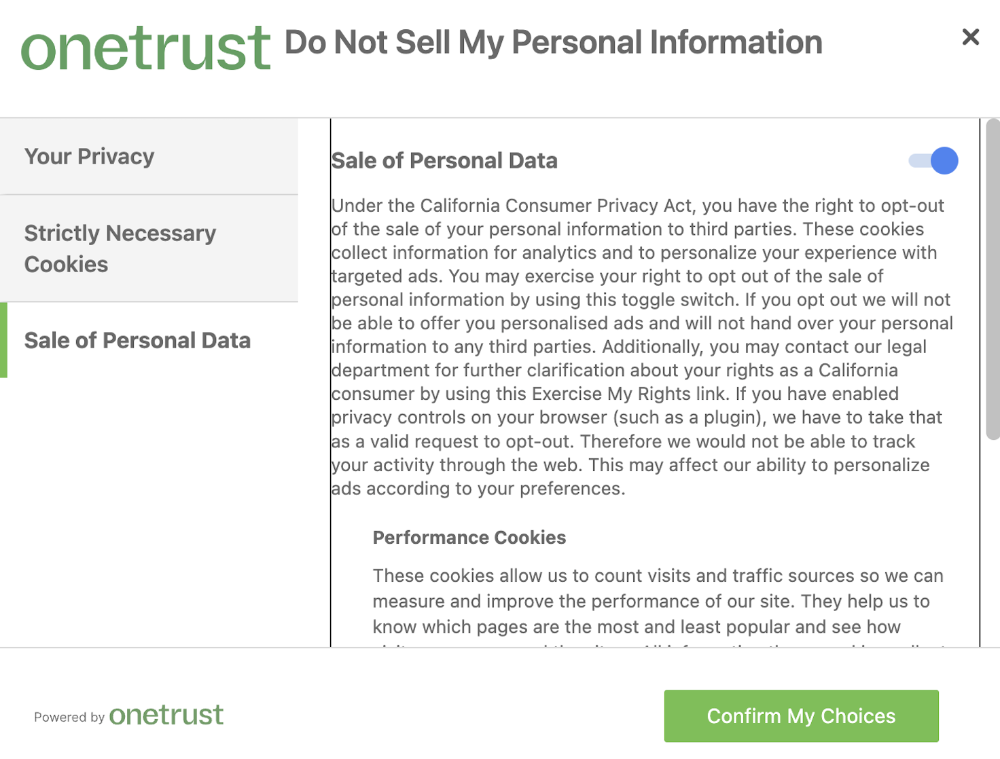
:::
::: {.column width="30%"}
**Opt-out form**

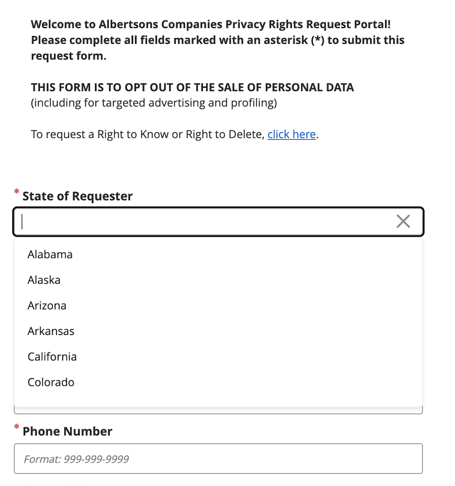
:::
::: {.column width="36%"}
**Both control methods**

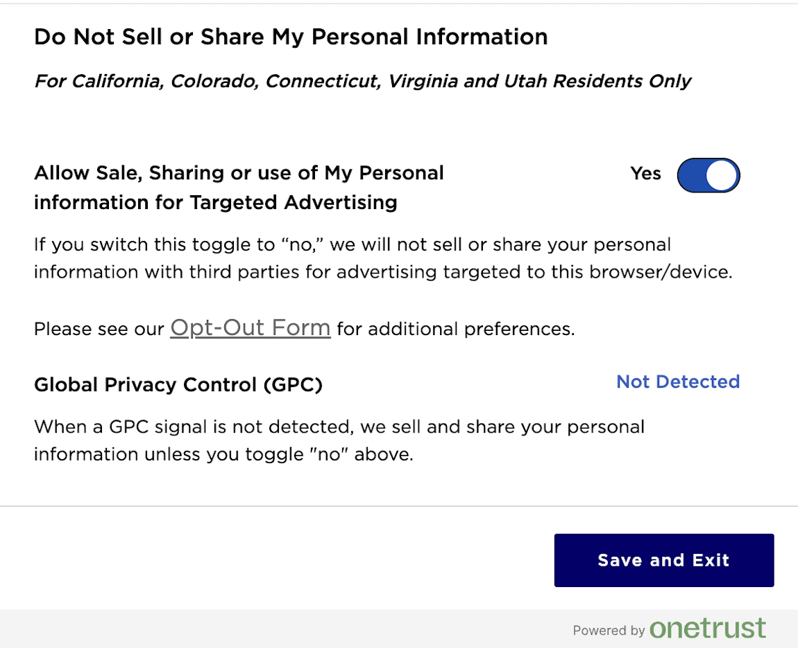
:::
:::

::: {.notes}
Three screenshots, one per control method. Left: a browser opt-out, a OneTrust
"Do Not Sell My Personal Information" panel with a toggle and "Confirm My Choices".
Middle: an opt-out form, a privacy-rights request portal asking for state, phone
number, and more. Right: both, a toggle plus a link to an opt-out form for additional
preferences.
:::

## Dark Patterns Taxonomy Development {visibility="hidden"}

- Leverage **existing dark pattern taxonomies**
- Our **observations** of possible dark patterns during the pilot study
- (Details about the dark patterns found are explained in the findings)

::: {.notes}
The taxonomy combines existing dark-pattern taxonomies from the literature with
patterns observed during the pilot study; the specific patterns are explained with the
findings.
:::

## Data Collection & Labelling Process {.smaller visibility="hidden"}

::: {.columns}
::: {.column width="42%"}
<!-- recovered from ppt-archive/12-Compliance.pptx slide 43 -->
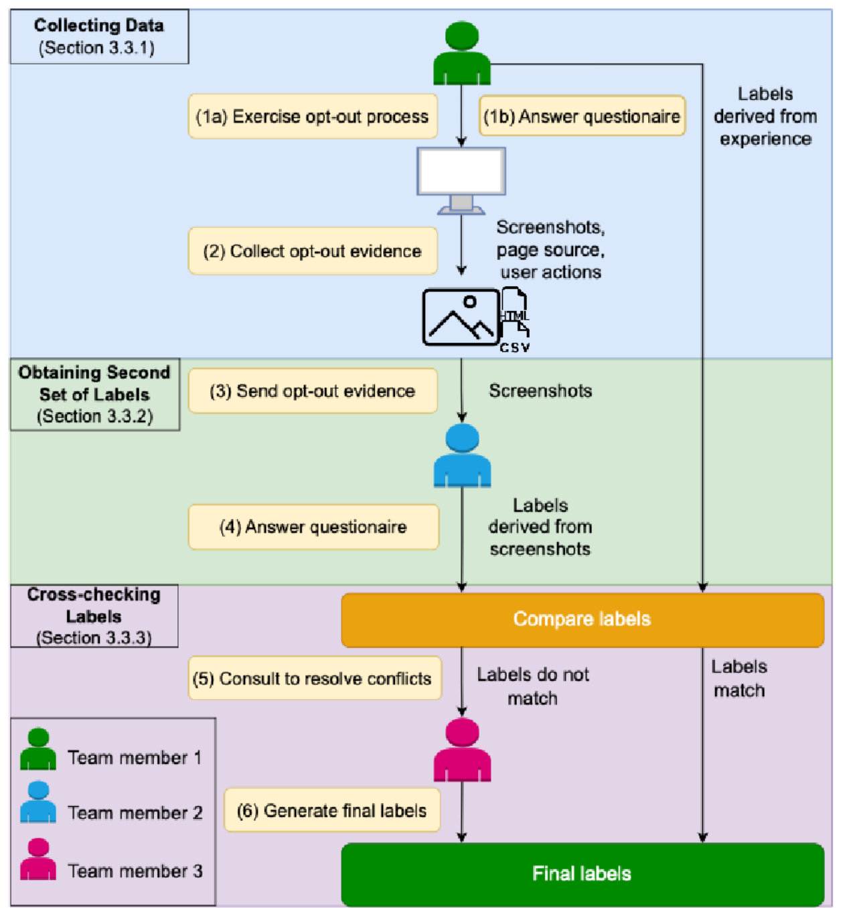{width="88%"}
:::
::: {.column width="58%"}
- **Team member 1** exercises the opt-out and answers a questionnaire: labels derived
  from *experience*
- The evidence (screenshots, page source, user actions) goes to **team member 2**, who
  labels from the *screenshots alone*
- The two label sets are **compared**; conflicts go to a **third member** for
  adjudication
- Why it matters: "is this a dark pattern?" is a judgment call, and two independent
  raters plus adjudication is what makes the counts defensible
:::
:::

::: {.notes}
Walk the three colored bands top to bottom. Blue: the person doing the opt-out
collects evidence as they go and records their own labels. Green: a second person who
never touched the site labels the same case from the screenshots. Purple: the labels
are compared; agreement goes straight to final, disagreement is resolved by a third
person. This is standard inter-rater practice from qualitative research applied to a
measurement study, and it is the answer to the obvious objection that dark-pattern
judgments are subjective. Cold-call: which kinds of dark pattern would you expect the
screenshot-only rater to miss?
:::

## Follow-Up Process {visibility="hidden"}

- Track and follow up with the opt-out process for **two months** after the
  request is submitted
- Each website is assigned a **unique identifier number**
- Summarize the **purpose of each email** and what action is required

::: {.notes}
Each request is tracked for two months after submission. Each website gets a unique
identifier, so follow-up email can be matched to the request; for each email, the
purpose and the required action are summarized. Chasing the email follow-ups for
eight full weeks is what lets the researchers measure the difference between
"submitted" and "actually resolved".
:::

# Findings {.center}

## RQ1: Can Consumers Successfully Exercise Their Opt-Out Rights? {.center visibility="hidden"}

::: {.notes}
First finding: whether the opt-out requests actually succeed.
:::

## Categorizing Opt-Out Request Outcome {.smaller visibility="hidden"}

<!-- recovered from ppt-archive/12-Compliance.pptx slide 47 -->
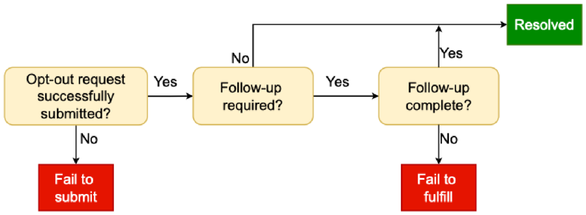{width="80%"}

- Three questions per site: did the request **submit**? was a **follow-up** required
  (email confirmation, identity check)? did the follow-up **complete**?
- Two red leaves, **fail to submit** and **fail to fulfill**; one green leaf, **resolved**;
  the two-month window is what separates *submitted* from *resolved*

::: {.notes}
Walk it left to right. If the request never submits, that is the first red box:
malfunctioning page, offline steps, instructions only. If it submits and nothing more
is required, it resolves immediately: the browser-toggle case. If a follow-up is
required, the clock starts: confirmation link, identity documents, a second form. Only
a completed follow-up counts as resolved; an unanswered one after two months is "fail
to fulfill". Emphasize that the researchers had to wait eight weeks per site to make
this determination, which is why nobody does this at scale. Cold-call: where in this
flow would a site that silently honors the request but never confirms end up, and is
that fair to the site?
:::

## Opt-Out Request Outcomes {.smaller visibility="hidden"}

::: {.columns}
::: {.column width="55%"}
**Failure to submit (37 websites)**

- Malfunctioning opt-out page (13 websites)
- Require offline opt-out steps (10 websites)
- Instructions only (8 websites)

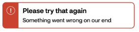{width="55%"}
:::
::: {.column width="45%"}
> "You're almost done. To complete your opt out, email DataPrivacyOfficer@urbn.com
> or call (888) 708-0525 and give us the email address or addresses you wish to opt
> out."
:::
:::

::: {.notes}
Failure to submit, 37 websites: a malfunctioning opt-out page (the "Please try that
again" error shown), offline steps required (the quoted instruction to email or call),
or instructions only.
:::

## Opt-Out Request Outcomes {.smaller visibility="hidden"}

::: {.columns}
::: {.column width="50%"}
**Failure to fulfill (48 websites)**

- Ambiguous status (35 websites)
- Outstanding follow-up actions (7 websites)
- Incomplete (6 websites)
:::
::: {.column width="50%"}
> "Thank you for your submission"

> "To ensure the highest possible security for your account, we need to verify some
> information. …high school name, test name, …"
:::
:::

::: {.notes}
Failure to fulfill, 48 websites: ambiguous status (a "thank you for your submission"
and nothing further), outstanding follow-up actions (such as the identity verification
request quoted, asking for high-school name and test name), or incomplete.
:::

## Opt-Out Request Outcomes {visibility="hidden"}

**Resolved (245 websites)**

- Confirmed to be successful (193 websites)
- Non-matching profile (51 websites)

::: {.notes}
Resolved, 245 websites: 193 confirmed successful, and 51 where the site reported a
non-matching profile for the identity used.
:::

## ~30% of Opt-Out Attempts Fail {.smaller}

::: {.columns}
::: {.column width="50%"}
**Could not submit / unclear:**

- Failure to submit (37)
- Malfunctioning opt-out page (13)
- Offline steps required (10)
- Instructions only (8)
:::
::: {.column width="50%"}
**Submitted but did not resolve:**

- Failure to fulfill (48)
- Ambiguous status (35)
- Outstanding follow-up (7)
- Incomplete (6)
:::
:::

Nearly **one-third** of attempts could not be submitted, did not succeed, or ended in
**unclear status**. Of the resolved, some demanded **identity verification** the user
couldn't meet.

::: {.notes}
Roll-up of the three outcome slides; the failure taxonomy is the paper's own. The
"ambiguous status" bucket of 35 sites is the most enforcement-interesting: the site
displays "Thank you for your submission" and nothing further ever happens, no
confirmation, no rejection, no way to know. That ambiguity is exactly what makes
GPC-first regimes (opt out once, no per-site trust needed) so attractive. Also call out
the identity-verification pattern: some sites demanded high-school name, standardized
test scores, or driver's-license photos to "verify identity" before honoring an
opt-out; asking for more personal data as the price of exercising a data-minimization
right is the canonical use of compliance as a data-collection lever. Cold-call: which
of these buckets is a §7004 violation, and which is legal but adversarial?
:::

## RQ2: What Does It Take for a Consumer to Submit an Opt-Out Request? {.center visibility="hidden"}

::: {.notes}
Second finding: the shape of the opt-out process itself.
:::

## Opt-Out Control Methods {visibility="hidden"}

<!-- recovered from ppt-archive/12-Compliance.pptx slide 52 -->
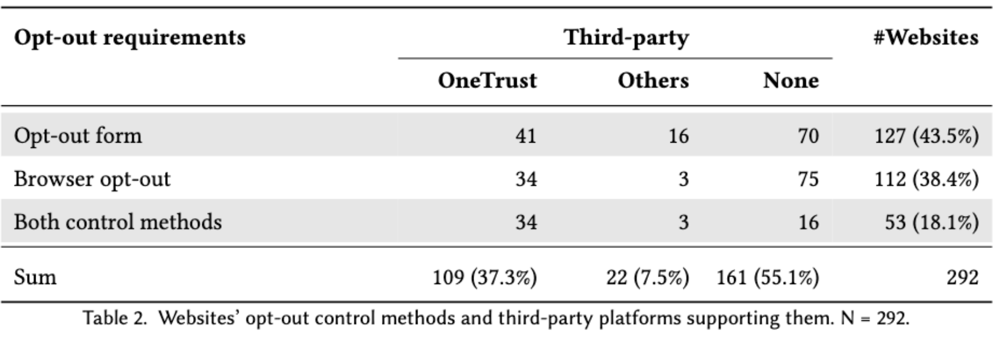{width="85%"}

::: {.notes}
Table 2: control methods by the third-party platform that serves the opt-out, N=292.
Opt-out form 127 (43.5%), browser opt-out 112 (38.4%), both 53 (18.1%). OneTrust
serves 109 sites (37.3%), other vendors 22 (7.5%), and 161 (55.1%) use no third party.
:::

## Number of Clicks {.smaller}

<!-- recovered from ppt-archive/12-Compliance.pptx slide 53 -->
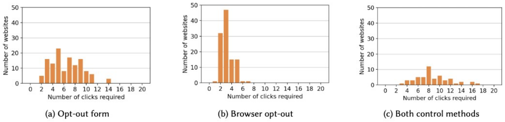{width="95%"}

- **Browser opt-out:** two or three clicks almost always; **opt-out form:** three to
  eleven is typical, with a tail out to **14**; **both:** mode at eight, the form path
  dominates
- Opting *in* to tracking is usually **one** click ("Accept all"); that asymmetry is
  the §7004 "symmetry in choice" test

::: {.notes}
Three histograms, same axes, so the shapes are comparable. The browser-toggle
distribution is tight at two or three clicks; the form distribution is wide and
shifted right; the "both" distribution is wider still because the form path sets the
floor. Ask what a 14-click opt-out looks like in practice: find the footer link, open
the portal, choose request type, fill five fields, solve a CAPTCHA, confirm by email,
log in again. Then ask how many clicks the same site's "Accept all cookies" button
takes. Cold-call: should the law set a maximum click count, and what would sites do in
response?
:::

## Personal Information Required {visibility="hidden"}

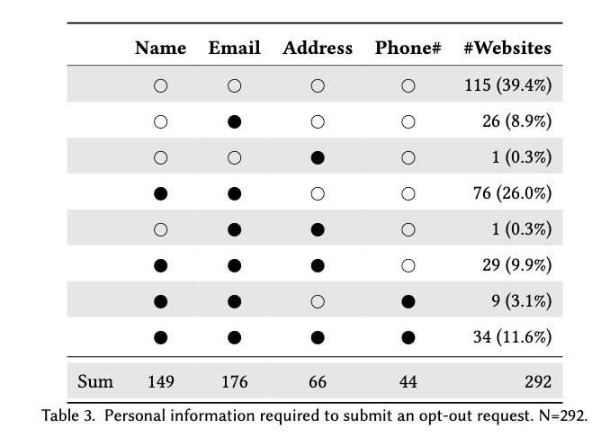{width="60%"}

::: {.notes}
Table 3: the personal information required to submit a request, N=292. 115 sites
(39.4%) require none; 76 (26.0%) require name and email; 34 (11.6%) require name,
email, address, and phone number.
:::

## Do Opt-Out Processes Violate CCPA Requirements? {.smaller visibility="hidden"}

::: {.columns}
::: {.column width="62%"}
<!-- recovered from ppt-archive/12-Compliance.pptx slide 55 -->
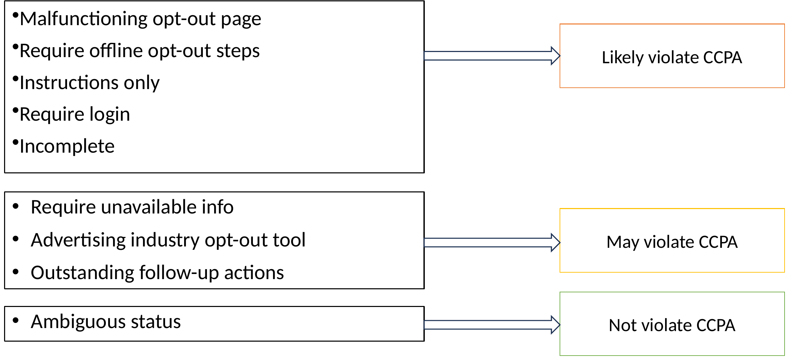
:::
::: {.column width="38%"}
- **Likely violate CCPA:** malfunctioning opt-out page, require offline opt-out
  steps, instructions only, require login, incomplete; the statute requires a
  *working online* method
- **May violate CCPA:** require unavailable info, advertising-industry opt-out
  tool, outstanding follow-up actions
- **Not violate CCPA:** ambiguous status; the law does not require a receipt
:::
:::

::: {.notes}
The top box is the clean case: the regulations require an online method that works,
so a broken page or an "email us" instruction is a violation on its face. The middle
box is where lawyers argue: requiring a driver's license may be "reasonable
verification" or may be an obstruction; routing to the DAA or NAI industry tool may or
may not count as the business's own method. The bottom box is the loophole: 35 sites
whose status is simply unknown. Nothing in the statute obliges a site to tell you the
request was honored, so silence is legal, and silence is also exactly what a
non-compliant site would do. That is the enforcement gap in one diagram. Cold-call:
should the law require a receipt, and what would that cost sites?
:::

## RQ3: What Types of Dark Patterns Are Used in the Opt-Out Process? {.center visibility="hidden"}

::: {.notes}
Third finding: the dark patterns themselves, by family.
:::

## Three Families of Dark Patterns {.smaller}

::: {.columns}
::: {.column width="33%"}
**Obstruction**
Barriers to completing the task: CAPTCHA, separate submissions for sale vs. share,
asymmetry (1 click in, 2 to opt out), identity-verification deadlines
:::
::: {.column width="33%"}
**Interface interference**
Privileging some choices: aesthetic manipulation that hides the opt-out link
:::
::: {.column width="34%"}
**Misdirection**
Confusing or absent instructions: a toggle with no indication of which way means "out"
:::
:::

::: {.notes}
Exam material: students should be able to reproduce the three families and give one
example each. Categories draw on Brignull's deceptive-design catalog at
deceptive.design and the Gray et al. CHI 2018 taxonomy; these are broader than privacy
but map cleanly onto opt-out flows. Obstruction is about friction: CAPTCHAs, extra
pages, asymmetry between opt-in (one click) and opt-out (many). Interface interference
is about visual privileging: the "Accept All" button styled bright and the "Reject"
button hidden as small gray text. Misdirection is about unclear or absent
instructions. Ask students to name a real one they saw this week. §7004(a) in the CCPA
regulations codifies the counter-principles: symmetry in choice, minimal steps, easy to
understand, avoid manipulative design. The next four slides are the paper's own
examples.
:::

## Obstruction {.smaller}

"Obstruction" refers to dark patterns where users encounter barriers or hurdles that
make it difficult for them to complete a task or access information.

::: {.columns}
::: {.column width="50%"}
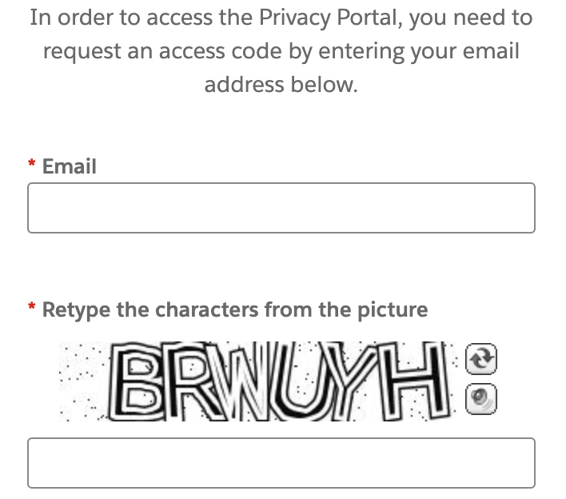{height="300px"}

**Verified email message.** Users must solve a CAPTCHA and verify their identity via
email to access a privacy portal. Website www.nfl.com.
:::
::: {.column width="50%"}
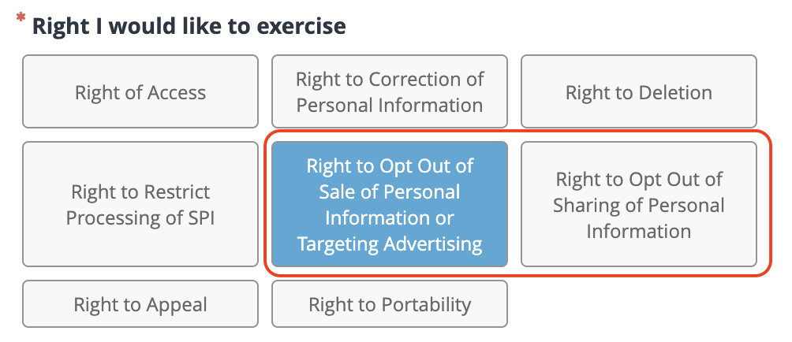

**Separate submissions.** Users can only opt out of either the sale or the sharing of
their personal information per request, not both. Website www.finishline.com.
:::
:::

::: {.notes}
Two obstruction examples. Left, nfl.com: a CAPTCHA and an email verification before
the privacy portal even opens. Right, finishline.com: sale and sharing must be opted
out of in separate submissions.

Discussion prompt on the CAPTCHA: dark pattern, or legitimate security? Genuine
ambiguity. CAPTCHA has a real anti-bot rationale (automated mass opt-outs would be
their own problem), but it adds friction to a legally protected action, and the
statute is silent on CAPTCHA specifically. This is the archetypal edge case that makes
automated dark-pattern enforcement hard: a rule that catches every CAPTCHA
overreaches; a rule that catches none underreaches. Ask the class to vote. Follow-up:
does the answer change if only the opt-out flow has a CAPTCHA but sign-up does not?
That asymmetry test is closer to §7004's "symmetry in choice" language and often flips
people's answer.
:::

## Obstruction {.smaller visibility="hidden"}

"Obstruction" refers to dark patterns where users encounter barriers or hurdles that
make it difficult for them to complete a task or access information.

::: {.columns}
::: {.column width="50%"}
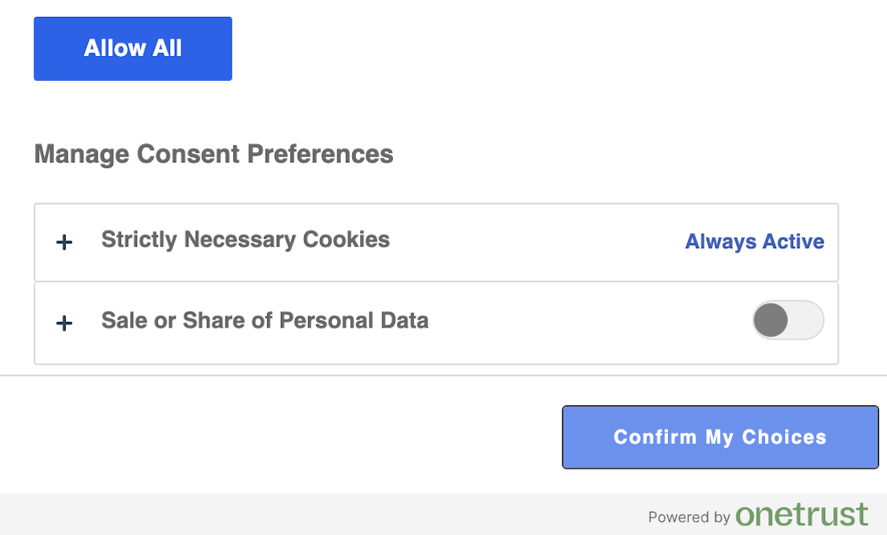

**Asymmetry.** It only takes one click to opt in (by clicking "Allow All") but two
clicks to opt out (toggle off and select "Confirm My Choices"). Website
www.huffpost.com.
:::
::: {.column width="50%"}
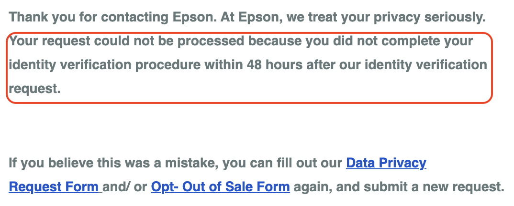

**Identity confirmation.** Users must verify their identity within a timeframe. If
they fail, they have to resubmit the request. Website https://epson.com/usa.
:::
:::

::: {.notes}
Two more obstruction examples. Left, huffpost.com: one click to allow all, two to opt
out. Right, epson.com: identity verification must be completed within 48 hours or the
request is discarded and must be resubmitted.
:::

## Interface Interference {.smaller}

"Interface interference" is a strategy used to manipulate interfaces, privileging
certain actions and, thus, limiting the discoverability of alternatives.

::: {.columns}
::: {.column width="55%"}
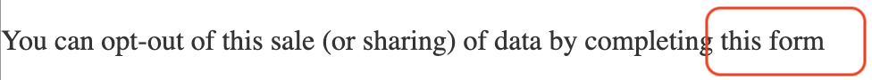
:::
::: {.column width="45%"}
**Aesthetic manipulation.** The link to the opt-out form is difficult to see. Website
https://theweek.com.
:::
:::

::: {.notes}
Interface interference example, theweek.com: the words "this form" are the link to the
opt-out form, with nothing to distinguish them from the surrounding text.
:::

## Misdirection {.smaller}

"Misdirection" refers to dark patterns where the instructions about how to exercise
privacy-protective choices are either not mentioned or are very confusing.

::: {.columns}
::: {.column width="55%"}
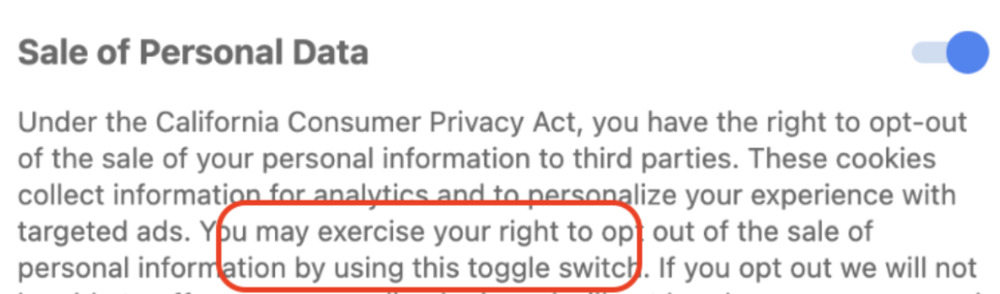
:::
::: {.column width="45%"}
**Confusing choices.** The users are instructed to "use this toggle switch". However,
neither the text nor the toggle clearly indicates which direction should be toggled
to. Website www.apartmenttherapy.com.
:::
:::

::: {.notes}
Misdirection example, apartmenttherapy.com: "use this toggle switch", with no
indication of which position means opted out.
:::

## RQ3: Are These Dark Patterns Violating CCPA Requirements, or Exploiting Loopholes the CCPA Has Not Addressed? {.center visibility="hidden"}

::: {.notes}
Second half of the third question: which of these patterns the law actually reaches.
:::

## Clear Violations vs. Loopholes {.smaller}

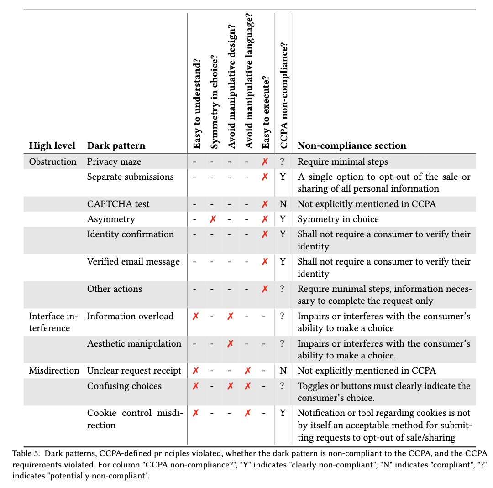{width="72%"}

Some patterns **clearly violate** the statute (asymmetry breaks the required
*symmetry in choice*; a 14-click flow breaks *minimal steps*). Others, **CAPTCHAs**,
unclear receipts, ambiguous toggles, are **not addressed at all**.
The **Disney 2026 settlement** ($2.75M) squarely litigated fragmented
per-device/per-service opt-out flows as CCPA violations: the "may violate" column
is starting to become "does violate."

::: {.notes}
The mapping of each dark pattern to the CCPA's principles: likely violates, may
violate, or not addressed. The original slide has no title. Walk one row from each
bucket. The "clearly violates" column maps to explicit statutory hooks in 11 CCR
§7004: asymmetry breaks "symmetry in choice" at §7004(a)(2); a 14-click flow breaks
"minimal steps" at §7004(a)(3). The "may violate" column is where enforcement has to
make new law; until 2026 there was little privacy-opt-out dark-pattern litigation at
all. That is changing: the Disney $2.75M settlement in February 2026 squarely
litigated fragmented per-device/per-service opt-out flows as CCPA violations, so one
row just moved from "may violate" to "does violate". The unaddressed column, CAPTCHAs,
ambiguous receipts, ambiguous toggles, is the statutory loophole; watch for the first
case citing §7004 directly on those. Cold-call: which row do you think enforcement
targets next?
:::

## RQ4: What Are the Characteristics of Websites That Employ Dark Patterns? {.center visibility="hidden"}

::: {.notes}
Fourth finding: which sites use dark patterns, and which patterns.
:::

## Prevalence of Dark Patterns

<!-- recovered from ppt-archive/12-Compliance.pptx slide 64 -->
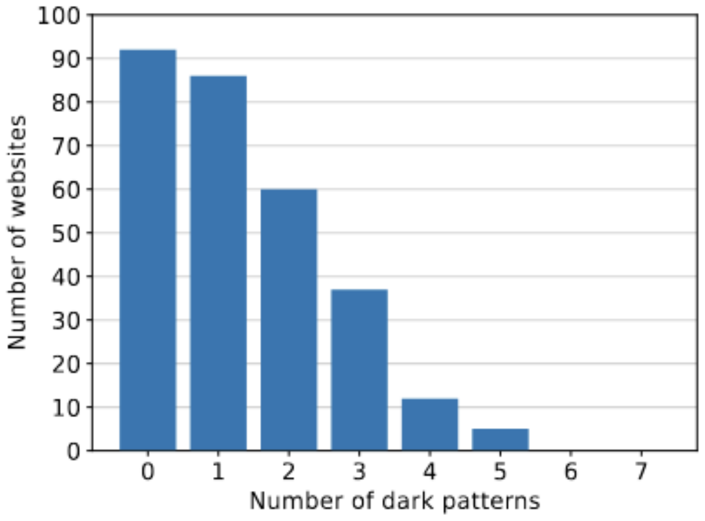{width="55%"}

::: {.notes}
Number of dark patterns per site, N=292: 92 sites have none, 86 have one, 60 have two,
with a tail out to five. 200 of 292 sites (68%) use at least one.
:::

## Prevalence of Dark Patterns {.smaller visibility="hidden"}

<!-- recovered from ppt-archive/12-Compliance.pptx slide 65 -->
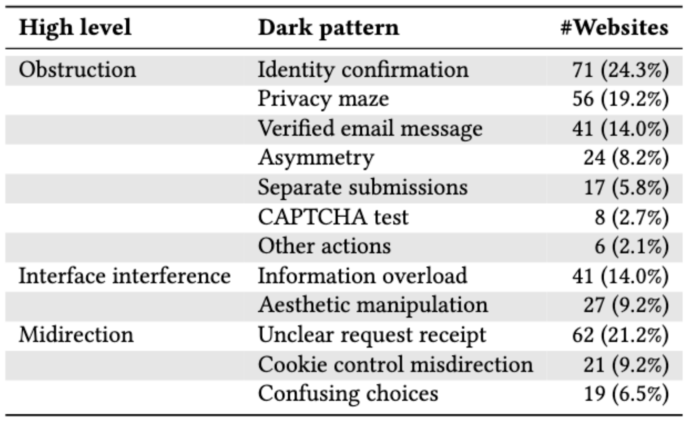{width="58%"}

**200 of 292 sites (68%)** use at least one. The leaders are **identity
confirmation** (24%), **unclear request receipt** (21%), and the **privacy maze** (19%).

::: {.notes}
The catalog of dark patterns and how often each appears, grouped by the three
families. The top three are worth naming: identity confirmation (prove who you are
before we stop selling your data), unclear request receipt (did it work? nobody
knows), and the privacy maze (the opt-out is somewhere in here). CAPTCHA, the example
students argued about earlier, is rare at under 3%. Cold-call: the three leaders are
all about information rather than visual trickery; what does that say about where
regulation should focus?
:::

## Distribution of Dark Patterns Across Opt-Out Control Methods {visibility="hidden"}

<!-- recovered from ppt-archive/12-Compliance.pptx slide 66 -->
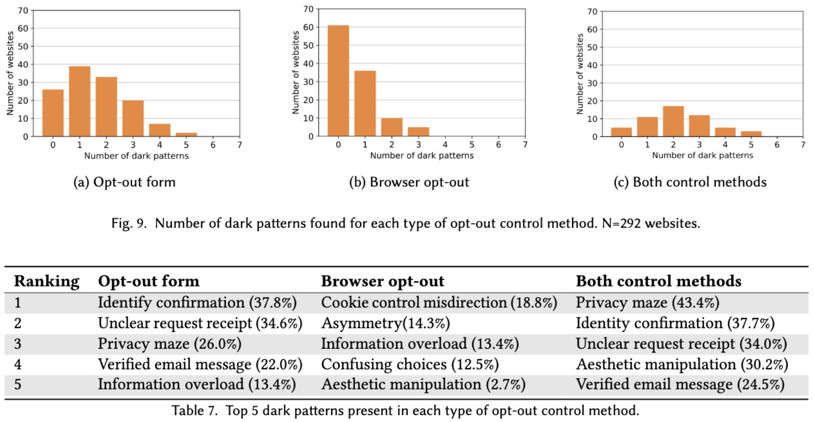{width="88%"}

::: {.notes}
Fig. 9 and Table 7: number of dark patterns per site for each control method, N=292,
and the top five patterns in each. Browser opt-out sites mostly have zero or one;
form sites peak at one or two; "both" sites peak at two. Forms lead with identity
confirmation (37.8%) and unclear request receipt (34.6%); browser opt-outs with cookie
control misdirection (18.8%) and asymmetry (14.3%); "both" with the privacy maze
(43.4%) and identity confirmation (37.7%).
:::

## Distribution of Dark Patterns Across Third-Party Platforms {.smaller}

::: {.columns}
::: {.column width="64%"}
<!-- recovered from ppt-archive/12-Compliance.pptx slide 67 -->
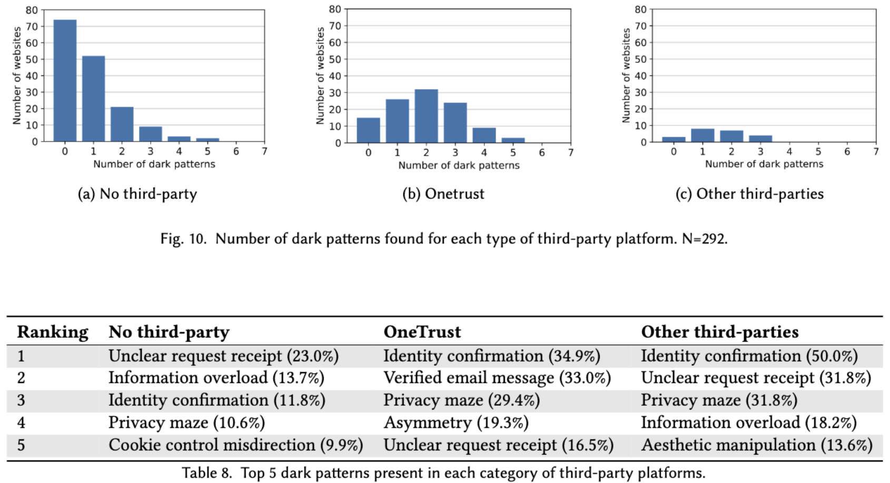
:::
::: {.column width="36%"}
- Of 292 sites, **37%** use OneTrust, **7.5%** another vendor, **55%** built their own
- Sites with **no vendor** cluster at zero or one dark pattern; **OneTrust** sites
  cluster at **two**
- Top OneTrust patterns: identity confirmation (35%), verified email (33%), privacy
  maze (29%), baked into the default flow
- Paying for compliance tooling is not compliance: the **vendor irony**
:::
:::

::: {.notes}
Fig. 10 and Table 8: number of dark patterns per site by third-party platform, N=292,
and the top five patterns in each. This is the single most surprising figure in Study
2, so give it a beat. Same axes across the three panels. The in-house sites are mostly
at zero or one; the OneTrust sites have a hump at two and a longer tail. Nobody is
accusing OneTrust of malice; the point is that the vendor's default request flow asks
for identity confirmation and a verified email, and most customers never change the
defaults. That is why the enforcement-gap slide calls it an irony: the site paid for
compliance and got a worse opt-out than the site that wrote its own. Other third
parties lead with identity confirmation (50.0%). Cold-call: who should the regulator
fine, the site or the vendor, and what would each do differently?
:::

## Discussion {.smaller visibility="hidden"}

::: {.columns}
::: {.column width="30%"}
**Effectiveness of the CCPA**

- Seems to improve since the CPRA went into effect
- However, many websites still fail to comply with the CCPA
:::
::: {.column width="36%"}
**Challenges of measuring CCPA non-compliance**

- Human-intensive and time-consuming to examine the opt-out process
- Challenges of defining a dark pattern
- Challenges of verifying whether an opt-out request is complied with and fully
  executed
:::
::: {.column width="34%"}
**Recommendations**

- Regulators should take action to enforce the law
- Policy makers need clearer guidelines and more specific requirements, and should
  draft the law to make it easy to compliance-check websites' opt-out processes
:::
:::

::: {.notes}
Three threads. Effectiveness: compliance seems to improve since the CPRA, but many
websites still fail. Measurement challenges: examining opt-out processes is
human-intensive and slow, defining a dark pattern is hard, and verifying that a
request was complied with and fully executed is harder still. Recommendations:
regulators should enforce the law, and policy makers should write clearer, more
specific requirements that make opt-out processes easy to compliance-check. The 2026
Disney and GM settlements are the first recommendation starting to happen.
:::

# Why Automated Compliance Is Hard {.center}

## The Enforcement Gap {.smaller}

- **Determining coverage** is hard: key thresholds rely on **non-public** data
- **Presence ≠ function:** a compliant-looking link may not work
- **Third-party irony:** sites pay vendors (e.g., **OneTrust**) and are *still* out
  of compliance; misconfiguration? no testing? willful neglect? hard to tell
- **The statute is silent** on many real patterns (CAPTCHAs, ambiguous receipts)
- **Willful evasion vs. honest oversight** is often **indistinguishable from the outside**

This is why **regulators**, not just scrapers, are needed, and why 2026's
enforcement turn toward *functional* opt-out matters.

::: {.notes}
Tie the whole class together. Determining coverage is hard because key thresholds
use non-public data. Presence does not equal function. Third-party irony: sites pay
vendors like OneTrust and are still out of compliance because of misconfiguration or
no functional testing. The statute is silent on many real patterns, and willful
evasion is often indistinguishable from honest oversight from outside. That last point
is the division of labor: automated measurement finds the haystack, but the final
call, covered? willful? legitimate security?, needs human and legal judgment. Natural
breakout prompt: if you were the CPPA, would you fund a permanent continuous auditing
program, or hire more lawyers? The 2026 enforcement turn toward functional opt-out is
why the answer is starting to look like "both". Route to the compliance breakout.
:::

## What Measurement Tells Policy {.smaller}

- Compliance is **rising but incomplete**; ~45% fail even appearance rules
- **Spillover is real** (78% extend opt-out nationwide): a strong state law can set
  a national floor
- **~30%** of opt-out attempts fail outright; most sites use **at least one dark pattern**
- Banning dark patterns **on paper** (CPRA) is not the same as **eliminating** them

**Open questions:** automatically verify an opt-out actually *worked*? Detect dark
patterns at scale? Distinguish evasion from error?

::: {.notes}
Land on the meta-point: empirical measurement is how we hold privacy law accountable
to its own promises. The 2026 GM ($12.75M) and Disney ($2.75M) settlements are
enforcement catching up to what these two studies documented in 2023 and 2024:
measurement finds the pattern, enforcement litigates one instance of it. The open
research questions are the natural bridge forward: can we automatically verify that an
opt-out actually worked? detect dark patterns at scale? distinguish willful evasion
from honest error? Bridge back to the federal-vs-state debate and forward to the AI
and privacy meeting.
:::

## Summary of Findings {.smaller visibility="hidden"}

- **RQ1: Can consumers successfully exercise their opt-out rights?**
  Nearly 30% of the attempted opt-out requests could not be submitted, did not
  succeed, or had unclear status updates.
- **RQ2: What does it take for a consumer to submit an opt-out request? Do
  opt-out processes violate CCPA requirements?**
  The opt-out process varies widely depending on website categories, opt-out
  control methods, and third-party platforms handling the opt-out process on
  behalf of the websites. Some sites allow submission with just a few clicks,
  while others require a lengthy process and significant personal information.
- **RQ3: What types of dark patterns are used in the opt-out process? Are they
  violating CCPA requirements, or exploiting loopholes the CCPA has not addressed?**
  Multiple types of dark patterns are found in the opt-out process. Although some
  are clearly prohibited by the CCPA, others are not explicitly addressed by it.
- **RQ4: What are the characteristics of the websites that employ dark patterns?**
  Most websites implement at least one type of dark pattern. Sites with different
  opt-out control methods and third-party platforms tend to exhibit different
  types of dark patterns.

::: {.notes}
Close on the four findings. The original deck has a draft "Conclusions" slide listing
the first three questions without answers immediately before this one; it is folded
into this slide.
:::

# Discussion {.center}

Pick a website you used **today**. Find its opt-out. How many clicks? What does it ask
for? Which **dark pattern family**, if any, and is it a **violation** or a **loophole**?

::: {.notes}
Cold-call prompt as written on the slide: pick a site, walk the class through the
click count and any dark patterns encountered. Best-in-class exercise: enable GPC in
Safari or Firefox (Do Not Sell or Share toggle, about ten seconds), then load a site
you use daily and watch, via Privacy Badger or the dev-tools Network tab, whether
third-party behavior actually changes. Route students to the Web Tracking hands-on
activity to do this systematically, and to the compliance breakout for the extended
dark-patterns edge-case discussion. Debate seed: should state AGs and the CPPA fund
continuous automated auditing on the model of Study 1, or is enforcement better served
by targeted litigation on the model of the Disney and GM cases? Land the meta-point:
the enforcement gap closes when measurement and litigation move together.
:::
