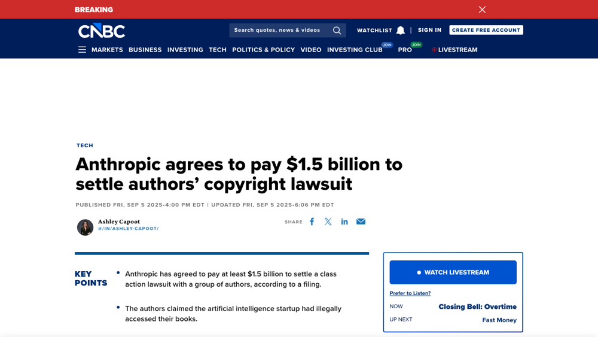
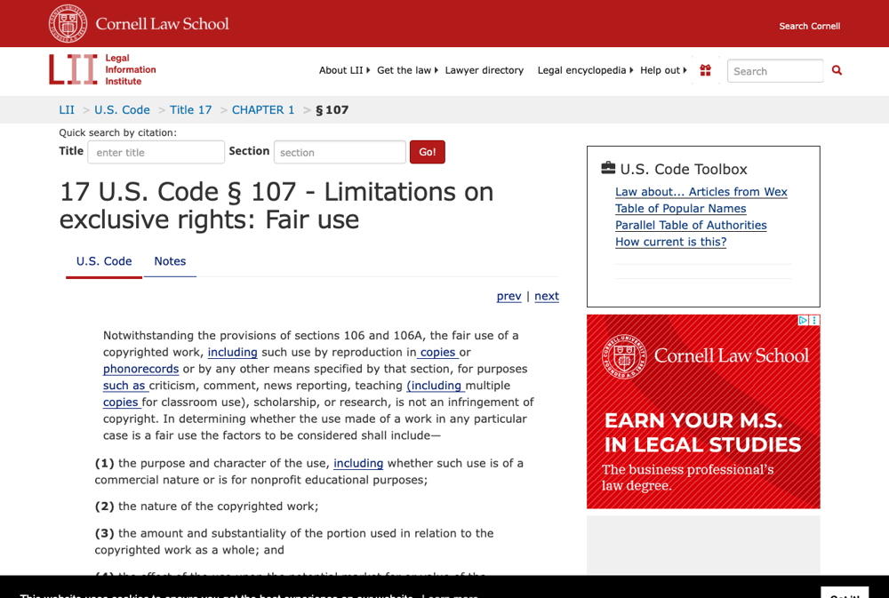
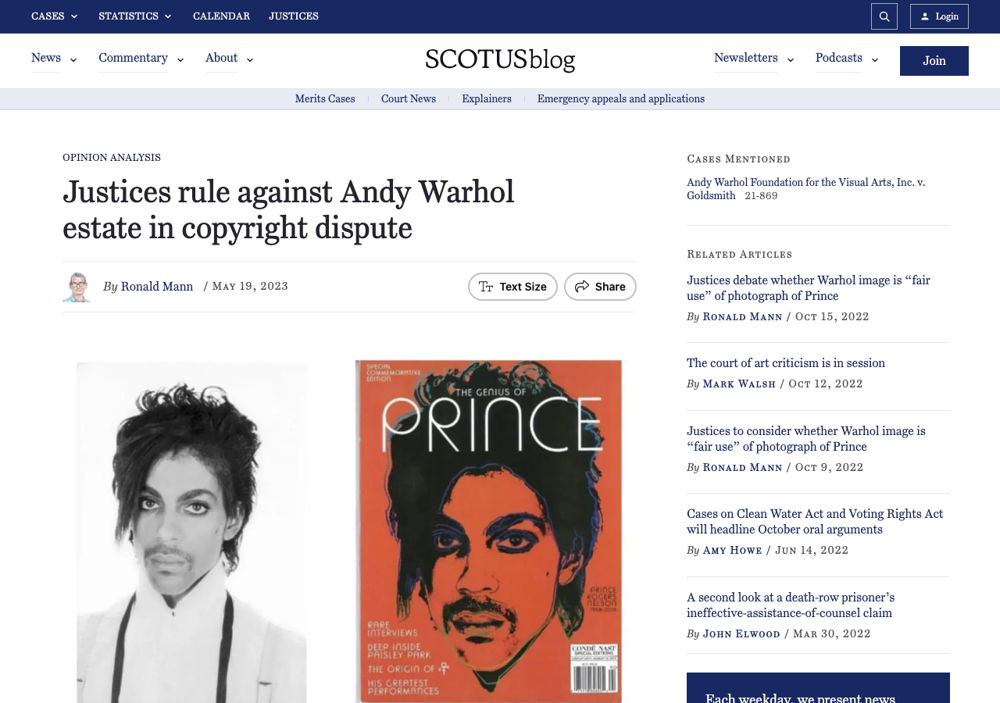
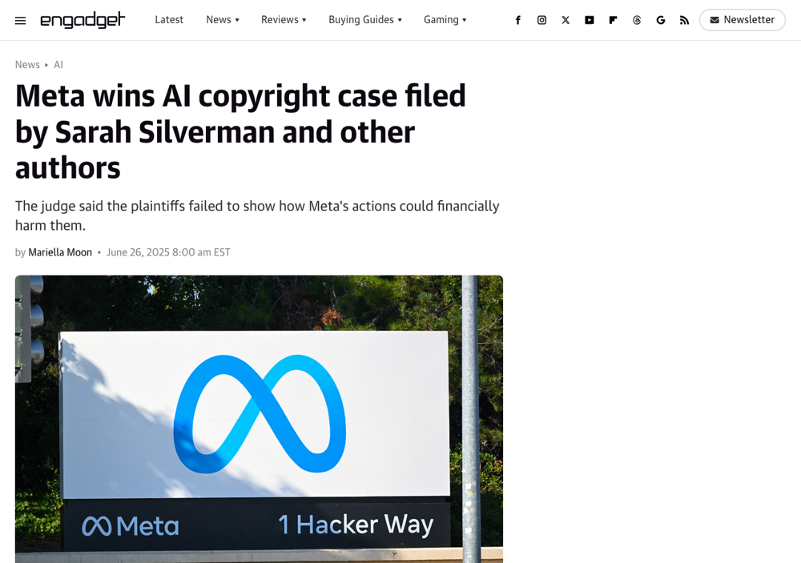
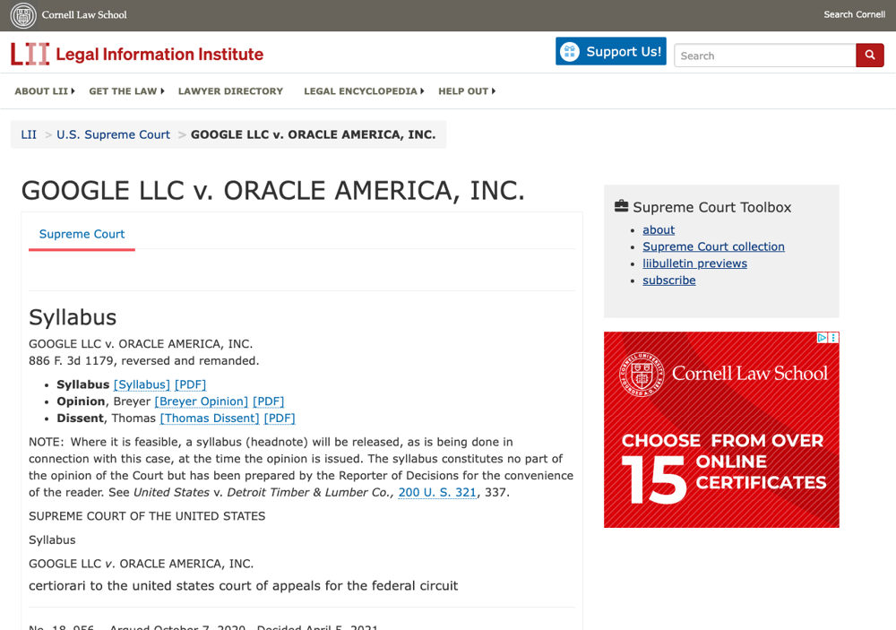
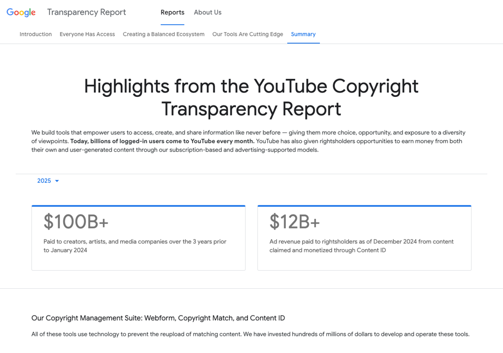
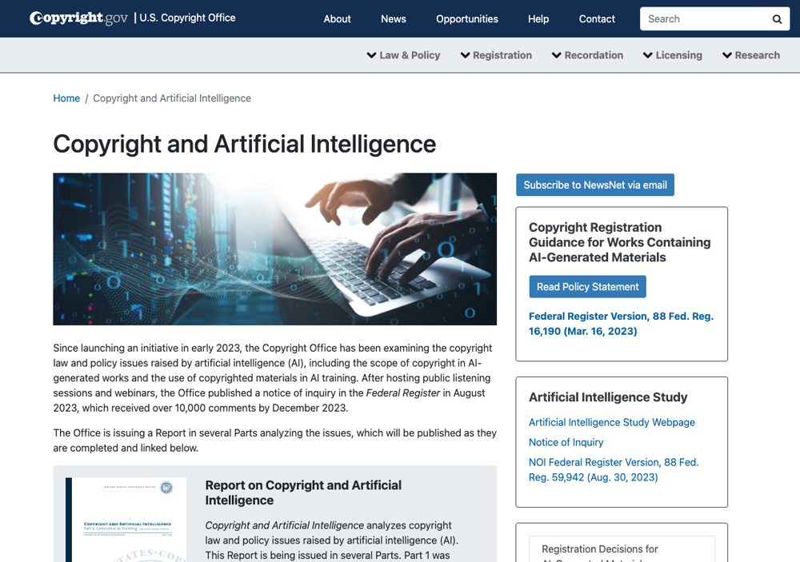

## Why Copyright Is in This Course {.center .larger}

> "To **promote the Progress of Science and useful Arts**..." — U.S. Constitution, Art. I, §8

Copyright is where **code, content, and AI training data** collide with the law.
The same doctrine that decided whether Google could copy Java is now deciding
whether AI companies can train on your books.

::: {.notes}
Open with the framing: copyright feels like an entertainment-industry topic, but for
this class it is a tech-policy topic. The through-line of the lecture is one idea —
*transformative use* — and one judge — Alsup of the Northern District of California —
who shows up in both the Oracle API case in 2012 and the Bartz v. Anthropic AI case
in 2025. The constitutional hook is Article I, Section 8, Clause 8: "to promote the
progress of science and useful arts." That utilitarian framing (progress, not
authors' natural rights) matters — it is why fair use exists at all. Tell students
now that the four-factor fair-use test is a near-certain midterm question; per the
agenda the professor "put real money" on a for-versus-against fair-use case-study
prompt. Cold-call: give me one thing you have copied this week that was arguably
copyrighted. Ask "was that fair use?" and watch the class realize they cannot
answer.
:::

## A 2026 Vignette: The Anthropic Decision

::: {.columns}
::: {.column width="60%"}
::: {.vignette}
On **June 23, 2025**, Judge William Alsup (N.D. Cal.) ruled in **Bartz v. Anthropic**
that training an LLM on books is "**exceedingly transformative**" and therefore *fair
use* — but that **downloading 7+ million pirated books** to build a permanent library
was **not** fair use. **September 2025:** Anthropic agreed to a **~$1.5 billion**
settlement (~482k works, ~$3,000/work), the largest copyright settlement in U.S.
history. **July 20, 2026:** Judge Martínez-Olguín granted **final approval** and
entered judgment, cutting class counsel's fee request to **~$101.5M**; the first
payments (about **70%** of each claim, pending Anthropic's remaining installments) are
expected in **late November 2026**.
:::

Same doctrine, opposite outcomes — **how you acquire** the work matters as much as
**what you do** with it.
:::
::: {.column width="40%"}
::: {.capture}
[{width="100%"}](https://www.cnbc.com/2025/09/05/anthropic-to-pay-1point5-billion-to-settle-authors-copyright-lawsuit-.html)

CNBC, Sep 5 2025: Anthropic agrees to pay $1.5 billion. Captured Nov 18 2026; click to open. Primary sources: [settlement site](https://www.anthropiccopyrightsettlement.com/) · [docket](https://www.courtlistener.com/docket/69058235/bartz-v-anthropic-pbc/) · [final approval (Authors Alliance)](https://www.authorsalliance.org/2026/07/21/bartz-v-anthropic-settlement-receives-final-approval/)
:::
:::
:::

::: {.notes}
Freshest hook of the deck. Three load-bearing facts, all verified. First: on June 23,
2025, Judge William Alsup ruled that training an LLM on books is "exceedingly
transformative" and therefore fair use, but that downloading 7+ million pirated books
to build a permanent library was not fair use. Second: in September 2025 Anthropic
settled for roughly $1.5B, covering about 482,460 works at roughly $3,000/work —
the largest copyright settlement in US history. Third: on July 20, 2026, Judge
Martínez-Olguín granted final approval and entered final judgment, rejecting
objections that the price was too low; more than 91% of eligible authors claimed;
she cut class counsel's fee request (originally $300M, trimmed to $187.5M) to about
$101.5M, roughly 6.8% of the fund. Several appeals of the final judgment were filed.
The Authors Guild (Nov 16, 2026) says first payments go out the week of Nov 23, 2026
at about 70% of each claim because Anthropic has not yet paid all four installments
(Oct 2025, within a week of final approval, Sept 2026, Sept 2027). Alsup irony worth
naming: he is the same former-programmer judge who first ruled APIs uncopyrightable
in Oracle in 2012. Do not overstate — the settlement resolved *piracy* liability; the
*training-is-fair-use* holding is district-court precedent, not Supreme Court law.
Cold-call: why did Anthropic settle instead of appealing the piracy holding?
:::

## What Copyright Protects

The line is **idea vs. expression**. You can't copyright *how* to sort a list —
only a particular *written* implementation of it.

```{dot}
//| fig-width: 12.4
//| fig-height: 3.6
digraph ideaexpr {
  rankdir=LR; nodesep=0.3; ranksep=1.1; bgcolor="transparent";
  node [shape=box, style="filled,rounded", fontname="Helvetica", fontsize=22,
        color="#555555", penwidth=1.4, margin="0.2,0.1"];
  edge [color="#555555", penwidth=1.5, fontname="Helvetica", fontsize=19];
  subgraph cluster_i { label="Not protected: the idea"; fontname="Helvetica"; fontsize=24; color="#bbbbbb"; style="rounded";
    i1 [label="How to sort a list\n(a method, a system)", fillcolor="#f8d7c4", style="filled,rounded,dashed"];
    i2 [label="Who has which phone number\n(facts: Feist, 1991)", fillcolor="#f8d7c4", style="filled,rounded,dashed"];
    i3 [label="A recipe's list of ingredients", fillcolor="#f8d7c4", style="filled,rounded,dashed"]; }
  subgraph cluster_e { label="Protected: original expression"; fontname="Helvetica"; fontsize=24; color="#bbbbbb"; style="rounded";
    e1 [label="Your quicksort.c\n(software code, since 1980)", fillcolor="#d9efd3"];
    e2 [label="A directory with original\nselection and arrangement", fillcolor="#d9efd3"];
    e3 [label="The cookbook's prose\naround the recipe", fillcolor="#d9efd3"]; }
  i1 -> e1 [label="written down as"]; i2 -> e2 [label="written down as"]; i3 -> e3 [label="written down as"];
}
```

::: {.notes}
Drive the idea/expression dichotomy hard — it is the root of the entire API debate
later in the deck. The diagram's three rows: a method (sorting), facts (phone
numbers), and a list of ingredients sit on the unprotected side; a particular written
implementation, a directory with original selection and arrangement, and the prose
around a recipe sit on the protected side. Anchor case: Feist v. Rural Telephone
(1991), where the Supreme Court held that alphabetical phone-book listings are facts,
not copyrightable, even though the phone company invested labor in compiling them —
"sweat of the brow" does not create copyright. Software became copyrightable
expression with the Computer Software Copyright Act of 1980; before that its status
was contested. Because code is treated as expression *of* an implementation of a
system, not as the system itself, Oracle's argument that copying API declarations was
infringement was at least plausible. Cold-call: is a recipe copyrightable? Answer:
the list of ingredients is not (facts) but a distinctive prose narrative around it
can be. Same line runs through everything today. Also covered: literary, musical,
dramatic, artistic works are protected; facts, concepts, ideas, systems, methods,
and processes are not.
:::

## The Rights a Holder Controls {.larger}

A copyright is really a **bundle of exclusive rights**:

1. **Reproduction** — making copies
2. **Distribution** — selling, sharing, lending
3. **Derivative works** — adaptations, sequels, translations
4. **Public performance** — e.g., a cover song at an open mic
5. **Public display**

**Duration:** life of the author **+ 70 years**. **Infringement** = exercising any of
these without permission — and at internet scale, damages reach the **billions**.

::: {.notes}
The exclusive rights are enumerated at 17 U.S.C. §106 — reproduction, derivative
works, distribution, public performance, public display, digital audio transmission.
Each is separately licensable, which is the whole architecture of the entertainment
business. Buying a film on iTunes licenses display-to-yourself only; you cannot
project it at a paid screening or make copies for friends. Scale point: statutory
damages under §504 run $750 to $150,000 per work, and record-company suits against
ISPs cover millions of works — that is how per-work damages stack into billion-dollar
jury verdicts. Duration is currently life of the author plus 70 years, extended by
the 1998 Copyright Term Extension Act — the "Mickey Mouse Protection Act" — passed
just as Steamboat Willie was about to enter the public domain. Cold-call: does
"life+70" plausibly promote progress? Debate hook — that is the utilitarian
question the Constitution's copyright clause actually asks.
:::

## Fair Use: An Affirmative Defense {.smaller}

::: {.columns}
::: {.column width="50%"}
**Fair use is not a loophole — it's a defense you raise *after* you've copied.**

Codified at **17 U.S.C. §107**. Permits limited unlicensed use for purposes like:

- Criticism and commentary
- News reporting
- Teaching and research
- Scholarship
- Parody

Decided **case-by-case** — there are **no bright-line rules** (no "10% rule," crediting
the artist is not permission).
:::
::: {.column width="50%"}
::: {.capture}
[{width="100%"}](https://www.law.cornell.edu/uscode/text/17/107)

17 U.S.C. §107 at Cornell's Legal Information Institute: the whole statute is one paragraph and four factors. Captured Nov 18 2026; click to read it.
:::
:::
:::

::: {.notes}
Emphasize the phrase "affirmative defense" — you concede a copy was made, and then
argue it was fair. Codified at 17 U.S.C. §107; the capture on the right is the
statute itself, short enough to read aloud. Pre-empt the common student
misconceptions right now, before the four-factor slide, or you will fight them all
class: crediting the artist is not permission; "I only used 10%" is not a rule that
exists anywhere in the statute; Creative Commons is a *license* system, not a fair-use
exception (always check the specific license terms — CC BY-NC is very different from
CC0). "AI-generated content" is a separate question — the U.S. Copyright Office
position is that human authorship is required (its own slide near the end). Everyday
examples: showing a reading in class (usually fair), photocopying excerpts (often
fair), photocopying whole books for classroom distribution (usually not). Reference
resources are the Stanford Fair Use site and the U.S. Copyright Office Fair Use Index.
:::

## The Four-Factor Test

::: {.columns}
::: {.column width="62%"}
Courts weigh **all four together** — no single factor decides:

| # | Factor | Core question |
|---|--------|---------------|
| 1 | **Purpose, character** | Why? Is it **transformative**? |
| 2 | **Nature of the work** | Creative or factual? |
| 3 | **Amount** | How much; the "heart"? |
| 4 | **Market effect** | A substitute for the original? |

::: {.vignette}
**Midterm signal:** know all four cold; argue *for* and *against* fair use on an AI case study.
:::
:::
::: {.column width="38%"}
::: {.capture}
[{width="100%"}](https://www.scotusblog.com/2023/05/justices-rule-against-andy-warhol-estate-in-copyright-dispute/)

SCOTUSblog, May 19 2023: *Warhol v. Goldsmith*, the Supreme Court's latest word on Factor 1 (7–2 against the Warhol estate). Captured Nov 18 2026; click to open. [Opinion at Cornell LII](https://www.law.cornell.edu/supremecourt/text/21-869).
:::
:::
:::

::: {.notes}
Per the agenda this is the single highest-probability midterm item — the professor
"put real money" on a fair-use case-study question. Have students practice
articulating both sides for and against fair use on the same set of facts. Read the
four-clause §107 statutory text aloud if time allows — it is short. Empirical anchor:
Barton Beebe's "An Empirical Study of U.S. Copyright Fair Use Opinions, 1978-2005"
(156 U. Pa. L. Rev. 549) showed Factor 1 (purpose and character) is by far the
strongest predictor of case outcome — so weight your midterm-prep time accordingly.
Courts are supposed to weigh all four together with no single factor decisive, but
transformativeness bends the whole analysis in practice. Cold-call: which factor do
*you* think matters most for AI training on books? Answer usually splits — that
split is exactly the current litigation.
:::

## Weighing the Four Factors

```{dot}
//| fig-width: 12.4
//| fig-height: 5
digraph weigh {
  rankdir=LR; nodesep=0.3; ranksep=0.8; bgcolor="transparent";
  node [shape=box, style="filled,rounded", fontname="Helvetica", fontsize=22,
        color="#555555", penwidth=1.4, margin="0.2,0.1"];
  edge [color="#555555", penwidth=1.5, fontname="Helvetica", fontsize=19];
  f1 [label="1. Purpose and character\nnew meaning or purpose?\ncommercial?", fillcolor="#cfe3f5"];
  f2 [label="2. Nature of the work\ncreative or factual?\npublished?", fillcolor="#cfe3f5"];
  f3 [label="3. Amount\nhow much, and\nwas it the heart?", fillcolor="#cfe3f5"];
  f4 [label="4. Market effect\nsubstitute? lost licensing?\nfuture markets?", fillcolor="#cfe3f5"];
  w  [label="Weigh all four\ntogether\n(no bright lines)", fillcolor="#f2d9a8", penwidth=2];
  fu [label="Fair use:\nthe defense succeeds", fillcolor="#d9efd3"];
  inf [label="Infringement:\ndamages, injunction", fillcolor="#f8d7c4"];
  f1 -> w [label="transformative:\nheaviest weight"]; f2 -> w; f3 -> w; f4 -> w [label="strongest for\nplaintiffs"];
  w -> fu [label="favors"]; w -> inf [label="disfavors"];
}
```

::: {.caption}
Factor 1 is the strongest single predictor of outcome in the case law (Beebe, 2008); Factor 4 is where rights holders push back hardest in the AI cases.
:::

::: {.notes}
Use this picture to make the structure concrete before walking the factors one at a
time. Four inputs feed one weighing step; the output is binary (the defense succeeds
or it does not), but the inputs are not scored and summed — a court can let a
strongly transformative purpose carry the day even when the whole work was copied
(Google Books, search thumbnails), or let a 300-word excerpt sink a defendant when
it was the heart of the work (Harper & Row). The edge labels record Beebe's finding
that Factor 1 predicts outcomes best, and the litigation reality that Factor 4 is the
authors' strongest ground in the AI cases. Cold-call: if you were drafting the
statute today, would you keep "weigh together" or write bright-line rules?
:::

## Factor 1: Purpose and Character {.larger}

**The most important factor — and it turns on *transformativeness*.**

::: {.columns}
::: {.column width="50%"}
**Favors fair use**

- Adds new meaning / purpose
- Education, research, nonprofit
- Commentary, criticism, parody
:::
::: {.column width="50%"}
**Disfavors fair use**

- Purely commercial substitution
- Verbatim copying for the same use
- Supersedes the original
:::
:::

**Music intuition:** replaying a song = not transformative; **sampling** it into a new
track (Beastie Boys) = transformative.

::: {.notes}
Transformativeness as a doctrine came from Campbell v. Acuff-Rose Music, 510 U.S. 569
(1994) — the 2 Live Crew "Pretty Woman" parody case. Justice Souter for a unanimous
Court: copyright's goal "is generally furthered by the creation of transformative
works." Give the music intuition — replaying a song verbatim is not transformative;
sampling it into a new track (Beastie Boys, De La Soul) is. This is the factor that
AI training cases live or die on. Courts calling LLM training transformative reason
that the model learns statistical patterns to produce something new, not to regurgitate
the novel. Plaintiffs push back on exactly this — memorization examples from Carlini
et al. show the model can regurgitate. Cold-call: is Napster's user copying a song
transformative? Answer: no, same use (listening) — that is the Napster/Grokster line.
Contrast with Google Books scanning, which the Second Circuit called highly
transformative in Authors Guild v. Google (2015).
:::

## Factor 2: Nature of the Work {.larger}

**What kind of work was copied?** Copyright protects *expression*, so the closer a work
is to pure fact or function, the weaker its protection.

- **Strong protection:** novels, music, film (highly creative)
- **Weaker:** news, databases (factual)
- **Weakest:** software, instructions (functional)

Verbatim copying tends to cut **against** fair use; unpublished works get **stronger**
protection.

::: {.notes}
Factor 2 asks what kind of work was copied — the closer to pure fact or function,
the weaker the protection. This is the factor that helped Google in Oracle:
declaring code is functional, close to an unprotectable system. Feist v. Rural
again — facts are not copyrightable at all. Unpublished works get stronger
protection, which is why Harper & Row v. Nation Enterprises (1985) cut against
fair use — Nation Magazine had leaked Ford's forthcoming memoir. In AI training,
plaintiffs argue novels sit at the strong-creative end of the spectrum, so factor 2
leans their way even when factor 1 favors the AI company; that partial-win pattern
is why courts have been splitting the difference so often. Cold-call: does a
functional/creative label bias the whole test toward defendants who copy code and
plaintiffs who write novels? Answer usually: yes, and it is coherent with the
Constitution's "progress of science and useful arts" goal.
:::

## Factor 3: Amount and Substantiality {.larger}

Two questions, not one:

- **Quantitative:** what fraction was copied?
- **Qualitative:** was it the **"heart"** of the work?

**Counterintuitive:** copying the *whole* work can still be fair use (search-engine
thumbnails). Conversely, **300 words** out of a 200,000-word memoir was *not* fair use
in *Harper & Row* — because it was the heart.

::: {.notes}
Two questions on factor 3, not one: how much was copied, and was it the "heart" of
the work? Anchor cases. Perfect 10 v. Amazon (9th Cir. 2007): Google copied entire
thumbnail images and it was still fair use because the use — image search — was
transformative and the thumbnails were only as much as the search purpose required.
Harper & Row v. Nation Enterprises, 471 U.S. 539 (1985): ~300 words out of a
200,000-word Gerald Ford memoir, and it was NOT fair use because Nation Magazine
took the newsworthy pardon-of-Nixon passage — the heart of the book. Principle:
amount is judged *relative to the transformative purpose* — copy only what you need.
AI training tension: models ingest entire books, but arguably need every token to
learn distributional statistics. Cold-call: is that closer to Perfect 10 or Harper
& Row?
:::

## Factor 4: Effect on the Market

**Does the use substitute for, or undercut the market for, the original?**

::: {.columns}
::: {.column width="55%"}
- Direct substitution (a pirated copy people use instead of buying)
- Harm to **licensing** and **derivative-work** markets
- Considers **potential future** markets, not just current losses

::: {.vignette}
This is the authors' core argument in the AI cases: *"AI generates a romance novel in
seconds — you're putting me out of business."* In *Kadrey v. Meta* the authors lost
on this record, but the court named **market dilution** as the harm to prove next time.
:::
:::
::: {.column width="45%"}
::: {.capture}
[{width="100%"}](https://www.engadget.com/ai/meta-wins-ai-copyright-case-filed-by-sarah-silverman-and-other-authors-120035768.html)

Engadget, Jun 26 2025: Meta wins on fair use because the authors showed no market harm. Captured Nov 18 2026; click to open. [Order (PDF)](https://media.npr.org/assets/artslife/arts/2025/order1.pdf) · [docket](https://www.courtlistener.com/docket/67569326/kadrey-v-meta-platforms-inc/).
:::
:::
:::

::: {.notes}
Factor 4 asks about market substitution — direct substitution, licensing markets,
derivative-works markets, and potential future markets. Anchor case: Sony v. Universal
City Studios, 464 U.S. 417 (1984) — the Betamax case. Home time-shifting of TV
broadcasts was fair use; the home-video market then exploded, which vindicated the
ruling from a progress-of-the-useful-arts point of view. In AI litigation, market
harm is the authors' strongest factor. Load-bearing recent development: Judge
Chhabria's "market dilution" theory in Kadrey v. Meta (June 25, 2025) — LLMs can
flood the market with substitutable content, and even if any single generated
romance novel does not compete with any single Sarah Silverman work, the aggregate
effect is dilutive. That is the direction future plaintiffs are being pushed. Recent
rulings have leaned more on transformativeness than on market effect, but Chhabria
warned "in most cases the answer will likely be [that AI training is illegal]" —
that quote lands. The licensing-market slide near the end closes the loop: once
paid licensing deals exist, "harm to the licensing market" is easier to show.
:::

# Case Study: Google v. Oracle {.center}

The $9 billion fight over **11,500 lines of code**.

## Google v. Oracle: The Dispute

::: {.columns}
::: {.column width="52%"}
- **Java** API created by Sun (1995); **Oracle** bought Sun in **2010**, then sued
- **Android** (2007) reused Java's **API declarations** so developers could reuse skills
- Google copied **~11,500 lines** of *declaring code* (0.4% of the API) and wrote its
  **own** implementing code
- Oracle demanded **~$9 billion**
:::
::: {.column width="48%"}
::: {.capture}
[{width="100%"}](https://www.law.cornell.edu/supremecourt/text/18-956)

Google LLC v. Oracle America, Inc., No. 18-956 (Apr. 5, 2021), full opinion at Cornell LII. Captured Nov 18 2026; click to open.
:::
:::
:::

::: {.notes}
Set the stakes and the timeline. Java was created by Sun Microsystems in 1995;
Oracle acquired Sun in 2010 and immediately sued Google over Android, which had
launched in 2007 and reused Java's API declarations so developers could reuse their
Java skills. Google copied ~11,500 lines of declaring code — about 0.4% of the Java
API — and wrote all of its own implementing code. Oracle sought approximately
$9 billion in damages. The dispute is narrow but the principle is huge: can you
copyright the *interface* that lets software interoperate? Oracle's theory would
let a company own a de facto standard that everyone else must license — which is
why Microsoft, IBM, Mozilla, and the software-industry amici lined up on Google's
side. Full opinion is Google LLC v. Oracle America, 593 U.S. ___ (2021); the capture
links to the Cornell LII copy of the opinion. Cold-call: if Oracle had won, what
would that do to open-source software that reimplements Java, POSIX, or the Windows
API?
:::

## Declaring Code vs. Implementing Code {.larger}

::: {.columns}
::: {.column width="50%"}
**Declaring code** — the "menu"
(names, parameters, return types)

```java
public static int max(int a, int b)
```

*This is what Google copied (~11,500 lines).*
:::
::: {.column width="50%"}
**Implementing code** — the "recipe"
(the actual algorithm)

```java
public static int max(int a, int b) {
    return (a > b) ? a : b;
}
```

*Google wrote all of this itself.*
:::
:::

**The analogy from the briefs:** copying the **QWERTY layout** so typists can reuse
their skill — not copying anyone's prose.

::: {.notes}
Give the restaurant analogy explicitly for the non-CS students in the room:
declaring code is the menu listing that tells you what's available and what to ask
for; implementing code is the kitchen recipe that produces the dish. Google reused
Sun's menu so that Java developers would not have to relearn how to order, and then
wrote its own kitchen from scratch. Justice Breyer leaned on exactly this intuition
in the majority opinion. The briefs invoked the QWERTY keyboard analogy too — you
can copy the layout so typists reuse their skill without copying anyone's prose.
Note that "declaring code" is a term of art that Alsup, himself a programmer,
introduced at the district-court level; the doctrinal line between declaring and
implementing code is what let the Court decide fair use without deciding
copyrightability. Cold-call: is the QWERTY analogy fair? Or does it minimize the
creative choices in API design?
:::

## The Eleven-Year Journey {.smaller}

| Year | Court | Holding |
|------|-------|---------|
| 2012 | District (Alsup) | APIs **not** copyrightable |
| 2014 | Federal Circuit | APIs **are** copyrightable *(reversed)* |
| 2016 | District (jury) | Google's use **was** fair use |
| 2018 | Federal Circuit | **Not** fair use *(reversed again)* |
| **2021** | **Supreme Court** | Google's use **was** fair use, **6–2** |

```{dot}
//| fig-width: 12.4
//| fig-height: 2.2
digraph journey {
  rankdir=LR; nodesep=0.3; ranksep=0.45; bgcolor="transparent";
  node [shape=box, style="filled,rounded", fontname="Helvetica", fontsize=22,
        color="#555555", penwidth=1.4, margin="0.2,0.1"];
  edge [color="#555555", penwidth=1.5, fontname="Helvetica", fontsize=19];
  a [label="2012 District\nGoogle wins", fillcolor="#d9efd3"];
  b [label="2014 Fed. Cir.\nOracle wins", fillcolor="#f8d7c4"];
  c [label="2016 Jury\nGoogle wins", fillcolor="#d9efd3"];
  d [label="2018 Fed. Cir.\nOracle wins", fillcolor="#f8d7c4"];
  e [label="2021 Supreme Court\nGoogle wins, 6–2", fillcolor="#d9efd3", penwidth=2.2];
  a -> b [label="reversed"]; b -> c [label="remand"]; c -> d [label="reversed"]; d -> e [label="cert."];
}
```

The Court **assumed** APIs were copyrightable and decided the case **on fair use**.

::: {.notes}
The procedural ping-pong is the point — even expert judges disagreed four times over
eleven years; the strip under the table alternates green (Google) and orange
(Oracle). Judge Alsup, a former programmer, sided with Google twice (2012 on
copyrightability, 2016 jury verdict on fair use). The Federal Circuit reversed him
both times. Justice Breyer's move in 2021 was to *assume* APIs are copyrightable and
decide the case on fair use — which is why Google v. Oracle is precedent about *fair
use of functional code*, not about whether APIs are copyrightable. The 6-2 majority
(Barrett did not participate) with Alito and Thomas in dissent is worth naming. Read
the EFF and Ars Technica plain-language summaries as background if students want
them. Cold-call: what does it say about copyright doctrine that four sets of
sophisticated judges reached different answers on the same facts? Answer usually
lands on: the four-factor test is inherently indeterminate at the frontier — which
is why the AI cases are so hard to predict.
:::

## How the Court Applied the Four Factors {.larger}

| Factor | Court's finding for Google |
|--------|----------------------------|
| **Purpose** | **Highly transformative** — a new platform (smartphones), new developers |
| **Nature** | Declaring code is **functional**, like an organizing system |
| **Amount** | Only **0.4%**, and only what compatibility required |
| **Market** | Different markets (mobile vs. server); blocking would harm the public's interest in **progress** |

> "Google's reimplementation... was consistent with that creative progress that is the
> basic constitutional objective of copyright itself." — *Breyer, J.*

::: {.notes}
Walk each cell of the table. The unifying thread is Factor 1 driving the rest —
because the use was highly transformative (new platform, new developers, new
market), the amount is read generously (only what compatibility required), and
Oracle's lost license fee is not cognizable market harm (blocking would harm the
public's interest in progress). This is exactly the Beebe empirical finding at work:
Factor 1 predicts the rest. Alito and Thomas dissented (pp. 53-63 of the opinion),
arguing this weakens copyright's incentive to create. Name the dissent for balance —
some students will find it persuasive and it is worth engaging. Pull the Breyer
quote from the slide: "Google's reimplementation... was consistent with that
creative progress that is the basic constitutional objective of copyright itself."
That is a utilitarian, not a natural-rights, framing — and it is the same framing
the AI-training defendants will invoke in Bartz and Kadrey.
:::

# From Code to Content: Enforcement at Scale {.center}

The law is case-by-case. The internet is **500 hours of video per minute**.

## Content ID: Filtering by Fingerprint {.smaller}

```{dot}
//| fig-width: 12.4
//| fig-height: 3.4
digraph contentid {
  rankdir=LR; nodesep=0.22; ranksep=0.5; bgcolor="transparent";
  node [shape=box, style="filled,rounded", fontname="Helvetica", fontsize=24,
        color="#555555", penwidth=1.4, margin="0.2,0.1"];
  edge [color="#555555", penwidth=1.5, fontname="Helvetica", fontsize=20];
  ref [label="Rights holder uploads\nreference files;\nsystem fingerprints them", fillcolor="#cfe3f5"];
  db  [label="Reference database\n100M+ fingerprints\n(audio spectral,\nvideo perceptual)", fillcolor="#cfe3f5"];
  up  [label="Every new upload\nfingerprinted\nand compared", fillcolor="#cfe3f5"];
  m   [label="Match?", fillcolor="#f2d9a8", penwidth=2];
  pol [label="Rights holder's\npreset policy", fillcolor="#f2d9a8"];
  blk [label="Block", fillcolor="#f8d7c4"];
  mon [label="Monetize\n(take the ad revenue)", fillcolor="#d9efd3"];
  trk [label="Track\n(watch the stats)", fillcolor="#d9efd3"];
  pub [label="Publish normally", fillcolor="#d9efd3"];
  ref -> db; db -> m; up -> m;
  m -> pol [label="yes"]; m -> pub [label="no"];
  pol -> blk; pol -> mon; pol -> trk;
}
```

1. **Rights holders upload reference files** (songs, films) — 100M+ in the database
2. **The system fingerprints** them — audio spectral hashing, video perceptual hashing
3. **Every upload is scanned** against the database
4. **The rights holder picks an action:** **block**, **monetize** (take the ad revenue), or **track**

No lawyer, no judge, no fair-use analysis — *private ordering*, not the DMCA.

::: {.notes}
Content ID is *private ordering* — YouTube built a system faster and broader than
the DMCA requires because manual legal review at internet scale is impossible. Walk
the pipeline on the slide: the rights holder uploads reference files, the system
fingerprints them (audio uses spectral hashing; video uses perceptual hashing) into a
database of 100M+ references, every upload is fingerprinted and compared, and a match
triggers the rights holder's *preset* policy: block, monetize (take the ad revenue),
or track. The numbers are from YouTube's own copyright transparency report for
calendar 2025 (TorrentFreak's write-up has the exact figures): 2,502,941,368 Content
ID claims, over 99% of all copyright actions on the platform, over 90% monetized
rather than blocked, 12.8M disputes (0.51%), 67% of disputes resolved for the
uploader; cumulative ad revenue paid to rights holders through Content ID passed $12B
by December 2024. So the legal fair-use analysis you just learned governs a tiny
fraction of what actually happens on the platform. Trade-off: Content ID operates
*above* the legal floor, so it sweeps in things the law would protect. Cold-call: if
500 hours of video are uploaded to YouTube every minute, is there any alternative to
automated matching? Answer usually: no, but the terms of the automation should
include due process the current system lacks. That is the setup for the next two
slides.
:::

## Content ID by the Numbers {.smaller}

::: {.columns}
::: {.column width="50%"}
**YouTube's copyright transparency report, calendar 2025:**

- **2.5 billion** Content ID claims — over **99%** of all copyright actions on YouTube
- Over **99%** of those claims were **automated**
- Rights holders chose to **monetize over 90%** of claims, not block
- Uploaders disputed about **0.5%**; about **two-thirds** of disputes went the uploader's way
- Cumulative ad revenue routed to rights holders through Content ID: **$12B+** (Dec 2024)

The vast majority of YouTube copyright actions never touch the **legal** DMCA process.
:::
::: {.column width="50%"}
::: {.capture}
[{width="100%"}](https://transparencyreport.google.com/youtube-copyright/summary)

Google's YouTube Copyright Transparency Report summary page, 2025 edition. Captured Nov 18 2026; click to open.
:::
:::
:::

::: {.notes}
The numbers are from YouTube's own copyright transparency report for calendar 2025
(the capture is the summary page; TorrentFreak's June 2026 write-up has the exact
figures): 2,502,941,368 Content ID claims, up 14% on 2024; over 99% of all copyright
actions on the platform, and over 99% of Content ID claims automated; over 90%
monetized rather than blocked; 12.8M disputes (0.51%), 67.42% of them resolved for
the uploader because the claimant released the claim or let it lapse; cumulative ad
revenue paid to rights holders through Content ID passed $12B by December 2024.
Also from the report: over 7,600 partners have Content ID access, and about 6% of
webform removal requests in 2025 were judged likely false assertions of ownership.
The point for the lecture: the legal fair-use analysis students just learned governs
a tiny fraction of what happens on the platform, and the choice of monetize over
block means rights holders mostly treat Content ID as a revenue pipe, not a wall.
Cold-call: if two-thirds of the disputes succeed, what does that say about the
0.5% who dispute — and about the 99.5% who do not?
:::

## The DMCA §512 Safe Harbor {.smaller}

The legal baseline that lets platforms exist: **notice and takedown**.

```{dot}
//| fig-width: 12.4
//| fig-height: 3.6
digraph dmca {
  rankdir=LR; nodesep=0.25; ranksep=0.5; bgcolor="transparent";
  node [shape=box, style="filled,rounded", fontname="Helvetica", fontsize=24,
        color="#555555", penwidth=1.4, margin="0.2,0.1"];
  edge [color="#555555", penwidth=1.5, fontname="Helvetica", fontsize=20];
  n  [label="Rights holder sends\na takedown notice", fillcolor="#cfe3f5"];
  r  [label="Platform removes it\n'expeditiously'\n→ shielded from liability", fillcolor="#d9efd3"];
  cn [label="User files a\ncounter-notice\n(under penalty of perjury)", fillcolor="#cfe3f5"];
  w  [label="Rights holder has\n10–14 business days", fillcolor="#f2d9a8", penwidth=2];
  suit [label="Files suit:\ncontent stays down", fillcolor="#f8d7c4"];
  back [label="No suit:\ncontent restored", fillcolor="#d9efd3"];
  strike [label="Repeat strikes:\naccount terminated", fillcolor="#f8d7c4", style="filled,rounded,dashed"];
  n -> r -> cn -> w; w -> suit; w -> back; r -> strike [style=dashed];
}
```

**The structural problem:** the law rewards **takedown first**. The claimant effectively
acts as judge in the early rounds, and **repeat strikes** can delete a channel — a strong
**chilling effect** on legitimate fair use. [Statute: 17 U.S.C. §512](https://www.law.cornell.edu/uscode/text/17/512).

::: {.notes}
Distinguish Content ID (private, contractual) from DMCA (statutory, at 17 U.S.C.
§512; the link on the slide opens the statute). The DMCA safe harbor is why YouTube,
Twitter, and every UGC platform is not liable for every user upload — walk the flow:
notice, expeditious removal, shield from liability, counter-notice under penalty of
perjury, 10-14 business days for the claimant to sue, restoration if no lawsuit. The
structural problem is takedown-first: the claimant effectively acts as judge in the
early rounds, and three strikes can delete a channel (the dashed box) — a strong
chilling effect on legitimate fair use. EFF calls automated filters "censorship
machines." Note the specific power imbalance: the same rights holder that filed the
takedown reviews the creator's counter-notice. Distinguish DMCA §512 (safe harbor
for platforms) from DMCA §1201 (anti-circumvention) — different regime with
security-research implications discussed elsewhere in the course. Debate seed:
should platforms face strict liability for user uploads (kill §512), or is the
current notice-and-takedown regime the least-bad compromise?
:::

## When Filters Can't Read Context {.larger}

Automated matching **cannot evaluate fair use** — it sees a match, not a *purpose*.

**Real over-blocking patterns:**

- Film **criticism** with short clips (commentary)
- **Parody** music videos (transformative)
- **Public-domain** classical works (rights in the *recording* vs. the composition)
- A musician's **own** song (split distribution rights)
- **Government / public-domain** footage re-claimed by a broadcaster who aired it

::: {.notes}
Automated matching sees a match, not a purpose. Deep point: fair use requires human
judgment about *why* a copy was made, and hash-matching has none. Classic pattern
worth naming: NASA's own public-domain footage getting flagged because a broadcast
network that aired it claimed the broadcast — The Verge covered a February 2021
Perseverance-landing instance. Public-domain classical music routinely flagged because
of the split between rights in the *composition* (public domain) and rights in a
particular *recording* (still under copyright). Musicians' own songs flagged because
of split distribution rights across labels. Tom Scott's YouTube video on why fair-use
filters are structurally impossible is a good optional assignment. Cold-call: is
there any technical fix here, or is this an inherent limit of automation? The honest
answer is: current ML cannot judge purpose reliably; that is why fair use has stayed
human-judged for 180 years.
:::

## Activity: Run the Four-Factor Test {.larger}

**Scenario.** A YouTuber posts a **15-minute film-criticism** video: a **2-minute clip**,
frame-by-frame analysis, and short comparison clips from other films.

**Your task — apply each factor:**

::: {.columns}
::: {.column width="50%"}
1. Purpose / character?
2. Nature of the work?
:::
::: {.column width="50%"}
3. Amount and substantiality?
4. Market effect?
:::
:::

**Pair-share, 5 minutes** — then: *would Content ID block it anyway?*

::: {.notes}
Five-minute pair-share, then reconvene. Expected answers to walk through: (1)
purpose — transformative criticism/commentary, favors fair use; (2) nature — a
creative film but published, roughly neutral; (3) amount — ~2 minutes of ~100
minutes is small, favors fair use *unless* it happens to be the "heart" of the film
(the twist ending, the key reveal); (4) market — a criticism video is unlikely to
substitute for viewing the film and may promote it, favors fair use. Bottom line:
likely fair use. Punchline: a Content ID filter would probably block it anyway,
because it cannot see the commentary — it just sees a 2-minute audio-visual match.
That gap between the doctrine and the enforcement layer *is* the policy problem
the whole second half of the lecture identified. Route to the hands-on copyright
activity and the copyright breakout for the extended version.
:::

## Copyright Meets AI Training

The Oracle question — *can you copy functional material for a transformative new
purpose?* — is now the **AI training** question.

::: {.columns}
::: {.column width="50%"}
**AI companies argue**

- Training is **transformative** (learning patterns, not copying)
- Promotes progress, like Oracle
:::
::: {.column width="50%"}
**Rights holders argue**

- **Memorization** can reproduce works
- **Market substitution** + lost licensing
:::
:::

**Where it stands (Bartz v. Anthropic):** training on books = **fair use**; building a
library from **pirated** copies = **not** fair use. **Meta won a parallel fair-use ruling**
two days later (Kadrey v. Meta, June 25, 2025) — but Judge Chhabria called it a narrow,
fact-specific win and endorsed a **"market dilution"** theory of harm. *NYT v. OpenAI*
(S.D.N.Y.): summary-judgment motions on fair use filed **September 2026**, no ruling yet.

::: {.notes}
Bridge to the AI/copyright material and a near-certain midterm theme. Three
current-as-of-November-2026 cases to know. Bartz v. Anthropic (June 23, 2025,
Alsup, N.D. Cal.): training on books is transformative and fair use, but downloading
7M+ pirated books to build a permanent library is not — settled September 2025 for
roughly $1.5B, final approval July 20, 2026. Kadrey v. Meta (June 25, 2025, Chhabria,
N.D. Cal.): Meta's use fair on this record, but Chhabria warned "in most cases the
answer will likely be [that AI training is illegal]" and endorsed the market-dilution
theory for future plaintiffs; on July 8, 2026 he denied the authors' motion to
certify the shadow-library downloading ruling for interlocutory appeal, saying the
Ninth Circuit should get the issues "as a tidy package" after a final judgment in
one of the Meta cases; the remaining claims (including a distribution claim over
Meta's torrenting) are in discovery. NYT v. OpenAI (Judge Stein, S.D.N.Y., MDL
25-md-03143): cross-motions for summary judgment on fair use were filed September 4,
2026, oppositions October 23, replies due in November; no fair-use merits ruling yet
— and this is the case whose subpoena order pulled 20M user chat logs, discussed in
the AI-privacy lecture. Nuance students should carry: the *training* fight is
bending toward transformative/fair use, but *how the data was obtained* is a
separate live exposure. Do not claim the Supreme Court has ruled — it has not.
Route the "AI training more like Google's API copy or Napster" question to the
copyright debate.
:::

## The AI-Training Question as a Decision Flow

```{dot}
//| fig-width: 12.4
//| fig-height: 5.4
digraph aiflow {
  rankdir=LR; nodesep=0.4; ranksep=0.45; bgcolor="transparent";
  node [shape=box, style="filled,rounded", fontname="Helvetica", fontsize=24,
        color="#555555", penwidth=1.4, margin="0.2,0.1"];
  edge [color="#555555", penwidth=1.5, fontname="Helvetica", fontsize=20];
  how [label="Copyrighted works\nused to train\na model: how were\nthe copies obtained?", fillcolor="#f2d9a8", penwidth=2];
  pir [label="Shadow library,\ntorrents\nBartz: not fair use\n→ $1.5B settlement", fillcolor="#f8d7c4"];
  tr [label="Is training\ntransformative?\n(Factor 1)\nBartz, Kadrey 2025:\n'exceedingly' so", fillcolor="#f2d9a8", penwidth=2];
  mkt [label="Does the output\nsubstitute for or\ndilute the market?\n(Factor 4)", fillcolor="#f2d9a8", penwidth=2];
  fu [label="No evidence\non the record\n→ fair use\n(Kadrey, on\nthose facts)", fillcolor="#d9efd3"];
  no [label="Shown with\nevidence\n→ likely not fair use\n(Chhabria's warning;\nNYT v. OpenAI pending)", fillcolor="#f8d7c4"];
  how -> pir [label="pirated"]; how -> tr [label="bought, scanned,\nor licensed"];
  tr -> mkt [label="yes"]; mkt -> fu [label="not shown"]; mkt -> no [label="shown"];
}
```

::: {.caption}
Two separable questions: the *source* of the copies and the *use* made of them. A fair use of the training can coexist with liability for the download.
:::

::: {.notes}
This is the midterm drill in one picture. First branch: acquisition. Alsup held
that building a permanent library from pirated books is not fair use regardless of
what you do with it later, and that branch cost Anthropic $1.5B. Second branch:
is training transformative? Both N.D. Cal. judges said yes in June 2025. Third
branch: market harm. Chhabria found fair use for Meta *only* because the plaintiffs
did not put evidence of market dilution on the record, and said that in most cases
plaintiffs who do will win; NYT v. OpenAI, with its unsealed market-harm evidence,
is the test of that branch. Drill: have students argue each decision node for and
against on the Bartz facts, then on a hypothetical where the training set was
licensed. Cold-call: which node would you attack if you represented the authors?
:::

## Who Owns AI Output? {.smaller}

::: {.columns}
::: {.column width="55%"}
The deck so far is about copying *into* a model. The other question: can the model's
*output* be copyrighted? **Only where a human authored the expression.**

- **U.S. Copyright Office, *Copyright and AI, Part 2* (Jan 29, 2025):** human
  authorship required; prompts "convey unprotectable ideas"; AI-assisted works are
  registrable for the human-authored part; no new legislation needed
- ***Thaler v. Perlmutter*:** D.C. Circuit (2025) affirmed refusal to register a
  work Thaler said his AI made alone; **Supreme Court denied cert, March 2, 2026**
:::
::: {.column width="45%"}
::: {.capture}
[{width="100%"}](https://www.copyright.gov/ai/)

U.S. Copyright Office, Copyright and Artificial Intelligence: the policy statement, the Part 1–3 reports, and registration guidance. Captured Nov 18 2026; click to open.
:::
:::
:::

::: {.notes}
Natural contrast with the training debate: copying *into* a model may be fair use;
what comes *out* may belong to nobody. The Copyright Office's Part 2 report
(January 29, 2025, drawn from 10,000+ comments) holds the line it has drawn since
Zarya of the Dawn: copyright protects only what a human authored. Register
Perlmutter: extending protection to machine-determined expression "would undermine
rather than further the constitutional goals of copyright." The office said no new
law is needed. Thaler v. Perlmutter is the litigation test: Stephen Thaler sought to
register "A Recent Entrance to Paradise," listing his DABUS system as sole author
and disclaiming any human contribution; the Office refused, the district court and
then the D.C. Circuit (2025) agreed that the Act presupposes a human author
(ownership, duration measured by a life, signatures), and on March 2, 2026 the
Supreme Court denied certiorari in No. 25-449 without comment. The capture is the
Office's AI page, where the reports and the registration guidance live. Next slide:
the spectrum of human control.
:::

## How Much Human Control Is Enough?

```{dot}
//| fig-width: 12.4
//| fig-height: 4.4
digraph authorship {
  rankdir=LR; nodesep=0.5; ranksep=1.0; bgcolor="transparent";
  node [shape=box, style="filled,rounded", fontname="Helvetica", fontsize=24,
        color="#555555", penwidth=1.4, margin="0.22,0.12"];
  edge [color="#555555", penwidth=1.5, fontname="Helvetica", fontsize=20];
  a [label="AI as a tool\n(Auto-Tune, color correction)\n→ protected", fillcolor="#d9efd3"];
  b [label="Human selects, arranges,\nor modifies AI output\n→ protected in that part", fillcolor="#d9efd3"];
  c [label="Prompts alone,\nhowever detailed\n→ not protected (Office, 2025)", fillcolor="#f8d7c4", style="filled,rounded,dashed"];
  d [label="Autonomous machine output\n(Thaler v. Perlmutter)\n→ no author, no copyright", fillcolor="#f8d7c4", style="filled,rounded,dashed"];
  { rank=same; a; c; }
  { rank=same; b; d; }
  a -> b [label="less human control"]; b -> c [label="less"]; c -> d [label="none"];
}
```

The Office's line, left to right: protection follows the **human's expressive choices**,
not the effort spent prompting. Nobody has yet said exactly where on this axis the line sits.

::: {.notes}
Walk the axis. Using AI as a tool (the report's own examples are Auto-Tune and color
correction) does not affect protection; a human who selects, arranges, or creatively
modifies AI output owns that contribution, like the author of a derivative work;
prompts alone, however detailed and however many times re-run, are instructions
conveying ideas, because the system interprets them and the same prompt yields
different outputs — the Office compares re-rolling a prompt to rolling dice; and a
work the machine made with no human input at all has no author, which is Thaler.
Because Thaler disclaimed human input, the open question is *how much* human
control suffices — no court has drawn that line, and the Office decides
registrations case by case. Cold-call: you spend a week iterating prompts and
curating 500 images down to one — author or not? Then: does your answer change if
you also retouch the one you picked?
:::

## Licensing Markets: The Feedback Loop {.smaller}

::: {.columns}
::: {.column width="56%"}
```{dot}
//| fig-width: 7
//| fig-height: 5.2
digraph loop {
  rankdir=TB; nodesep=0.3; ranksep=0.4; bgcolor="transparent";
  node [shape=box, style="filled,rounded", fontname="Helvetica", fontsize=22,
        color="#555555", penwidth=1.4, margin="0.2,0.1"];
  edge [color="#555555", penwidth=1.5, fontname="Helvetica", fontsize=19];
  d [label="Rights holders sign paid\nlicensing deals with AI firms", fillcolor="#cfe3f5"];
  m [label="A licensing market\nfor training data exists", fillcolor="#cfe3f5"];
  f4 [label="Factor 4: unlicensed training\nnow harms a real market", fillcolor="#f2d9a8", penwidth=2];
  c [label="Courts weigh that harm;\nfair use gets harder", fillcolor="#f8d7c4"];
  more [label="More firms license\nrather than litigate", fillcolor="#d9efd3"];
  d -> m -> f4 -> c -> more; more -> d [constraint=false, label="loop"];
}
```
:::
::: {.column width="44%"}
**Deals with a reported price**

- News Corp – OpenAI (2024): **$250M+** over five years
- Reddit – Google (2024): **~$60M/year**
- Wiley: **$49M** AI-licensing revenue in FY2026 (up 23%)

Most deals disclose **no** price at all (Press Gazette's tracker counts about four in five
that way).

**The bind:** a licensing market makes Factor 4 **stronger for plaintiffs** — and small
rights holders, with no deal, get neither a check nor a say.
:::
:::

::: {.notes}
Coverage-notes item: licensing markets as the emerging "answer." Walk the loop on
the left: once rights holders sign paid deals with AI companies, a market for
training data demonstrably exists; Factor 4 then asks whether unlicensed training
harms that market, and the answer gets easier for plaintiffs (lost licensing revenue
is cognizable harm; compare Oracle, where the Court refused to treat a lost license
fee as decisive because the use was transformative). That makes fair use harder to
win, which pushes more firms to license, which deepens the market — a feedback loop
between business model and doctrine. The figures: News Corp–OpenAI, May 2024,
reported at more than $250M over five years (Wall Street Journal and Dow Jones
titles are in the deal); Reddit–Google, reported at about $60M a year, and Reddit's
IPO filing disclosed $203M of aggregate data-licensing contract value; Wiley reported
$49M of AI-licensing revenue for the fiscal year ended April 30, 2026, up 23%, with
lifetime AI revenue past $110M. Press Gazette's tracker (mid-2026) counted 49
publisher deals, of which only about one in five disclosed a price; OpenAI is the
buyer in the most. Anthropic is the outlier with essentially no publisher deals and
the $1.5B settlement instead. The bind: a licensing market is good evidence for the
publishers who have one, and nothing for the individual author who was never
offered a deal. Debate seed: compulsory licensing with a collecting society (the
ASCAP/BMI model for music) versus the current bilateral deals.
:::

## Key Takeaways {.larger}

1. Copyright protects **expression**, not ideas — and serves a **constitutional** goal
2. **Fair use** is a four-factor, case-by-case **defense** — no bright lines
3. **Transformativeness (Factor 1)** drives modern outcomes
4. **Google v. Oracle:** transformative use can justify copying **functional** code
5. **Content ID / DMCA** scale enforcement but **can't judge fair use** → over-blocking
6. **AI training** is the new Oracle — and *how you got the data* is its own question
7. **AI output** needs a human author; **licensing deals** feed back into Factor 4

::: {.notes}
Close by returning to Alsup — the same Northern District of California judge and the
same transformative-use doctrine connect a 2010 API fight to a 2025 AI fight. One
idea (transformativeness, from Campbell 1994) is doing most of the doctrinal work
across code, content, and training data. Tell students the two things to over-prepare
for the midterm: the four factors of §107 cold (be able to name them and give one
anchor case each), and the for-versus-against AI case-study drill (be able to argue
both sides of Bartz or Kadrey on the same set of facts). Note the two independent
tracks in the AI cases — training itself, and acquisition of the training corpus —
because a lot of student answers collapse them. New seventh point: the output side
(human authorship, Thaler) and the licensing loop (Factor 4 strengthens as deals
accumulate). Bridge forward: the next lecture goes deeper into AI-copyright including
memorization and active litigation.
:::
